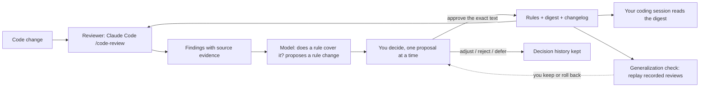

English | [中文](README.zh.md)

# house-rules

Grow your own house rules from code review.

What an external code reviewer (Claude Code's built-in `/code-review`) keeps finding in
your code becomes written, versioned rules. You approve each rule change one by one. The
rules are compiled into a short digest that both your coding session and the next review read.

[Limits](#limits-stated-first) · [The loop](#the-loop) · [Try it for free](#try-it-for-free) · [Install](#install) · [Quickstart](#quickstart) · [Make it yours](#make-it-yours) · [Cost controls](#cost-controls)

## What it is, and what it is not

**It is** a way to keep your coding standards as plain text that a reviewer and a coding agent
both read, and to change that text on evidence:

- Your rules live in a file you own, as clauses with stable IDs such as `REL.1`, versioned in
  git. `house-rules compile` turns them into a digest of at most 4096 bytes by default.
- Every finding of the reviewer is recorded with its evidence. A model checks it against your
  rules and proposes to add, rewrite, merge or retire a rule, or says an existing one already
  covers it. A person approves, adjusts, rejects or defers each proposal. The exact before and
  after text goes into a changelog, and an applied batch can be rolled back.
- It is a Python 3.10+ command line with no third-party dependencies, plus a Claude Code
  plugin that runs the loop for you.

**It is not**:

- A benchmark, or a claim that your coding agent writes better code with these rules. No
  experiment on that was run.
- Training. No model weights change; what changes is rule text.
- A way to improve the reviewer. The reviewer is Claude Code's `/code-review`, which its
  vendor upgrades. house-rules writes down what it keeps finding; it looks for blind spots
  (problems no rule covers), not for bugs.

The one thing that is measured is whether a rule learned from one finding still works on a
new case: [the generalization check](#the-generalization-check). Its result is mostly negative.

## Limits, stated first

- **The one measurement is small and mostly negative.** The generalization check covers
  4 rules, 7 cases, 3 runs per condition, one reviewer version (Claude Code 2.1.284) and one
  author. In round 1 the rules passed 1 case and failed 6. Two attempts to tune them (rewriting
  two rules, shortening the labeling instruction) did not help (round 2: 0 pass, 6 fail;
  round 3: 1 pass, 5 fail), so the rewrites were rolled back. See
  [the check](#the-generalization-check).
- **The reviewer also flags the legitimate look-alike.** With or without the rule, it flagged
  both files of a case in all 3 runs of every case. With the rule it often tagged the exempt
  file with the rule's ID (as the finding's `category`) too, and writing the exemption into the
  digest line did not stop that.
- **Labels are fragile.** In 7 of the 21 round-1 runs that had the rule, no finding carried a
  `category` label at all. With a shorter labeling instruction it was 17 of 18.
- **Three runs is noise.** With the rule text unchanged, one case went from 1 of 3 to 3 of 3
  between two rounds. A difference of one or two runs means nothing.
- **Narrow, self-referential evidence.** The rules were learned from the tool's reviews of its
  own code. The check's cases are synthetic code written around those same mechanisms by the
  author's coding agents, and the reviewer ran with the author's own Claude Code settings.
  Only Claude Code's `/code-review` has been exercised.
- **One person's local setup.** The ledger is a local, git-ignored file. The approval step
  records an answer; it cannot tell a person from an agent typing the answer. A review is a
  sample, so a quiet review does not prove that no blind spot is left.

The full list, with the evidence: [docs/METHOD.md](docs/METHOD.md#8-limits).

## The loop



With the Claude Code plugin the loop runs by itself. Install it, run `/house-rules:setup`
once, and commit as usual: when enough has changed, Claude runs the review in the background,
and you answer one question only when it finds a new blind spot. See the
[Quickstart](#quickstart) and [how it fits into daily work](docs/INTEGRATION.md).

The author has used the loop on this repository. Its local ledger, which is not committed and
cannot be checked by you, held 39 findings from 5 reviews on 2026-10-31: 24 fixed, 5 marked as
not a real problem, 10 still open. 32 of the 39 matched no existing rule. The 17 accepted
rule changes (some later rolled back) are public in
[CODING-STYLE.changelog.md](CODING-STYLE.changelog.md), each with its evidence and the
decision. That is a record of activity, not evidence that the code got better.

## The generalization check

A rule is only useful if it helps on code it was not written from. The check
([`samples/generalization/`](samples/generalization/README.md)) asks, for four rules learned
from real findings (REL.1 to REL.4): given a new instance of the same mechanism, does the rule
make the reviewer flag it, label it with the rule's ID, and leave a similar-looking legitimate
counterpart alone?

Each case is a pair of small synthetic files, a violation and a control, plus an `oracle.py`
that settles the truth by running them under an injected failure, not by asking a model.
Claude Code's `/code-review` (level `high`) reviews the pair 3 times with the rule in the
digest and 3 times with that one line removed. A case passes only if the violation carries the
rule's label in at least 2 of 3 runs and the control in none. That line was written
([CRITERIA.md](samples/generalization/CRITERIA.md)) before any run was recorded. There are 7
cases for the 4 rules: one per rule; `rel-3b`, because the control of `rel-3` was defective
(the reviewer was right and the case was wrong), so both are reported; and two held-out cases
written after round 1. No overall accuracy is computed, on purpose.

Round 1, with the rules as they were (each cell is runs out of 3, with the rule in the digest):

| case | rule | violation labeled | control labeled | verdict |
|---|---|---|---|---|
| rel-1 | REL.1 | 3/3 | 3/3 | FAIL |
| rel-1b | REL.1 | 2/3 | 2/3 | FAIL |
| rel-2 | REL.2 | 2/3 | 2/3 | FAIL |
| rel-2b | REL.2 | 1/3 | 0/3 | FAIL |
| rel-3 | REL.3 | 3/3 | 3/3 | FAIL |
| rel-3b | REL.3 | 2/3 | 0/3 | PASS |
| rel-4 | REL.4 | 1/3 | 0/3 | FAIL |

Without the rule its ID is never used (0 of 3 everywhere), and in every row of every round
the reviewer flagged both files in all 3 runs either way. So the rule changes the label, not
what gets found, and the look-alike is flagged as often as the violation.

- Round 1: PASS 1 (`rel-3b`), FAIL 6.
- Round 2: a shorter labeling instruction, and REL.1 and REL.2 rewritten to lead with their
  exemptions. PASS 0, FAIL 6; in 17 of 18 runs with the rule no finding carried a `category`.
- Round 3: only the REL.1 and REL.2 rewrites, labeling instruction restored. PASS 1, FAIL 5.
  The exempt controls of REL.1 were labeled as often as the violations.
- Decision: the rewrites showed no improvement, so they were rolled back to the round-1
  wording. Today's digest is byte-identical to round 1's. The three rounds were 114 reviewer
  calls in all.

To replay all three rounds, free and deterministic, in a git clone (a downloaded zip is not
enough):

```sh
python3 samples/generalization/run_check.py
```

The replay scores each recording against the digest it was made with, so editing a rule later
changes no score. (Rounds 2 and 3 print a note that the REL.1 and REL.2 lines now differ from
the recorded ones: that is the rollback.) Only a new live round can show whether an edited
rule helps, and it costs money (roughly $0.2 per review, estimated; several dollars per round).
How to record one: [samples/generalization/README.md](samples/generalization/README.md).

## Try it for free

About ten minutes, most of it reading the output. No model call, no account, no cost. You need
git and Python 3.10+:

```sh
git clone https://github.com/wangxuzhou666-arch/house-rules
cd house-rules
python3 samples/config-replacement/check_examples.py   # sample code that loses the old config when a write fails, and the version that keeps it
python3 samples/generalization/run_check.py            # replays the recorded reviews and prints the tables above
```

[WORKSHOP.md](WORKSHOP.md) is the guided version: six sections, 45 to 60 minutes, alone or in
a group. You compile a rules file into a digest, replay a recorded review into a scratch
repository, turn a finding into a rule, read the generalization check, see what the automation
costs, and try to improve a rule, which shows why tuning is hard. The main line is free and
calls no model; one optional step in each of sections 5 and 6 spends money, and says so first.
The plugin part of section 5 needs Claude Code.

To check a clean install, the hooks, a review replay and the closing of a finding without a
model call (the human decision is not exercised):

```sh
python3 scripts/check_acceptance.py --output-dir /absolute/new/scratch-directory
```

For a real review, use the sample's [reviewer prompt](samples/config-replacement/reviewer-prompt.md)
and then its maintenance prompt. [Acceptance record](docs/ACCEPTANCE.md): what was observed
and what was not. The samples are not a general benchmark.

## Install

As a Claude Code plugin, from the marketplace in this repository (Python 3.10+; the automatic
wrap-up needs Claude Code 2.1.163 or newer):

```sh
claude plugin marketplace add wangxuzhou666-arch/house-rules
claude plugin install house-rules@house-rules
```

These commands install from the repository on GitHub. The project's own acceptance run loads
the plugin from a local checkout and does not verify a remote install.

From a local checkout, load it for one session without installing:

```sh
claude --plugin-dir /path/to/house-rules
```

Without the plugin, run the command straight from the checkout (standard library only):

```sh
/path/to/house-rules/bin/house-rules init
```

## Quickstart

With the plugin installed:

1. **Set up once.** In your repo, run `/house-rules:setup`. It previews and then runs
   `house-rules init`: a rules file (the bundled template is a draft to adjust), the compiled
   digest, an `@import` line in `CLAUDE.md`, git hooks (each is run once to prove it is
   reached), `.gitignore` entries, a start point for the default branch and, if you choose it,
   the automatic wrap-up. It ends with a ready `git add ... && git commit` line for the files
   it created: run it, because the pre-commit hook checks the staged copies.
2. **Commit as usual.** When a turn ends after a commit and the work since the last review
   has reached a threshold (200 changed lines or 5 files by default), Claude runs a review in
   the background. Below the threshold nothing runs. [Cost controls](#cost-controls) lists the
   caps.
3. **Answer the occasional question.** It asks only when the review found a blind spot that you
   have not been asked about before. Accepted changes update the rules and the digest;
   rejection, deferral and requests for revision are recorded too. To work through the
   findings yourself, run `/house-rules:maintain`; the question offers to start it. See
   [the workflow and assessment contract](docs/DECISION-CARDS.md).

That is the whole loop. [Fitting house-rules into daily work](docs/INTEGRATION.md) adds
worktrees, a shared rule layer, privacy and cost.

Optional, by hand: `/house-rules:review` runs one review and records the findings against
your clause IDs; `/house-rules:wrapup` (or say "wrap up") counts what changed since the last
review and reviews once only if enough did ([wrap-up](docs/WRAPUP.md)). To import a review made
somewhere else, use `house-rules review --from-file out.txt --run ID` ([how](docs/INTEGRATION.md#review-output-from-elsewhere)).

Without the plugin nothing triggers automatically: run the commands yourself, or call
`house-rules wrapup` from your own closing step ([how](docs/INTEGRATION.md#with-and-without-the-plugin)).
From a terminal in your repo:

```sh
/path/to/house-rules/bin/house-rules init            # asks a few questions; --yes accepts the defaults, --dry-run only prints the plan
/path/to/house-rules/bin/house-rules review          # runs claude -p "/code-review high" (on the default branch, with the commit range to read), records the findings
/path/to/house-rules/bin/house-rules wrapup          # counts the work since the last review; reviews once only if enough changed
/path/to/house-rules/bin/house-rules count --by-rule # what is open, by clause
```

Commit the files `init` lists (the line it prints does it). Fix a finding by committing with
a `Fixes-Finding: <id>` trailer, where `<id>` is the short id the review table shows
(`r3-2`); the post-commit hook closes it. Put `bin/` on your PATH to type `house-rules`
instead of the full path; hooks kept in a committed directory such as `.githooks` also find
the tool through `PATH`, `$HOUSE_RULES_BIN` or `"bin"` in `.house-rules.json`. What `init`
changes, and how to undo it: [docs/ONBOARDING.md](docs/ONBOARDING.md).

## Make it yours

| What you swap in | How | Details |
|---|---|---|
| **Rules file** | Point `init --rules-file` or `rules_files` in `.house-rules.json` at your own `CODING-STYLE.md`. You do not need to adopt the author's rules. Use your own family names; a clause is a line that starts with `**[ID]**`, with a severity tag or a family table. | [Customization](docs/CUSTOMIZATION.md), [rule writing](docs/RULE-WRITING.md), [template](templates/CODING-STYLE.template.md) |
| **Config keys** | `.house-rules.json`. Every key is optional and an unknown key is an error: `rules_files`, `clause_id_pattern`, `digest_max_bytes`, `max_review_rounds`, `wrapup_auto_max_per_day`, `wrapup_min_changed_lines`, and more. | [Config table with defaults](docs/LEDGER.md#config-house-rulesjson) |
| **Finding format** | What a reviewer must print: a JSON array, or text with a fenced `json` block, one object per defect with `file`, `line`, `summary`, `failure_scenario`, `category` (a clause ID in kebab-case, or `unmapped`) and `severity` (`blocker`, `should-fix`, `nice`). Other field names need your own adapter; there is no mapping setting. | [Your review output](docs/CUSTOMIZATION.md#your-review-output), [stored form](schemas/finding.v1.schema.json), [reviewer prompt](samples/config-replacement/reviewer-prompt.md) |
| **Reviewer** | Run any reviewer elsewhere and import its output with `house-rules review --from-file out.txt --run ID`, or `wrapup --from-file` (thresholds still apply). The built-in route runs `claude -p "/code-review high"`. Only that one has been exercised. | [Review output from elsewhere](docs/INTEGRATION.md#review-output-from-elsewhere), [carrying the loop to another reviewer](docs/METHOD.md#5-carrying-the-loop-to-another-reviewer) |

How the question is put to you is changed through your repository instructions or a customized
maintenance skill ([sample](samples/config-replacement/maintenance-prompt.md),
[layout](docs/DECISION-CARDS.md)); there is no layout setting. The edges of what can be
customized: [docs/CUSTOMIZATION.md](docs/CUSTOMIZATION.md).

## Cost controls

Measuring what changed is local git work and costs nothing. A review costs one
`/code-review` at level `high`, at most one question and at most 3 proposals.

| Control | Default | What it does |
|---|---|---|
| Threshold (`wrapup_min_changed_lines`, `wrapup_min_files`) | 200 lines, 5 files; either is enough | Below it nothing runs and nothing is billed. |
| Round cap (`max_review_rounds`) | 3 reviews per change | The 4th is refused before the reviewer runs (exit 3). `--over-cap` overrides and is recorded. |
| Daily cap (`wrapup_auto_max_per_day`) | 2 automatic reviews in any 24 hours, per repository | A failed review counts. Past it you are told once and the next one waits (exit 4). A review you start yourself is neither counted nor held back. [Details](docs/WRAPUP.md#the-daily-cap) |
| Automatic wrap-up (`wrapup_auto`) | `init` asks | `"wrapup_auto": false` turns it off. |
| Digest budget (`digest_max_bytes`, `digest_max_chars`) | 4096 bytes, 90 characters per line | `compile` warns when over, and a proposal that would push the digest over is refused. This repository's own digest is 4082 bytes. Every session and review reads it, so it has to earn its size. |

Cost in money depends on the size of the change. As an estimate, not a recorded figure, a
review of a two-file change in the generalization check cost roughly $0.2.

Privacy: the ledger and `.house-rules/` stay on your machine and are git-ignored. What you
commit is the rules, the digest and the changelog, and a changelog entry can carry a code
snippet, so read it before you push to a public repository. The review itself is Claude Code's,
so the code it reads goes to the model provider under Claude Code's settings.

## Usage

Every command, with its main options. Details: [wrap-up](docs/WRAPUP.md), [the ledger](docs/LEDGER.md), [compile](docs/COMPILE.md).

```sh
bin/house-rules init [--yes] [--dry-run] [--no-wrapup-auto]                    # set up this repo (config, rules file, digest, CLAUDE.md, hooks, .gitignore, start point)
bin/house-rules review [--level high] [--target T] [--from-file F] [--over-cap] # run /code-review, save the raw output, record the findings; 3 rounds per change, then exit 3
bin/house-rules wrapup [--level high] [--base REF] [--from-file F] [--json] [--dry-run] [--auto] # count what changed since the last review; review once if enough did (docs/WRAPUP.md); exit 3 at the round cap; --auto marks an automatic review, takes a slot of the daily cap and exits 4 past it
bin/house-rules ingest-code-review --source l1 --run R12 < review-output.txt   # JSON array, or text containing a ```json block
bin/house-rules add --source l2 --run R12 --input report.json                  # explicit report shape
bin/house-rules count [--by-rule [--label-source]]                             # totals, open findings, by source / rule / how the rule was labeled
bin/house-rules decision-context [--finding ID] [--assessment FILE]            # evidence packet or validated model assessment, read-only
bin/house-rules prepare-decisions --assessment FILE [--finding ID]            # persist analysis and proposed edits for native human questions
bin/house-rules apply-decisions --input FILE                                  # record actual answers and apply accepted groups
bin/house-rules decision-summary                                             # author-specific accept/revise/reject/defer counts, not accuracy
bin/house-rules rollback-proposals --batch ID [--dry-run]                      # restore the rules, digest and changelog of an applied batch, unless they were edited since
bin/house-rules recover-proposals                                              # restore the files of an interrupted apply or rollback (takes no --dry-run: it only restores)
bin/house-rules infer [--all] [--quiet]                                        # close findings from Fixes-Finding trailers and gate passes
bin/house-rules label r3-2 r3-5 --outcome false_positive [--note TEXT]         # record an outcome by id (the short ids the review table shows), no label page; all or nothing
bin/house-rules label-page                                                     # local HTML page to label what is still open
bin/house-rules apply-labels < labels.json                                     # record the labels copied from that page
bin/house-rules compile                                                        # rules files -> CODING-STYLE.digest.md (+ marker blocks in inject_targets)
bin/house-rules compile --check [--staged]                                     # write nothing; exit 1 listing every stale output (pre-commit / CI); --staged reads the git index
bin/house-rules gate record --input reports.json                               # a gate's findings [{file, line, code, message}] -> the ledger
bin/house-rules gate pass --files a.py b.py                                    # the gate passed over these files
bin/house-rules vendor --into third_party/house-rules [--check [--against-source]] # copy the tool into a repo / verify that copy
bin/house-rules auto {note|stop}                                               # called by the git post-commit hook (note) and the plugin's Stop hook (stop); not for direct use (docs/WRAPUP.md#automatic-wrap-up)
```

Every command but `vendor` and `auto` takes `--repo PATH`; all but `init`, `vendor` and `auto` also take `--ledger FILE` and `--config FILE`. The two `auto` commands are for the hooks: `auto note` takes `--repo` only, and `auto stop` takes no option, because it reads the hook's JSON from stdin. Every command that writes takes `--dry-run`, except `recover-proposals`, which only restores what an interrupted write left half done, and the two `auto` commands, which write only to [the machine's state directory](docs/WRAPUP.md#the-state-directory). `--dry-run` writes nothing and prints what it would have written (for `compile`, a diff; for `init`, the plan; for `review`, the command it would run; for `wrapup`, the measurement and whether it would review).

To give Claude Code's built-in `/code-review` the rules by hand instead of `init`, run `house-rules compile` and add one line to the repo's `CLAUDE.md`:

```
@CODING-STYLE.digest.md
```

Tests: `python3 -m unittest discover -s tests` (over 2,000 tests). Mutation self-test (applies one deliberate bug at a time to a temp copy and checks the suite goes red; `--full` lists every test that caught each one, `--jobs N` runs N at once): `python3 tests/mutation_check.py [--full] [--jobs N]`. Over 1,500 mutants are defined, and a full run can take more than a day.

## Prior art, and the name

The closest prior work found is Aggarwal 2026, "Self-Improving AI Coding Agents Through
Accumulated Behavioral Rules" (arXiv 2607.13091): adopted review comments, an engineer judges
whether the problem will recur, and the result goes into a versioned rules file that the coding
agent loads. It is an observational study (11 sessions, no control) with feedback mainly from
people, and its rules are never retired. Here the feedback comes from an LLM reviewer, a
person gates every change, rules can be retired and rolled back, and there is the check above.

Two searches found no prior work that (1) asks whether accumulated rules stay stable after the
reviewer's vendor upgrades it, (2) removes rules one at a time on a real repository under human
gating, or (3) validates an LLM reviewer as the feedback source for distilling rules. That says
what two searches found, not what exists. More in the
[related work](docs/METHOD.md#6-related-work) section of docs/METHOD.md, and what went wrong
along the way in [section 3](docs/METHOD.md#3-how-a-loop-like-this-misleads-itself).

Until 2026-10-31 this project was called review-ratchet. It was renamed because a 2026 paper,
Ratchet (arXiv 2605.22148), uses that name. Finding ids and old changelog entries keep the old
prefix.

## Contributing

Synthetic failing examples, regression pairs, generalization cases and rule proposals are welcome; findings from
real private repositories are not. See [CONTRIBUTING.md](CONTRIBUTING.md).

## License

[MIT](LICENSE).
