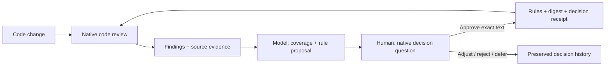

English | [中文](README.zh.md)

# review-ratchet

Turn code-review feedback into inspectable proposals for your own coding standards.
Your reviewer finds defects; the model compares them with your rules; you decide
which changes belong in the rulebook. The tool preserves the sources, validates
approved edits and feeds the updated digest into the next review.



With the Claude Code plugin the loop runs by itself. Install it, run
`/review-ratchet:setup` once, and commit as usual: when enough has changed, Claude runs
the review, and you answer one question only when it finds a blind spot (a problem no
rule covers) that is new. See the [Quickstart](#quickstart) and
[how it fits into daily work](docs/INTEGRATION.md).

The reference implementation is a Python 3.10+ CLI with no third-party runtime
dependencies and a coding-agent plugin. Findings live in a local, append-only
ledger; private review data is not uploaded by the harness. A native reviewer may
send code to its provider under that host's settings. This workflow does not train
model weights or guarantee a review-quality improvement.

Why the loop is built this way (the RL analogy and its limits, what went wrong along
the way, how to carry it to another reviewer, prior art): [docs/METHOD.md](docs/METHOD.md).

## Make it yours

| Bring your own | Blueprint supplied here | Stable contract |
|---|---|---|
| Coding style and risk policy | [Rule template](templates/CODING-STYLE.template.md), [writing guide](docs/RULE-WRITING.md) | Clause IDs, scope, severity and traceable edits |
| Review explanation and grouping | [Reviewer prompt](samples/config-replacement/reviewer-prompt.md) | File, line, failure scenario and normalized attribution |
| Human decision presentation | [Maintenance prompt](samples/config-replacement/maintenance-prompt.md), [bullet layout](docs/DECISION-CARDS.md) | Evidence, reason, exact change and explicit decision |
| Personal evaluation criteria | [Future metrics design](docs/DECISION-METRICS.md) | Original suggestions and actual responses retained |

Point `rules_files` at your `CODING-STYLE.md`; you do not need to adopt the author's
rules. Change presentation through your repository instructions or maintenance
skill. Custom review field names need an adapter to the canonical import format;
there is no arbitrary schema or popup-layout configuration engine today.
See [customization and its boundaries](docs/CUSTOMIZATION.md).

## Try the sample

The [configuration-replacement sample](samples/config-replacement/README.md) contains
a small rule corpus, intentionally faulty code, compliant controls, a transfer pair,
and reusable prompts. After cloning or downloading this repository:

```sh
python3 samples/config-replacement/check_examples.py
```

It injects a write failure and tests a serialization failure in disposable files.
The unsafe examples lose the previous configuration; the safe examples preserve it.
No model call or human approval is simulated by that command. To verify a clean
installation, hooks, review replay and finding closure without a model call:

```sh
python3 scripts/check_acceptance.py --output-dir /absolute/new/scratch-directory
```

For a real review, use the native reviewer with the sample's reviewer prompt, then
the maintenance prompt to obtain a source-backed decision question. The sample
explains how to start without REL.1 and evaluate a proposed addition, or start with
REL.1 and recognize existing coverage. Read the [acceptance record](docs/ACCEPTANCE.md)
for observed results and limitations; the examples are not a general benchmark.

## Install

As a Claude Code plugin, from the marketplace in this repository:

```sh
claude plugin marketplace add wangxuzhou666-arch/house-rules
claude plugin install house-rules@house-rules
```

The marketplace commands require a published repository revision. For an unpublished
checkout, use the local loading route below; local acceptance does not verify a remote install.

From a local checkout, load it for one session without installing:

```sh
claude --plugin-dir /path/to/house-rules
```

Without the plugin, run the command straight from the checkout (Python 3.10+, standard library only):

```sh
/path/to/house-rules/bin/house-rules init
```

## Quickstart

With the plugin:

1. [Install the plugin](#install).
2. In your repo, run `/review-ratchet:setup` once. It previews and then runs `ratchet init`: a rules file (the bundled template is a draft to adjust), the compiled style digest, an `@import` line in `CLAUDE.md`, git hooks (each is run once to prove it is reached), `.gitignore` entries, a start point for the default branch (the commit its first wrap-up measures from) and, if you choose it, the automatic wrap-up. It ends with a ready `git add ... && git commit` line for the files it created: run it, because the pre-commit hook checks the staged copies.
3. Commit as usual. When a turn ends after a commit and the work since the last review has reached a threshold (`wrapup_min_changed_lines`, default 200, or `wrapup_min_files`, default 5), Claude runs the wrap-up review in the background. It asks one question only when the review found a blind spot, a problem no rule covers, that you have not been asked about before. Below the threshold nothing runs, and by default at most 2 automatic reviews are asked for or started in any 24 hours, a failed one included (`wrapup_auto_max_per_day`; past that you are told once and the next one waits: [the daily cap](docs/WRAPUP.md#the-daily-cap)). This needs Claude Code 2.1.163 or newer; see [Automatic wrap-up](docs/WRAPUP.md#automatic-wrap-up).
4. Maintain the rules from those findings with `/review-ratchet:maintain`; the question offers to start it. The agent gathers code evidence, proposes scoped changes, and asks through the host's native question tool. Accepted changes update the rules and digest; rejection, deferral and requests for revision are also recorded. No custom UI or manual JSON copying is required. See [the workflow and assessment contract](docs/DECISION-CARDS.md).

That is the whole loop. [Fitting review-ratchet into daily work](docs/INTEGRATION.md) adds worktrees, a shared rule layer, privacy and cost. To run a step by hand instead, `/review-ratchet:review` runs one review, records the findings against your rules' clause IDs and shows them in a table, and `/review-ratchet:wrapup` (or say "wrap up") counts what changed since the last review and reviews once only if enough did. See [wrap-up](docs/WRAPUP.md).

Without the plugin nothing triggers automatically: run the commands yourself, or call `ratchet wrapup` from your own closing step ([how](docs/INTEGRATION.md#with-and-without-the-plugin)). From a terminal in your repo:

```sh
/path/to/review-ratchet/bin/ratchet init            # asks a few questions; --yes accepts the defaults, --dry-run only prints the plan
/path/to/review-ratchet/bin/ratchet review          # runs claude -p "/code-review high" (on the default branch, with the commit range to read), records the findings
/path/to/review-ratchet/bin/ratchet wrapup          # counts the work since the last review; reviews once only if enough changed
/path/to/review-ratchet/bin/ratchet count --by-rule # what is open, by clause
```

Commit the files `init` lists (the line it prints does it). Fix a finding by committing with a `Fixes-Finding: <id>` trailer, where `<id>` is the short id the review table shows (`r3-2`); the post-commit hook closes it. Put `bin/` on your PATH to type `ratchet` instead of the full path; hooks kept in a committed directory such as `.githooks` also find the tool through `PATH`, `$RATCHET_BIN` or `"bin"` in `.ratchet.json`. What `init` changes, and how to undo it: [docs/ONBOARDING.md](docs/ONBOARDING.md).

## Usage

Bring your own `CODING-STYLE.md`, risk policy and native-question presentation. The
bundled style is a blueprint; the evidence and approval contracts remain stable.
See [customization](docs/CUSTOMIZATION.md), [rule writing](docs/RULE-WRITING.md) and
the future [personal decision metrics](docs/DECISION-METRICS.md) direction.

```sh
bin/ratchet init [--yes] [--dry-run] [--no-wrapup-auto]                    # set up this repo (config, rules file, digest, CLAUDE.md, hooks, .gitignore, start point)
bin/ratchet review [--level high] [--target T] [--from-file F] [--over-cap] # run /code-review, save the raw output, record the findings; 3 rounds per change, then exit 3
bin/ratchet wrapup [--level high] [--base REF] [--from-file F] [--json] [--dry-run] [--auto] # count what changed since the last review; review once if enough did (docs/WRAPUP.md); exit 3 at the round cap; --auto marks an automatic review, takes a slot of the daily cap and exits 4 past it
bin/ratchet ingest-code-review --source l1 --run R12 < review-output.txt   # JSON array, or text containing a ```json block
bin/ratchet add --source l2 --run R12 --input report.json                  # explicit report shape
bin/ratchet count [--by-rule [--label-source]]                             # totals, open findings, by source / rule / how the rule was labeled
bin/ratchet decision-context [--finding ID] [--assessment FILE]            # evidence packet or validated model assessment, read-only
bin/ratchet prepare-decisions --assessment FILE [--finding ID]            # persist analysis and proposed edits for native human questions
bin/ratchet apply-decisions --input FILE                                  # record actual answers and apply accepted groups
bin/ratchet decision-summary                                             # author-specific accept/revise/reject/defer counts, not accuracy
bin/ratchet rollback-proposals --batch ID [--dry-run]                      # restore the rules, digest and changelog of an applied batch, unless they were edited since
bin/ratchet recover-proposals                                              # restore the files of an interrupted apply or rollback (takes no --dry-run: it only restores)
bin/ratchet infer [--all] [--quiet]                                        # close findings from Fixes-Finding trailers and gate passes
bin/ratchet label r3-2 r3-5 --outcome false_positive [--note TEXT]         # record an outcome by id (the short ids the review table shows), no label page; all or nothing
bin/ratchet label-page                                                     # local HTML page to label what is still open
bin/ratchet apply-labels < labels.json                                     # record the labels copied from that page
bin/ratchet compile                                                        # rules files -> CODING-STYLE.digest.md (+ marker blocks in inject_targets)
bin/ratchet compile --check [--staged]                                     # write nothing; exit 1 listing every stale output (pre-commit / CI); --staged reads the git index
bin/ratchet gate record --input reports.json                               # a gate's findings [{file, line, code, message}] -> the ledger
bin/ratchet gate pass --files a.py b.py                                    # the gate passed over these files
bin/ratchet vendor --into third_party/ratchet [--check [--against-source]] # copy the tool into a repo / verify that copy
bin/ratchet auto {note|stop}                                               # called by the git post-commit hook (note) and the plugin's Stop hook (stop); not for direct use (docs/WRAPUP.md#automatic-wrap-up)
```

Every command but `vendor` and `auto` takes `--repo PATH`; all but `init`, `vendor` and `auto` also take `--ledger FILE` and `--config FILE`. The two `auto` commands are for the hooks: `auto note` takes `--repo` only, and `auto stop` takes no option, because it reads the hook's JSON from stdin. Every command that writes takes `--dry-run`, except `recover-proposals`, which only restores what an interrupted write left half done, and the two `auto` commands, which write only to [the machine's state directory](docs/WRAPUP.md#the-state-directory). `--dry-run` writes nothing and prints what it would have written (for `compile`, a diff; for `init`, the plan; for `review`, the command it would run; for `wrapup`, the measurement and whether it would review).

To give Claude Code's built-in `/code-review` the rules by hand instead of `init`, run `ratchet compile` and add one line to the repo's `CLAUDE.md`:

```
@CODING-STYLE.digest.md
```

Tests: `python3 -m unittest discover -s tests`. Mutation self-test (applies one deliberate bug at a time to a temp copy and checks the suite goes red; `--full` lists every test that caught each one, `--jobs N` runs N at once): `python3 tests/mutation_check.py [--full] [--jobs N]`.

Contributing: synthetic failing examples, regression pairs and rule proposals are welcome; findings from real private repositories are not. See [CONTRIBUTING.md](CONTRIBUTING.md).

License: [MIT](LICENSE).
