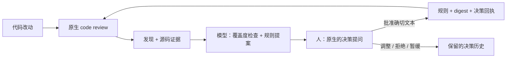

[English](README.md) | 中文

# review-ratchet

把 code review 的反馈变成可检视的提案，用来改进你自己的编码规范。
你的 reviewer 负责找缺陷；模型把缺陷和你的规则对照；由你决定哪些改动应该进规则手册。
这个工具负责保留来源、校验已批准的编辑，并把更新后的 digest 喂给下一次 review。



参考实现是一个 Python 3.10+ 的 CLI（没有第三方运行时依赖），外加一个编码 agent 插件。
发现记录在本地的只追加（append-only）ledger 里；harness 不会上传私有的 review 数据。
原生 reviewer 可能会按其宿主的设置，把代码发给它的服务商。这套流程不训练模型权重，
也不保证 review 质量一定提升。

为什么这样设计这个循环（类 RL 类比及其边界、一路踩过的坑、怎么搬到别的 reviewer、相关工作）：
[docs/METHOD.zh.md](docs/METHOD.zh.md)。

> 说明：`docs/` 下文件名带 `.zh.md` 的才有中文版（如 [RULE-WRITING.zh.md](docs/RULE-WRITING.zh.md)），
> 其余文档和示例里的提示词目前只有英文，下文链接直接指向英文原文。

## 定制成你自己的

| 你自带的 | 这里提供的蓝本 | 稳定的契约 |
|---|---|---|
| 编码规范与风险策略 | [规则模板](templates/CODING-STYLE.template.zh.md)、[编写指南](docs/RULE-WRITING.zh.md) | 条款 ID、适用范围、严重度，以及可追溯的编辑 |
| review 的解释方式与分组 | [Reviewer 提示词](samples/config-replacement/reviewer-prompt.md) | 文件、行号、失败场景，以及规范化的归属 |
| 人做决策时的呈现方式 | [维护提示词](samples/config-replacement/maintenance-prompt.md)、[要点式布局](docs/DECISION-CARDS.md) | 证据、理由、确切的改动和明确的决定 |
| 个人评估标准 | [未来的指标设计](docs/DECISION-METRICS.md) | 保留原始建议和实际回应 |

把 `rules_files` 指向你自己的 `CODING-STYLE.md` 即可；不需要采用作者的规则。
想改呈现方式，通过你仓库里的指令文件或 maintenance skill 来改。
自定义的 review 字段名需要一个适配器，转成规范的导入格式；
目前没有任意 schema 或弹窗布局的配置引擎。
详见[定制及其边界](docs/CUSTOMIZATION.md)。

## 试跑示例

[配置替换示例](samples/config-replacement/README.md)包含一个小型规则语料、
故意写错的代码、合规的对照代码、一组迁移用例，以及可复用的提示词。克隆或下载本仓库之后：

```sh
python3 samples/config-replacement/check_examples.py
```

它会在可丢弃的文件里注入一次写入失败，并测试一次序列化失败。
不安全的示例会丢掉原来的配置；安全的示例会保住它。
这条命令不会模拟任何模型调用或人工批准。想在不调用模型的情况下，
验证全新安装、hooks、review 回放和发现的关闭：

```sh
python3 scripts/check_acceptance.py --output-dir /absolute/new/scratch-directory
```

要做一次真实的 review，用原生 reviewer 配合示例里的 reviewer 提示词，
再用维护提示词拿到一个有源码依据的决策提问。示例说明了两种起法：
不带 REL.1 起步，评估一条新增提案；或带着 REL.1 起步，识别出已有覆盖。
观察到的结果和局限见[验收记录](docs/ACCEPTANCE.md)；这些示例不是通用的基准测试。

## 安装

作为 Claude Code 插件，从本仓库自带的 marketplace 安装：

```sh
claude plugin marketplace add wangxuzhou666-arch/review-ratchet
claude plugin install review-ratchet@review-ratchet
```

marketplace 命令需要仓库已发布的某个版本。对尚未发布的 checkout，
请用下面的本地加载方式；本地验收并不能验证远程安装。

从本地 checkout 加载，仅用于一个会话，不做安装：

```sh
claude --plugin-dir /path/to/review-ratchet
```

不用插件的话，直接从 checkout 里运行命令（Python 3.10+，仅用标准库）：

```sh
/path/to/review-ratchet/bin/ratchet init
```

## 快速开始

使用插件：

1. 在你的仓库里运行 `/review-ratchet:setup`。它先预览，再运行 `ratchet init`：一个规则文件（内置模板只是待调整的草稿）、编译出的风格 digest、`CLAUDE.md` 里的一行 `@import`、git hooks（每个都会被实际运行一次，证明确实被触发）以及 `.gitignore` 条目。结尾会给出一行现成的 `git add ... && git commit`，对应它创建的那些文件：请执行它，因为 pre-commit hook 检查的是暂存的副本。
2. 运行 `/review-ratchet:review`。它会运行 Claude Code 的 `/code-review`，按你规则的条款 ID 记录发现，并用表格展示。
3. 做完一段工作后，运行 `/review-ratchet:wrapup`（或直接说“收口”）。它统计上次 review 之后改了多少，只有改动够多（`wrapup_min_changed_lines` 默认 200 行，或 `wrapup_min_files` 默认 5 个文件）才 review 一次，并且只在 review 发现了没有任何规则覆盖的问题时才问你一个问题。详见[收口](docs/WRAPUP.md)。
4. 想根据这些发现维护规则，运行 `/review-ratchet:maintain`。agent 会收集代码证据，提出限定范围的改动，并通过宿主原生的提问工具来问你。被接受的改动会更新规则和 digest；拒绝、暂缓和要求修改也都会被记录。不需要自定义 UI，也不需要手动复制 JSON。详见[工作流与评估契约](docs/DECISION-CARDS.md)。

不用插件，在你仓库的终端里：

```sh
/path/to/review-ratchet/bin/ratchet init            # 会问几个问题；--yes 接受默认值，--dry-run 只打印计划
/path/to/review-ratchet/bin/ratchet review          # 运行 claude -p "/code-review high"，并记录发现
/path/to/review-ratchet/bin/ratchet wrapup          # 统计上次 review 之后的改动；够多才 review 一次
/path/to/review-ratchet/bin/ratchet count --by-rule # 按条款统计还有哪些未关闭
```

提交 `init` 列出的文件（它打印的那一行就能做到）。修复一条发现时，在提交信息里加一个 `Fixes-Finding: <id>` trailer，其中 `<id>` 是 review 表格里显示的短 id（比如 `r3-2`）；post-commit hook 会把它关闭。把 `bin/` 加进 PATH，就可以直接敲 `ratchet`，不用写完整路径；放在会被提交的目录（如 `.githooks`）里的 hooks，则通过 `PATH`、`$RATCHET_BIN` 或 `.ratchet.json` 里的 `"bin"` 找到这个工具。`init` 改了什么、怎么撤销：[docs/ONBOARDING.md](docs/ONBOARDING.md)。

### 使用中文规则模板

`ratchet init` 默认复制的是英文模板。想用中文模板，先把它复制进你的仓库，再让 `init` 指向它：

```sh
cp /path/to/review-ratchet/templates/CODING-STYLE.template.zh.md CODING-STYLE.md
/path/to/review-ratchet/bin/ratchet init --rules-file CODING-STYLE.md
```

仓库里已经有 `CODING-STYLE.md` 或 `docs/CODING-STYLE.md` 时，`ratchet init`（包括 `/review-ratchet:setup`）会把它当作默认值，所以只做第一步复制也行。几点说明：

- 中文模板和英文模板的条款 ID、严重度完全一致，`<!-- ADJUST: ... -->` 注释也在同样的位置，标出需要按你的仓库调整的阈值、白名单和工具代码。它同样只是草稿。
- 严重度表的表头（`family` / `severity`）和 `blocker` / `should-fix` / `nice` 这三个严重度词必须保持英文，解析器按它们识别。规则正文用中文不影响解析。
- digest 末尾的 Labeling 段是固定的英文指令，不随规则语言变化。
- 中文在 digest 里约占 3 个字节一个字，留意 `digest_max_bytes`（默认 4096）的预算；中文模板编译出的 digest 约 3.3 KB。

## 用法

自带你的 `CODING-STYLE.md`、风险策略和原生提问的呈现方式。内置的风格只是一份蓝本；
证据和批准的契约保持稳定。参见[定制](docs/CUSTOMIZATION.md)、
[规则编写](docs/RULE-WRITING.zh.md)，以及未来的[个人决策指标](docs/DECISION-METRICS.md)方向。

```sh
bin/ratchet init [--yes] [--dry-run]                                       # 初始化当前仓库（配置、规则文件、digest、CLAUDE.md、hooks、.gitignore）
bin/ratchet review [--level high] [--target T] [--from-file F] [--over-cap] # 运行 /code-review，保存原始输出，记录发现；每个改动最多 3 轮，之后以退出码 3 退出
bin/ratchet wrapup [--level high] [--base REF] [--from-file F] [--json] [--dry-run] # 统计上次 review 之后的改动；够多才 review 一次（见 docs/WRAPUP.md）；到轮次上限以退出码 3 退出
bin/ratchet ingest-code-review --source l1 --run R12 < review-output.txt   # JSON 数组，或包含 ```json 代码块的文本
bin/ratchet add --source l2 --run R12 --input report.json                  # 显式指定的报告格式
bin/ratchet count [--by-rule [--label-source]]                             # 总数、未关闭的发现，按来源 / 规则 / 规则的标注方式统计
bin/ratchet decision-context [--finding ID] [--assessment FILE]            # 证据包或经过校验的模型评估，只读
bin/ratchet prepare-decisions --assessment FILE [--finding ID]            # 持久化分析结果和拟议的编辑，供原生的人工提问使用
bin/ratchet apply-decisions --input FILE                                  # 记录实际回答，并应用被接受的分组
bin/ratchet decision-summary                                             # 针对作者个人的接受/修改/拒绝/暂缓计数，不是准确率
bin/ratchet rollback-proposals --batch ID [--dry-run]                      # 还原一个已应用批次的规则、digest 和 changelog（之后被改过则拒绝）
bin/ratchet recover-proposals                                              # 还原被中断的应用或回滚留下的文件（不接受 --dry-run：它只做还原）
bin/ratchet infer [--all] [--quiet]                                        # 根据 Fixes-Finding trailer 和 gate 通过记录关闭发现
bin/ratchet label r3-2 r3-5 --outcome false_positive [--note TEXT]         # 按 id 直接记录处置结果（用 review 表格里显示的短 id），不用标注页；要么全部记录要么都不记
bin/ratchet label-page                                                     # 本地 HTML 页面，用来给仍未关闭的发现打标注
bin/ratchet apply-labels < labels.json                                     # 记录从该页面复制出来的标注
bin/ratchet compile                                                        # 规则文件 -> CODING-STYLE.digest.md（以及 inject_targets 里的标记块）
bin/ratchet compile --check [--staged]                                     # 不写入任何东西；列出所有过期产物并以退出码 1 退出（pre-commit / CI）；--staged 读取 git 暂存区
bin/ratchet gate record --input reports.json                               # 一个 gate 的发现 [{file, line, code, message}] -> ledger
bin/ratchet gate pass --files a.py b.py                                    # gate 对这些文件通过
bin/ratchet vendor --into third_party/ratchet [--check [--against-source]] # 把工具复制进一个仓库 / 校验该副本
```

除 `vendor` 外，每个命令都接受 `--repo PATH`；除 `init` 和 `vendor` 外，其余命令还接受 `--ledger FILE` 和 `--config FILE`。每个会写入的命令都接受 `--dry-run`，只有 `recover-proposals` 例外（它只还原被中断的写入留下的半成品）。`--dry-run` 什么都不写，只打印本来会写的内容（`compile` 打印 diff，`init` 打印计划，`review` 打印它将要运行的命令，`wrapup` 打印统计结果以及是否会 review）。

如果不用 `init`，想手动让 Claude Code 内置的 `/code-review` 拿到这些规则，运行 `ratchet compile`，并在仓库的 `CLAUDE.md` 里加一行：

```
@CODING-STYLE.digest.md
```

测试：`python3 -m unittest discover -s tests`。变异自测（每次对一份临时副本植入一个刻意的 bug，检查测试套件是否变红；`--full` 会列出抓到每个变异的全部测试，`--jobs N` 同时运行 N 个）：`python3 tests/mutation_check.py [--full] [--jobs N]`。

参与贡献：欢迎提交合成的失败示例、回归对和规则提案；不接收来自真实私有仓库的 findings。见 [CONTRIBUTING.md](CONTRIBUTING.md)。

许可证：[MIT](LICENSE)。
