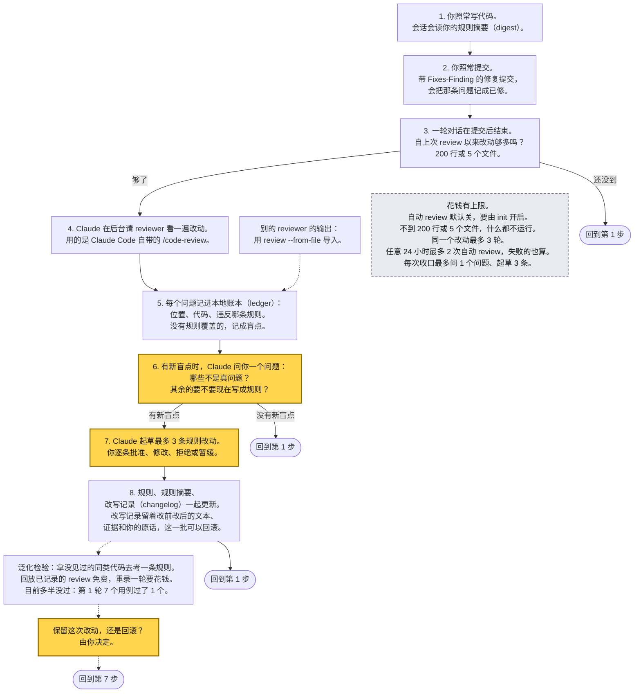

[English](README.md) | 中文

# house-rules

尝试把通用的 coding agent 变成懂你的 personal coding agent：从 code review 里，长出你自己的 house rules。

外部 code reviewer（Claude Code 内置的 `/code-review`）在你的代码里反复发现的问题，
会变成写下来、有版本的规则。每一条规则改动都由你逐条批准。规则会被编译成一份简短的 digest，
你的编码会话和下一次 review 都会读它。

[为什么做这个](#为什么做这个) · [循环](#循环) · [局限](#局限) · [免费试玩](#免费试玩) · [安装](#安装) · [快速开始](#快速开始) · [定制成你自己的](#定制成你自己的) · [成本控制](#成本控制)

> 说明：文件名带 `.zh.md` 的才有中文版（[WORKSHOP.zh.md](WORKSHOP.zh.md)、[docs/METHOD.zh.md](docs/METHOD.zh.md)、
> [docs/RULE-WRITING.zh.md](docs/RULE-WRITING.zh.md)），其余文档和示例里的提示词目前只有英文，下文链接直接指向英文原文。

## 为什么做这个

我想让 coding agent 在一个个 coding task 里越来越懂我，我后面 review 起来也越来越省力。

1. **问题。** Claude Code 的 `/code-review` 很会在我的代码里找问题，但它不认识我的 coding style，
   只会按它自己心目中的“好代码”来审；它发现的东西，也不会回到我的规则里去。
2. **想法。** 让 coding style 和 reviewer 互相当对方的 copilot：style 进入每一次编码会话和每一次 review；
   reviewer 发现的、style 没覆盖的问题，会作为规则改动提案回来，由我来定。
3. **代价。** 规则只加不减，反而可能帮倒忙：style 文档越写越长，就会撑爆上下文，每个会话、每次 review 都要为它付费，
   而一份上下文文件得配得上这笔开销。近期的研究里，模型自己写的上下文文件没有帮助，还多花约 20%；
   几个聚焦的 skill 也好过一个大而全的（见[相关工作](docs/METHOD.zh.md#6-相关工作)）。
   review 本身也要花钱，所以不能每次提交都审。
4. **我做了什么。** 一个成本低的插件，让 style 文档在我干活的同时持续维护：
   - 规则被编译成一份 digest，默认不超过 4096 字节，所以新规则得放得进去，否则先合并或退役别的规则；
   - 只有改动攒够了才跑一次 review，每个改动、每天都有次数上限；
   - 只有发现盲点时才来问我。

## 它是什么，不是什么

它是一种把编码规范存成纯文本的办法：reviewer 和编码 agent 都读这份文本，并且只凭证据去改它：

- 你的规则放在你自己的文件里，写成带稳定 ID 的条款（比如 `REL.1`），由 git 做版本管理。
  `house-rules compile` 把它们编译成一份 digest，默认不超过 4096 字节。
- reviewer 的每条发现都连同证据一起记录。模型把它和你的规则对照，提议新增、改写、合并或退役一条规则，
  或者指出已有规则已经覆盖。每条提议由人来批准、调整、拒绝或暂缓。改动前后的确切文本会写进 changelog，
  已应用的一批改动可以回滚。
- 它是一个 Python 3.10+ 的命令行工具（没有第三方依赖），外加一个替你跑这个循环的 Claude Code 插件。

它不是：

- 基准测试，也不声称用了这些规则之后你的编码 agent 会写出更好的代码。没有做过这方面的实验。
- 训练。模型权重没有任何变化，变的是规则文本。
- 提升 reviewer 的办法。reviewer 是 Claude Code 的 `/code-review`，由它的厂商升级。
  house-rules 只是把它反复发现的问题写下来；它找的是盲点（没有任何规则覆盖的问题），不是 bug。

唯一量化过的是：从一条发现里学来的规则，放到新情形里是否仍然有效，即[泛化检验](#泛化检验)。
它的结果大体是负面的。

## 循环



黄色的框：需要你拍板的三处。虚线：可选的旁支。圆角框：回到前面的某一步。

装上 Claude Code 插件后，这个循环会自己转：运行一次 `/house-rules:setup`，之后照常提交。
改动攒够了，Claude 会在后台跑 review；只有发现了新的盲点时，才会问你一个问题。
见[快速开始](#快速开始)和[融进日常工作](docs/INTEGRATION.md)。

作者在这个仓库上用过这个循环。那里的本地 ledger（没有提交，你无法核对）在 2026-10-31 记录了
5 次 review 的 39 条发现：24 条已修复，5 条标为“不是真问题”，10 条仍未关闭；39 条里有 32 条没有匹配任何已有规则。
17 次被接受的规则改动（有些后来回滚了）都公开在 [CODING-STYLE.changelog.md](CODING-STYLE.changelog.md) 里，
附有各自的证据和决定。这只是活动记录，不能证明代码变好了。

## 局限

- **唯一的测量规模很小，结果大体是负面的。** 泛化检验只涉及 4 条规则、7 个用例、每个条件跑 3 次、
  一个 reviewer 版本（Claude Code 2.1.284）、一位作者。第 1 轮，规则通过了 1 个用例，6 个没通过。
  两次调优尝试（改写两条规则、缩短标注指令）都没有帮助（第 2 轮：0 通过 6 失败；第 3 轮：1 通过 5 失败），
  所以改写被回滚了。见[检验](#泛化检验)。
- **reviewer 也会把合法的相似写法报出来。** 不管有没有这条规则，每个用例的 3 次运行里，两个文件它每次都报了。
  有规则时，它还常常把规则的 ID（作为发现的 `category`）也贴到被豁免的文件上，而把豁免写进 digest 那一行并没有挡住这一点。
- **标签很脆弱。** 第 1 轮带规则的 21 次运行里，有 7 次所有发现都没有 `category` 标签。
  把标注指令缩短之后，18 次里有 17 次没有。
- **3 次运行就是噪声。** 规则文本不变，同一个用例在两轮之间从 3 次里的 1 次变成了 3 次里的 3 次。
  差一两次运行，说明不了任何事。
- **证据范围窄，而且自我指涉。** 规则是从工具对自己代码的 review 里学来的；检验的用例是围绕同样的机制写的合成代码，
  由作者的编码 agent 写成；reviewer 运行时用的是作者自己的 Claude Code 设置。只试过 Claude Code 的 `/code-review`。
- **是一个人的本地环境。** ledger 是本地文件，被 git 忽略。批准这一步只是记录一个回答，
  它分不清敲下回答的是人还是 agent。review 只是抽样，所以一次安静的 review 不能证明盲点已经清零。

完整清单和证据见 [docs/METHOD.zh.md](docs/METHOD.zh.md#8-局限)。

## 泛化检验

一条规则只有在没见过的代码上也有用，才算有用。这个检验（[`samples/generalization/`](samples/generalization/README.md)）
针对从真实发现里学来的四条规则（REL.1 到 REL.4）问：给定同一机制的一个新实例，这条规则能不能让 reviewer
把它报出来、贴上规则的 ID，并且放过一个看起来相似但合法的对照写法？

每个用例是一对很小的合成文件，一个违规、一个对照，外加一个 `oracle.py`：它在注入的故障下实际运行这两个文件来判定真相，
不靠问模型。Claude Code 的 `/code-review`（`high` 档）对这一对文件各 review 3 次：digest 里有这条规则时 3 次，
去掉那一行时 3 次。一个用例要通过，必须是违规文件在 3 次里至少 2 次带上规则的标签，且对照文件一次都不带。
这条通过线写在 [CRITERIA.md](samples/generalization/CRITERIA.md) 里，早于任何一次运行的记录。4 条规则共 7 个用例：
每条规则一个；`rel-3b`，因为 `rel-3` 的对照有缺陷（reviewer 是对的，用例是错的），所以两个都列出；
另有两个在第 1 轮之后才写的留出用例。有意不计算总体准确率。

第 1 轮，规则保持原样（每格是 3 次运行里的次数，digest 里带着规则）：

| 用例 | 规则 | 违规文件被标注 | 对照文件被标注 | 结论 |
|---|---|---|---|---|
| rel-1 | REL.1 | 3/3 | 3/3 | FAIL |
| rel-1b | REL.1 | 2/3 | 2/3 | FAIL |
| rel-2 | REL.2 | 2/3 | 2/3 | FAIL |
| rel-2b | REL.2 | 1/3 | 0/3 | FAIL |
| rel-3 | REL.3 | 3/3 | 3/3 | FAIL |
| rel-3b | REL.3 | 2/3 | 0/3 | PASS |
| rel-4 | REL.4 | 1/3 | 0/3 | FAIL |

没有规则时，规则的 ID 一次都不会出现（处处 0/3），而且每一轮的每一行里，不管有没有规则，两个文件 reviewer 每次都报了。
所以规则改变的是标签，不是发现了什么；那个合法的相似写法被报出来的次数和违规文件一样多。

- 第 1 轮：PASS 1（`rel-3b`），FAIL 6。
- 第 2 轮：缩短标注指令，并把 REL.1 和 REL.2 改写成先写豁免。PASS 0，FAIL 6；带规则的 18 次运行里有 17 次，所有发现都没有 `category`。
- 第 3 轮：只保留 REL.1 和 REL.2 的改写，标注指令恢复原样。PASS 1，FAIL 5。REL.1 被豁免的对照文件被标注的次数和违规文件一样多。
- 决定：改写没有带来改善，所以回滚到第 1 轮的措辞。今天的 digest 与第 1 轮的逐字节相同。三轮一共 114 次 reviewer 调用。

回放全部三轮，免费、结果确定，需要在 git 克隆里运行（下载的 zip 不行）：

```sh
python3 samples/generalization/run_check.py
```

回放会拿每条记录对照它当时所用的 digest 来打分，所以之后改规则不会改变任何分数。（第 2、3 轮会打印一条提示，
说明 REL.1 和 REL.2 现在的措辞与当时记录的不同：那就是回滚。）只有重新跑一轮真实调用，才能看出改过的规则有没有帮助，
而那要花钱（粗略估计每次 review 约 0.2 美元，是估算值；一轮要几美元）。怎么录一轮：
[samples/generalization/README.md](samples/generalization/README.md)。

## 免费试玩

大约十分钟，多半花在看输出上。不调用模型、不用账号、不花钱。你只需要 git 和 Python 3.10+：

```sh
git clone https://github.com/wangxuzhou666-arch/house-rules
cd house-rules
python3 samples/config-replacement/check_examples.py   # 写入失败时会丢掉旧配置的示例代码，和能保住旧配置的写法
python3 samples/generalization/run_check.py            # 回放已记录的 review，打印上面那些表格
```

[WORKSHOP.zh.md](WORKSHOP.zh.md) 是带着走一遍的版本：共六节，45 到 60 分钟，一个人或一组人都可以。你会把规则文件编译成 digest，
把一次已记录的 review 回放进一个临时仓库，把一条发现变成规则，读懂泛化检验，看自动化要花多少，最后试着改进一条规则，
并因此看到调优为什么很难。主线免费、不调用模型；第 5、6 节各有一个可选步骤会花钱，会事先说明。第 5 节的插件部分需要 Claude Code。

想在不调用模型的情况下，验证全新安装、hooks、review 回放和一条发现的关闭（不涉及人的决定）：

```sh
python3 scripts/check_acceptance.py --output-dir /absolute/new/scratch-directory
```

要做一次真实的 review，用示例里的 [reviewer 提示词](samples/config-replacement/reviewer-prompt.md)，
再用它的维护提示词。[验收记录](docs/ACCEPTANCE.md)写明了观察到了什么、没观察到什么。这些示例不是通用的基准测试。

## 安装

作为 Claude Code 插件，从本仓库自带的 marketplace 安装（Python 3.10+；自动收口需要 Claude Code 2.1.163 或更高版本）：

```sh
claude plugin marketplace add wangxuzhou666-arch/house-rules
claude plugin install house-rules@house-rules
```

这两条命令从 GitHub 上的仓库安装。项目自己的验收是从本地 checkout 加载插件的，并不验证远程安装。

从本地 checkout 加载，仅用于一个会话，不做安装：

```sh
claude --plugin-dir /path/to/house-rules
```

不用插件的话，直接从 checkout 里运行命令（仅用标准库）：

```sh
/path/to/house-rules/bin/house-rules init
```

## 快速开始

装好插件之后：

1. **设置一次。** 在你的仓库里运行 `/house-rules:setup`。它先预览，再运行 `house-rules init`：
   一个规则文件（内置模板只是待调整的草稿）、编译出的 digest、`CLAUDE.md` 里的一行 `@import`、git hooks
   （每个都会被实际运行一次，证明确实被触发）、`.gitignore` 条目、默认分支的 start point，以及（由你选择是否开启的）自动收口。
   结尾会给出一行现成的 `git add ... && git commit`，对应它创建的那些文件：请执行它，因为 pre-commit hook 检查的是暂存的副本。
2. **照常提交。** 当某个回合在一次提交之后结束、并且上次 review 之后的改动已达到阈值（默认 200 行改动或 5 个文件）时，
   Claude 会在后台跑一次 review。没到阈值，什么都不会运行。各项上限见[成本控制](#成本控制)。
3. **偶尔回答一个问题。** 只有 review 发现了你还没被问过的盲点时，才会问你。被接受的改动会更新规则和 digest；
   拒绝、暂缓和要求修改也都会被记录。想自己过一遍这些发现，运行 `/house-rules:maintain`；那个问题会提议替你启动它。
   详见[工作流与评估契约](docs/DECISION-CARDS.md)。

整个循环就是这些。[把 house-rules 融进日常工作](docs/INTEGRATION.md)补充了多 worktree、共享规则层、隐私和成本。

可选，手动操作：`/house-rules:review` 做一次 review，按你的条款 ID 记录发现；`/house-rules:wrapup`（或直接说“收口”）
统计上次 review 之后改了多少，只有改动够多才 review 一次（[收口](docs/WRAPUP.md)）。要导入在别处做的 review，
用 `house-rules review --from-file out.txt --run ID`（[做法](docs/INTEGRATION.md#review-output-from-elsewhere)）。

不用插件的话，没有任何东西会自动触发：自己运行命令，或者在自己的收尾步骤里调用 `house-rules wrapup`
（[做法](docs/INTEGRATION.md#with-and-without-the-plugin)）。在你仓库的终端里：

```sh
/path/to/house-rules/bin/house-rules init            # 会问几个问题；--yes 接受默认值，--dry-run 只打印计划
/path/to/house-rules/bin/house-rules review          # 运行 claude -p "/code-review high"（在默认分支上会带上要读的提交范围），并记录发现
/path/to/house-rules/bin/house-rules wrapup          # 统计上次 review 之后的改动；够多才 review 一次
/path/to/house-rules/bin/house-rules count --by-rule # 按条款统计还有哪些未关闭
```

提交 `init` 列出的文件（它打印的那一行就能做到）。修复一条发现时，在提交信息里加一个 `Fixes-Finding: <id>` trailer，
其中 `<id>` 是 review 表格里显示的短 id（比如 `r3-2`）；post-commit hook 会把它关闭。把 `bin/` 加进 PATH，
就可以直接敲 `house-rules`，不用写完整路径；放在会被提交的目录（如 `.githooks`）里的 hooks，则通过 `PATH`、
`$HOUSE_RULES_BIN` 或 `.house-rules.json` 里的 `"bin"` 找到这个工具。`init` 改了什么、怎么撤销：[docs/ONBOARDING.md](docs/ONBOARDING.md)。

### 使用中文规则模板

`house-rules init` 默认复制的是英文模板。想用中文模板，先把它复制进你的仓库，再让 `init` 指向它：

```sh
cp /path/to/house-rules/templates/CODING-STYLE.template.zh.md CODING-STYLE.md
/path/to/house-rules/bin/house-rules init --rules-file CODING-STYLE.md
```

仓库里已经有 `CODING-STYLE.md` 或 `docs/CODING-STYLE.md` 时，`house-rules init`（包括 `/house-rules:setup`）会把它当作默认值，所以只做第一步复制也行。几点说明：

- 中文模板和英文模板的条款 ID、严重度完全一致，`<!-- ADJUST: ... -->` 注释也在同样的位置，标出需要按你的仓库调整的阈值、白名单和工具代码。它同样只是草稿。
- 严重度表的表头（`family` / `severity`）和 `blocker` / `should-fix` / `nice` 这三个严重度词必须保持英文，解析器按它们识别。规则正文用中文不影响解析。
- digest 末尾的 Labeling 段是固定的英文指令，不随规则语言变化。
- 中文在 digest 里约占 3 个字节一个字，留意 `digest_max_bytes`（默认 4096）的预算；中文模板编译出的 digest 约 3.3 KB。

## 定制成你自己的

| 你换上的 | 怎么换 | 详情 |
|---|---|---|
| **规则文件** | 用 `init --rules-file`，或在 `.house-rules.json` 里设置 `rules_files`，指向你自己的 `CODING-STYLE.md`。不需要采用作者的规则。条款家族名用你自己的；一条条款是以 `**[ID]**` 开头的一行，带严重度标记或家族严重度表。 | [定制](docs/CUSTOMIZATION.md)、[规则编写](docs/RULE-WRITING.zh.md)、[模板](templates/CODING-STYLE.template.zh.md) |
| **配置项** | `.house-rules.json`。每一项都是可选的，出现未知的项会报错：`rules_files`、`clause_id_pattern`、`digest_max_bytes`、`max_review_rounds`、`wrapup_auto_max_per_day`、`wrapup_min_changed_lines` 等。 | [带默认值的配置表](docs/LEDGER.md#config-house-rulesjson) |
| **发现的格式** | reviewer 必须打印的内容：一个 JSON 数组，或带 `json` 围栏代码块的文本，每个缺陷一个对象，含 `file`、`line`、`summary`、`failure_scenario`、`category`（kebab-case 的条款 ID，或 `unmapped`）和 `severity`（`blocker`、`should-fix`、`nice`）。别的字段名需要你自己写适配器；没有字段映射的配置项。 | [你的 review 输出](docs/CUSTOMIZATION.md#your-review-output)、[落库后的形态](schemas/finding.v1.schema.json)、[reviewer 提示词](samples/config-replacement/reviewer-prompt.md) |
| **Reviewer** | 在别处跑任意 reviewer，再用 `house-rules review --from-file out.txt --run ID`（或 `wrapup --from-file`，阈值仍然适用）导入它的输出。内置的路线运行 `claude -p "/code-review high"`，目前只试过这一种。 | [别处产生的 review 输出](docs/INTEGRATION.md#review-output-from-elsewhere)、[把循环搬到别的 reviewer](docs/METHOD.zh.md#5-把循环搬到别的-reviewer) |

人被问的那个问题怎么呈现，通过你仓库里的指令文件或定制的 maintenance skill 来改（[示例](samples/config-replacement/maintenance-prompt.md)、
[布局](docs/DECISION-CARDS.md)）；没有布局配置项。能定制到什么程度、边界在哪：[docs/CUSTOMIZATION.md](docs/CUSTOMIZATION.md)。

## 成本控制

统计改了什么只是本地的 git 操作，不花钱。一次 review 花的是一次 `high` 档的 `/code-review`，至多一个问题、至多 3 条提案。

| 控制项 | 默认值 | 作用 |
|---|---|---|
| 阈值（`wrapup_min_changed_lines`、`wrapup_min_files`） | 200 行、5 个文件；满足任一即可 | 没到阈值，什么都不运行，也不产生费用。 |
| 轮次上限（`max_review_rounds`） | 每个改动 3 次 review | 第 4 次在 reviewer 运行之前就被拒绝（退出码 3）。`--over-cap` 可以越过，并会被记录。 |
| 每日上限（`wrapup_auto_max_per_day`） | 每个仓库任意 24 小时内 2 次自动 review | 失败的也算。超过之后只会告诉你一次，下一次等窗口腾出名额（退出码 4）。你自己发起的 review 既不计数也不受限。[详情](docs/WRAPUP.md#the-daily-cap) |
| 自动收口（`wrapup_auto`） | 由 `init` 询问 | `"wrapup_auto": false` 可关闭。 |
| digest 预算（`digest_max_bytes`、`digest_max_chars`） | 4096 字节，每行 90 个字符 | 超出时 `compile` 会警告，会把 digest 推过上限的提案会被拒绝。本仓库自己的 digest 是 4082 字节。每个会话和每次 review 都要读它，所以它的体积得物有所值。 |

花多少钱取决于改动的大小。作为估算（不是记录下来的数字），泛化检验里对一个两文件改动的一次 review，大约花 0.2 美元。

隐私：ledger 和 `.house-rules/` 留在你的机器上，被 git 忽略。你会提交的是规则、digest 和 changelog，
而 changelog 条目里可能带一段代码片段，所以推到公开仓库之前请先读一遍。review 本身是 Claude Code 的，
所以它读到的代码会按 Claude Code 的设置发给模型服务商。

## 用法

列出全部命令及其主要选项。详情见：[收口](docs/WRAPUP.md)、[ledger](docs/LEDGER.md)、[compile](docs/COMPILE.md)。

```sh
bin/house-rules init [--yes] [--dry-run] [--no-wrapup-auto]                    # 初始化当前仓库（配置、规则文件、digest、CLAUDE.md、hooks、.gitignore、start point）
bin/house-rules review [--level high] [--target T] [--from-file F] [--over-cap] # 运行 /code-review，保存原始输出，记录发现；每个改动最多 3 轮，之后以退出码 3 退出
bin/house-rules wrapup [--level high] [--base REF] [--from-file F] [--json] [--dry-run] [--auto] # 统计上次 review 之后的改动；够多才 review 一次（见 docs/WRAPUP.md）；到轮次上限以退出码 3 退出；--auto 标记自动 review、占用每日上限的一个名额，超过上限以退出码 4 退出
bin/house-rules ingest-code-review --source l1 --run R12 < review-output.txt   # JSON 数组，或包含 ```json 代码块的文本
bin/house-rules add --source l2 --run R12 --input report.json                  # 显式指定的报告格式
bin/house-rules count [--by-rule [--label-source]]                             # 总数、未关闭的发现，按来源 / 规则 / 规则的标注方式统计
bin/house-rules decision-context [--finding ID] [--assessment FILE]            # 证据包或经过校验的模型评估，只读
bin/house-rules prepare-decisions --assessment FILE [--finding ID]            # 持久化分析结果和拟议的编辑，供原生的人工提问使用
bin/house-rules apply-decisions --input FILE                                  # 记录实际回答，并应用被接受的分组
bin/house-rules decision-summary                                             # 针对作者个人的接受/修改/拒绝/暂缓计数，不是准确率
bin/house-rules rollback-proposals --batch ID [--dry-run]                      # 还原一个已应用批次的规则、digest 和 changelog（之后被改过则拒绝）
bin/house-rules recover-proposals                                              # 还原被中断的应用或回滚留下的文件（不接受 --dry-run：它只做还原）
bin/house-rules infer [--all] [--quiet]                                        # 根据 Fixes-Finding trailer 和 gate 通过记录关闭发现
bin/house-rules label r3-2 r3-5 --outcome false_positive [--note TEXT]         # 按 id 直接记录处置结果（用 review 表格里显示的短 id），不用标注页；要么全部记录要么都不记
bin/house-rules label-page                                                     # 本地 HTML 页面，用来给仍未关闭的发现打标注
bin/house-rules apply-labels < labels.json                                     # 记录从该页面复制出来的标注
bin/house-rules compile                                                        # 规则文件 -> CODING-STYLE.digest.md（以及 inject_targets 里的标记块）
bin/house-rules compile --check [--staged]                                     # 不写入任何东西；列出所有过期产物并以退出码 1 退出（pre-commit / CI）；--staged 读取 git 暂存区
bin/house-rules gate record --input reports.json                               # 一个 gate 的发现 [{file, line, code, message}] -> ledger
bin/house-rules gate pass --files a.py b.py                                    # gate 对这些文件通过
bin/house-rules vendor --into third_party/house-rules [--check [--against-source]] # 把工具复制进一个仓库 / 校验该副本
bin/house-rules auto {note|stop}                                               # 由 git post-commit hook（note）和插件的 Stop hook（stop）调用；不供直接使用（见 docs/WRAPUP.md#automatic-wrap-up）
```

除 `vendor` 和 `auto` 外，每个命令都接受 `--repo PATH`；除 `init`、`vendor` 和 `auto` 外，其余命令还接受 `--ledger FILE` 和 `--config FILE`。两个 `auto` 命令是给 hook 调用的：`auto note` 只接受 `--repo`，`auto stop` 不接受任何选项，因为它从 stdin 读取 hook 传来的 JSON。每个会写入的命令都接受 `--dry-run`，只有 `recover-proposals`（它只还原被中断的写入留下的半成品）和两个 `auto` 命令（它们只写[本机的状态目录](docs/WRAPUP.md#the-state-directory)）例外。`--dry-run` 什么都不写，只打印本来会写的内容（`compile` 打印 diff，`init` 打印计划，`review` 打印它将要运行的命令，`wrapup` 打印统计结果以及是否会 review）。

如果不用 `init`，想手动让 Claude Code 内置的 `/code-review` 拿到这些规则，运行 `house-rules compile`，并在仓库的 `CLAUDE.md` 里加一行：

```
@CODING-STYLE.digest.md
```

测试：`python3 -m unittest discover -s tests`（2000 多个测试）。变异自测（每次对一份临时副本植入一个刻意的 bug，检查测试套件是否变红；`--full` 会列出抓到每个变异的全部测试，`--jobs N` 同时运行 N 个）：`python3 tests/mutation_check.py [--full] [--jobs N]`。已定义 1500 多个变异，完整跑一遍可能要一天以上。

## 相关工作与名字

目前找到的最接近的前人工作是 Aggarwal 2026，“Self-Improving AI Coding Agents Through Accumulated Behavioral Rules”（arXiv 2607.13091）：
被采纳的 review 评论，由工程师判断这类问题会不会再出现，结果写进一个带版本的规则文件，由编码 agent 加载。
它是一项观察性研究（11 次会话，没有对照），反馈主要来自人，规则也从不退役。这里的反馈来自 LLM reviewer，
每个改动都由人把关，规则可以退役和回滚，另外还有上面的检验。

两次检索没有找到这样的前人工作：(1) 问 reviewer 的厂商升级它之后，积累下来的规则是否保持稳定；
(2) 在真实仓库里、在人把关的前提下逐条移除规则；(3) 验证 LLM reviewer 能否作为提炼规则的反馈来源。
这说的是两次检索找到了什么，不是说世上有什么。更多内容见 docs/METHOD.zh.md 的[相关工作](docs/METHOD.zh.md#6-相关工作)一节，
一路踩过的坑见[第 3 节](docs/METHOD.zh.md#3-这类循环怎样误导自己)。

到 2026-10-31 为止，这个项目叫 review-ratchet。因为 2026 年有一篇论文 Ratchet（arXiv 2605.22148）用了这个名字，所以改名。
发现的 id 和旧的 changelog 条目保留旧前缀。

## 参与贡献

欢迎提交合成的失败示例、回归对、泛化用例和规则提案；不接收来自真实私有仓库的 findings。见 [CONTRIBUTING.md](CONTRIBUTING.md)。

## 许可证

[MIT](LICENSE)。
