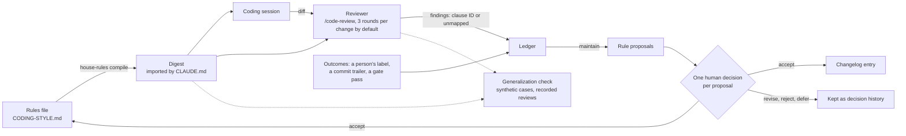

English | [中文](METHOD.zh.md)

# Why the loop is built this way

I built house-rules because I kept re-learning my own coding standards through code review, then losing the lessons. What an external reviewer (Claude Code's built-in `/code-review`) keeps finding becomes written, versioned rules that I approve one by one; the rules are compiled into a digest that both the coding session and the next review read. This page covers the design, how a loop like this misleads itself, how to carry it to your own repo and reviewer, the related work, and the limits.

It is one person's notes from a few repos, a private pilot and one small recorded check: read the numbers as anecdotes with counts attached. Nothing here trains a model, there is no benchmark, and I do not claim that the agent writes better code. The one measured part is a [generalization check](#does-a-rule-generalize) of whether a rule learned from one finding transfers to a new case; its result is mostly negative. Read the [limits](#8-limits) before deciding whether any of this is for you. Commands are in the [README](../README.md).

## Terms

| Term | Meaning here |
|---|---|
| Rules file | versioned markdown file of your coding rules |
| Clause, ID, family | one rule with a stable ID (`P0E.2`); the family is the prefix before the dot (`P0E`) |
| Severity | `blocker`, `should-fix` or `nice`: the clause's own tag, else the rules file's family table ([COMPILE.md](COMPILE.md#severity-table)) |
| Reviewer | the program that reads a change and reports findings; here Claude Code's built-in `/code-review`, which the vendor upgrades and this repo never modifies |
| Reviewer-conduct clause | no severity (the `R.*` family): how to review, not a defect |
| Digest | short text from `house-rules compile`; the coding session and the reviewer both load it |
| Ledger | append-only local JSONL file of findings and outcomes |
| Finding | one reported defect, labeled with a clause ID or `unmapped` |
| `source` | where a finding came from: `gate`, or `l1` / `l2` (review tiers, treated alike; `add` can record human review comments too) |
| Outcome | `fixed` (a change resolved it), `dismissed` (skipped), `false_positive` (no change needed) |
| Gate | an automated check (linter, script) that feeds the ledger |
| Round, change | a change is a branch since it forked from the default branch, or a `--target`; a round is one review of it |
| Replay | re-importing a recorded review (not another round), or re-scoring the recorded runs of the generalization check |
| Maintain, distill | the periodic step that turns open findings into proposed rule edits |
| Fold | a finding's state, computed from its events in file order |
| Generalization check | `samples/generalization/`: synthetic cases that ask whether a rule learned from one real finding lets the reviewer flag a new instance and label it ([section 7](#does-a-rule-generalize)) |
| Case | one pair of files (a violation and a legitimate control) plus a behavioural oracle that shows the difference by running them |
| Check round | a set of check runs made with one digest; not the same as a review round |

## 1. The problem

- **AI-written code repeats a few kinds of bloat.** In my repos: broad `except` blocks that swallow errors, fallbacks that make failure look like success, abstractions with one implementation, comments that restate the code.
- **A generic reviewer does not know your standards.** Claude Code's built-in `/code-review` is a bundled skill you cannot edit; for project rules it follows your `CLAUDE.md` and does not read `REVIEW.md` ([docs](https://code.claude.com/docs/en/code-review-local)).
- **Written rules rot.** Mine lived in three hand-synced copies, and nothing carried a review result back to a rule.

So: one versioned rules file with stable clause IDs; the same compiled digest for coding session and reviewer; every finding logged against a clause ID, with its outcome; and edit proposals that a person approves.

## 2. The loop

In words:

1. **Rules.** One markdown file with stable clause IDs. `house-rules compile` turns it into a short digest (4096 bytes at most by default) that `CLAUDE.md` imports, so the coding session and the reviewer read the same text.
2. **Review.** When a piece of work is done, by hand with `house-rules review` or because the optional Stop hook saw a big enough change, the reviewer reviews it with the digest loaded. The reviewer is external and upgraded by its vendor; this repo records its version and never tries to improve it. The loop looks for blind spots in the rules, not for bugs.
3. **Ledger.** Each finding is stored in a local, append-only file with its file, line, a snippet of the code and a clause ID or `unmapped`.
4. **Outcomes.** A finding is closed by a person's label, by a `Fixes-Finding:` trailer on the fixing commit, or by a gate pass.
5. **Proposals.** Periodically, and at wrap-up when new `unmapped` findings appeared, a model drafts rule proposals from the open findings: add, rewrite, merge, retire, or keep what is there.
6. **Human decision.** A person answers one question per proposal: accept, revise, reject or defer. Nothing is applied without an answer.
7. **Rules and changelog.** An accepted proposal edits the rules file, appends a changelog entry (before and after, the evidence, the person's words) and recompiles the digest. The next coding session and the next review read the new digest.
8. **Generalization check.** Off the main path: for a rule learned from a real finding, do the synthetic cases show that the reviewer flags a new instance, labels it with the rule's ID and leaves a legitimate counterpart alone? ([Section 7](#does-a-rule-generalize).)

No weights change. What is iterated is rule text, and every rule edit is meant to follow a recorded human decision.

A review costs money and attention, so the defaults are small and all of them are config keys: at most 3 reviews per change; a wrap-up review runs only when a change has at least 200 changed lines or 5 changed files; at most 2 automatic reviews per repository in any 24 hours; a wrap-up asks at most one question and drafts at most 3 proposals; the digest has a 4096-byte budget. Below the thresholds nothing runs and nothing is billed.

## 3. How a loop like this misleads itself

A loop that edits rules from reviewer output can fool its owner in quiet ways: a label that can never be wrong, an instruction nobody runs, a guard that never fires, a count that falls for the wrong reason, a measurement that moves with the noise. Most cases below are ones I saw or nearly saw (the precision-only case is anticipated, not observed), each with its guard. The first group comes from a private pilot and from the tool's own review history. The pilot figures are my report from its ledger as read on 2026-10-26: historical observations, not re-verified, from different moments, so never read two as before and after. The last three cases come from the [generalization check](#does-a-rule-generalize).

### A catch-all label

- **What happened.** Early labels had no "none of these" option. In a private pilot, 19 of 41 reviewer findings landed under one clause, the reviewer-conduct rule "standards come from this file" (R.1).
- **Why.** A labeler forced to name a rule picks the bucket that can never be wrong; the catch-all looked like the busiest rule and hid real gaps (by my manual reading of those 19; the count alone proves nothing).
- **Guard.** `unmapped` is a first-class label, and the digest tells the reviewer to prefer it to stretching a clause. Labels are validated deterministically ([section 5](#5-carrying-the-loop-to-another-reviewer)), and an ID recovered from prose is marked `attributed`. ([LEDGER.md](LEDGER.md#rule-ids))

### An instruction nobody wired

- **What happened.** The pilot's skill text said to run the step that closes findings; nothing did. A later dry run of that step, on the pilot's ledger (138 findings at the time; my report, which you cannot check), showed it could close 95 of the 97 open gate findings, and none of the 21 open reviewer findings, since no commit convention existed. Automatic outcomes: 0.
- **Why.** There was no outcome data: fix and false-positive rates were undefined, yet a long "open" list looked like many bugs.
- **Guard.** Mechanical triggers, not reminders. A post-commit hook runs `house-rules infer`, closing a finding when a commit message ends with `Fixes-Finding: <id>`; a gate pass closes gate findings in the files it covered; a local page collects human labels for the rest. The trailer path has since fired in this repo's own use: in my local ledger (git-ignored, so you cannot check it), 9 of 29 outcomes were closed by a trailer, the first on 2026-10-30, and 20 were a person's label. The gate-pass path has still run on fixtures only ([Limits](#8-limits)). ([LEDGER.md](LEDGER.md#attribution))

### A guard that never fires

- **What happened.** In a second repo, `init` appended its pre-commit check below the existing hook's `exit 0`: dead code, reported as success, "already ok" on rerun.
- **Why.** "Never fired" looks identical to "nothing to catch".
- **Guard.** The block goes directly under the shebang. After install, `init` runs each hook once with `HOUSE_RULES_HOOK_PROBE=1`; the block must answer before any of your code runs, or the step fails (no skip flag). Every gate also needs a mutation check (R.7, [section 4](#4-when-a-rule-becomes-a-mechanical-gate)): `tests/mutation_check.py` injects one deliberate bug at a time and requires the suite to go red. It defines over 1,500 mutants. The last full run, on 2026-10-28, caught all 328 that existed then ([ACCEPTANCE.md](ACCEPTANCE.md)); each mutant added since was checked by a targeted run, not a full one, and a full run is planned before the first release. That tests the tool's own code, not the loop's effect. ([ONBOARDING.md](ONBOARDING.md#where-the-block-goes-and-the-live-check))

### Precision alone favours silence

- **What happened.** Not seen in this tool; it is the first trap of automating rule changes against a precision number.
- **Why.** Reporting nothing scores perfectly, and so does a rule that never fires.
- **Guard.** Check a rule change on a pair: recall must not drop (the violating case is still reported) and clean code must not get invented findings (the compliant control stays clean). The sample reviewer prompt returns `[]` rather than forcing a finding, and R.2 asks the reviewer to say which rule clean code gets right. The generalization check is built on such pairs; nothing extracts them from the ledger, so they are written by hand.

### Fixes can create new findings

- **What happened.** In the tool's own self-review, round 1 reported 10 findings and round 2 reported 6 more, mostly in code a round-1 fix touched. One example: letting a saved review replay past the cap (r1-1) let a paid run slip past it by reusing an ID (r2-1). Caveats: I counted the rounds by hand (the two reviews fell under different round keys, [LEDGER.md](LEDGER.md#review-rounds)), and round 1's 10 equals the reviewer's default cap, so it may be truncated.
- **Why.** A fix is new code, and the next pass reviews it, so each extra pass adds cost and fixes to re-check. I have not measured whether later passes are worth less.
- **Guard.** A per-change cap, default 3. The fourth round is refused before the reviewer runs (exit 3, so it costs nothing); `--over-cap` records the override. On the last round fix blockers only, with the caveat in [the next case](#severity-can-rank-backwards). A replay is not a round, and reusing an ID cannot bypass the cap (PRJ.1). Three is a cost choice; I have not compared other values. ([LEDGER.md](LEDGER.md#review-rounds))

### Severity can rank backwards

- **What happened.** In round 1 of that self-review, the only `blocker` was a missing output line on a detached HEAD, because it matched a blocker-family clause. The real bugs (a vendor command that deleted the old copy before the new one was in place) matched no clause: 8 of 10 findings were `unmapped`, severity picked by the model.
- **Why.** Severity comes from the clause family, so `unmapped` has no anchor, and "fix blockers only" would have fixed the trivial issue first. My rules had no family for data loss.
- **Guard.** No code fixes this. Treat `unmapped` as input for new rules (the vendor bug became REL.1) and check that your rules cover the defect classes you care about: "blockers only on the last round" is only as good as that coverage. A person can override it (in that self-review I fixed 12 of the 13 `unmapped` findings), but it remains a known weakness.

### A falling count is not a fix

- **What happened.** In the pilot's history a nesting-depth check fell from 51 hits to 23 to 8. The first drop was a checker fix (an `elif` chain had counted as nesting); the second was flattened code. (Historical record, not re-verified.)
- **Why.** A count falls when the ruler changes, when findings are dismissed, or when the reviewer goes quiet.
- **Guard.** A person decides every rule change; the tool records the answer and applies nothing without one. Accepting a rule never marks its source findings fixed; a default, silence or a model's recommendation is not consent; uncertain or refuted evidence cannot produce a draft; stale batches are refused; applied batches can be rolled back. ([DECISION-CARDS.md](DECISION-CARDS.md))

### An exemption written into the rule did not stop the mislabel

- **What happened.** REL.1 exempts disposable, rebuildable temporary artifacts. In the generalization check the reviewer put the REL.1 label on the exempt control in 3 of 3 runs of `rel-1` and 2 of 3 runs of the held-out `rel-1b`. I rewrote the digest line to lead with the exemption. After the rewrite the counts were the same: 3 of 3 and 2 of 3. For REL.2 (two cases, six runs) the control label went from 2 of 6 to 1 of 6 and the violation label from 3 of 6 to 1 of 6: no clear gain. The reviewer reported problems in the control file in every run, with or without the rule; the rule changed only which label they carried.
- **Why.** I do not know. What the counts show is that finding a problem and labeling it are separate behaviours, and that the digest line told the reviewer about an exemption without the reviewer acting on it.
- **Guard.** Test every exemption on a held-out control before believing the wording. `rel-1b` and `rel-2b` were written after round 1 for this and were not used to tune the rewrite. And treat the model's label as a proposal that a person reads.

### Shortening the labeling instruction made the `category` key nearly vanish

- **What happened.** Round 2 of the check shortened the digest's Labeling instruction (so that it no longer named the keys the reviewer ships with) and rewrote REL.1 and REL.2. In 17 of 18 `with_rule` runs no finding carried a `category`, so nothing could be labeled and every case failed. The clauses of `rel-3b` and `rel-4` had not changed, yet both lost every label, and `rel-3b` went from PASS to FAIL. After the original instruction was restored, 6 of 18 runs still lacked the key (7 of 21 in round 1).
- **Why.** My inference from these counts is that the instruction's wording is what makes the reviewer add the key; it is an inference, not a tested mechanism.
- **Guard.** Write down what you will change and count before you record, store the digest each run was made with, change one thing per round where you can (round 3 changed only the REL.1 and REL.2 lines, with the Labeling text restored), and look at whether the key is present before you read a verdict.

### Three runs per condition is noisy

- **What happened.** The `rel-4` clause text did not change between rounds 1 and 3, but the violation was labeled in 1 of 3 runs in round 1 and in 3 of 3 in round 3 (the control: 0 of 3 to 1 of 3). `rel-3b` went 2/3, 0/3, 3/3 with the labeling change in the middle.
- **Why.** A reviewer's output varies from run to run, and a cell of 3 runs can only show 0, 1, 2 or 3.
- **Guard.** Report counts, not rates; never pool rounds; read a difference of one or two runs as nothing; and leave keep-or-roll-back to a person who has seen all the rounds. Here the REL.1 and REL.2 rewrites showed no improvement in any round, so I rolled them back to their round-1 wording (Revision 5 in [the changelog](../CODING-STYLE.changelog.md)). The current digest is byte-identical to the one round 1 was recorded with.

## 4. When a rule becomes a mechanical gate

My rule of thumb ([CODING-STYLE.md](../CODING-STYLE.md), section 0): if a rule holds in every session, is unrelated to the task and is unambiguous, make it mechanical (a linter or syntax-tree script in pre-commit). Otherwise it stays judgment, applied by the reviewer.

Promotion evidence is repeated findings of a form a tool can decide; the ledger gives the counts, a person decides, and the tool does not write the gate. Demotion happens too: a mechanical prefix check for boolean names blocked clear idioms such as `truncated`, so it became reviewer judgment (see the ADJUST note on P2.5 in the [template](../templates/CODING-STYLE.template.md)).

A new gate needs a failing example that proves it fires, a compliant one that stays clean (starting with the rule's stated exceptions), proof that reverting turns it green, and a mutation check, all committed (R.7; [CONTRIBUTING.md](../CONTRIBUTING.md)). Gates feed the same ledger through `house-rules gate record` and `house-rules gate pass` ([GATES.md](GATES.md)); a pass closes that file's gate findings, which is weaker than "verified fixed".

## 5. Carrying the loop to another reviewer

Most of the loop is plain files and a standard-library Python CLI; Claude Code supplies the reviewer, how it reads instructions and the question tool. Only Claude Code was exercised, so a port would need five things plus two guards (the deterministic label check and the round cap). The documented way to use a different reviewer is to run it yourself and import its output: `house-rules review --from-file out.txt --run ID` (or `wrapup --from-file`, where the thresholds still apply).

| Part | Commands | Claude Code needed? |
|---|---|---|
| Digest | `compile` | no: deterministic text |
| Import | `ingest-code-review`, `add`, `review --from-file` | no: any reviewer's JSON |
| Outcomes | `infer`, `gate record`, `gate pass`, `label-page`, `apply-labels` | no |
| Direct label | `label` | no: a person's answer in the host's question popup is recorded straight as a `human` outcome |
| Decision records | `decision-context`, `prepare-decisions`, `apply-decisions`, `apply-proposals`, `rollback-proposals` | no: they call no model |
| Run the reviewer | `review` | yes: it runs `claude -p "/code-review <level>"` |
| Assess and ask | the `maintain` skill | yes: the host agent writes the assessment and asks the native question |

**1. Make the reviewer read your rules.** Find where yours takes instructions, then check with a canary: a clause that can be cited only if the digest was loaded. The digest is deterministic text, one `ID | severity | short rule` line per violation clause (`ID | short rule` for reviewer-conduct clauses) plus a fixed labeling instruction, kept small because every session pays for it ([COMPILE.md](COMPILE.md#what-the-digest-contains)).

| Reviewer | Reads | Status |
|---|---|---|
| Claude Code `/code-review` | `CLAUDE.md`, `@import` expanded; not `REVIEW.md` | canary observed once (2026-10-26, `claude -p`): cited in both runs with the import, not in the runs without it; not re-run |
| Managed GitHub Code Review | `REVIEW.md` (from the base or default branch, never from the pull request's own changes) and `CLAUDE.md`, per [Anthropic's docs](https://code.claude.com/docs/en/code-review) | not tested by me |
| Anything else | its own config file, rules file or prompt | write the digest there |

**2. A finding contract.** One object per defect: `file`, `line`, `summary`, `failure_scenario`, `category` (a kebab-case clause ID such as `rel-1`, or `unmapped`) and `severity` (`blocker`, `should-fix`, `nice`). The reviewer-facing contract is the digest's Labeling section plus a [sample prompt](../samples/config-replacement/reviewer-prompt.md); the [schema](../schemas/finding.v1.schema.json) defines the stored ledger events. The importer accepts a bare JSON array or the first fenced `json` block.

The built-in reviewer, on the Claude Code version I tested in October 2026 (`claude -p`), printed at most 10 findings by default (newer versions add `--max-findings`), as plain-text JSON with `file`, `line`, `summary` and `failure_scenario`. It added `category` and `severity` when `CLAUDE.md` demanded them (2 of 2 runs), so the digest phrases it as an order. Labels were unstable: in the second run it stretched unmatched problems into existing clauses and split one defect into three findings under three IDs. The generalization check later measured the same weakness ([section 3](#shortening-the-labeling-instruction-made-the-category-key-nearly-vanish)). A model's label is a proposal.

**3. Finding identity.** For reviews, the importer mints IDs, not the reviewer: findings in one review get display IDs `<run>-1`, `<run>-2`, ... (such as `r3-2`, run `r3`), stored under the full ID `<repo>:<source>:<run>:<display ID>`. The fixer must see the display ID: `house-rules review` prints it in its table, and a PR-comment port should put it in each comment. The fixing commit then ends with a `Fixes-Finding: r3-2` trailer ([LEDGER.md](LEDGER.md#finding)).

**4. A ledger and mechanical outcomes.** An append-only JSONL file with four event kinds: `finding`, `outcome` (by commit trailer, gate pass or human, with evidence), `gate_pass` and `review_run` (one review round, for the cap; it also records the reviewer's version). A finding's state is the fold of its events in file order ([LEDGER.md](LEDGER.md#events)). Two traps when you build matching: do not parse commit subjects (an ID like `S1` collides with scope tags), and do not compare timestamps (a fix can be committed before the finding is logged).

**5. A human decision step.** Give a model the findings, their code and the whole rules file. Per group of findings sharing a mechanism it returns a verdict (supported, uncertain or refuted), an action (`covered`, `keep`, `add`, `rewrite`, `merge`, `retire`), a reason and the exact clause text. Ask a person one question per proposal, showing that evidence, with accept, revise, reject or defer. Record the answer as given, apply accepted changes in one reversible transaction, recompile ([DECISION-CARDS.md](DECISION-CARDS.md)). Check each accepted rule with a violating case and a compliant control.

The two guards:

- **Deterministic label check.** The clause ID must exist in the rules file, else `unmapped`; a reviewer-conduct clause cannot be blamed; an ID cited only in prose is a fallback, marked `attributed`; findings on one file and line collapse into the most severe; re-importing a review is a no-op, and a reused ID with different content is refused. This proves a label exists, not that it applies; a person judges that.
- **Round cap.** Count rounds per change: the branch since it forked from the default branch, or an explicit `--target` (in a PR-based port, the pull request). Check the cap before calling the reviewer, so a refused round costs nothing. Re-importing an already recorded review (`--from-file` with its run ID) is a replay, not a round ([LEDGER.md](LEDGER.md#review-rounds)).

## 6. Related work

I read these papers for what I could borrow, not as a survey, and checked each against its arXiv page (searches plus targeted reading, not a full read of each). The reading list comes from searches I ran on 2026-10-29.

**The closest prior work is Aggarwal 2026**, "Self-Improving AI Coding Agents Through Accumulated Behavioral Rules" ([arXiv 2607.13091](https://arxiv.org/abs/2607.13091)). Adopted review comments go to an engineer, who judges whether the problem will recur; if so, it is written into a versioned rules file and a checklist that the coding agent loads. That is the same skeleton as this repo. Its study is observational: 11 sessions, no control, and rules are never retired. Its feedback comes mainly from people.

What this repo does differently, as far as I can tell: the feedback source is an LLM reviewer run and upgraded by its vendor, not mainly people; the reviewer's version is recorded with every review; every rule change carries a recorded per-proposal decision and a changelog entry with the evidence, and an applied batch can be rolled back; rules can be retired (by hand; three so far); and the generalization check tests, with controls, whether a rule transfers. That check is small and its result mostly negative, so it is a method sketch, not a finding. From Aggarwal I borrow the "will it recur?" question; I ask it at the human decision, but the docs do not yet make it a written step.

| Paper | arXiv | What I borrow | Where it shows up here |
|---|---|---|---|
| Aggarwal 2026, Self-Improving AI Coding Agents Through Accumulated Behavioral Rules | [2607.13091](https://arxiv.org/abs/2607.13091) | the closest precedent; the "will it recur?" question a person asks before a finding becomes a rule | the human decision on each proposal ([DECISION-CARDS.md](DECISION-CARDS.md)) |
| Zhang 2026, Guardrails Beat Guidance | [2604.11088](https://arxiv.org/abs/2604.11088) | write rules as prohibitions ("Don't ..."): in its data every individually helpful rule was one (it measured task resolution, not style compliance) | [RULE-WRITING.md](RULE-WRITING.md) |
| Gloaguen 2026, Evaluating AGENTS.md | [2602.11988](https://arxiv.org/abs/2602.11988) | a context file must earn its token cost: few rules, only what the model would not do by default (LLM-written context files did not help and cost about 20% more) | the digest byte budget |
| Li 2026, SkillsBench | [2602.12670](https://arxiv.org/abs/2602.12670) | a few focused skills beat a big one, and a model's own skills do worse than reviewed ones | merge before add; at most 3 proposals per wrap-up |
| Zhang 2026, RSIFlow | [2610.21791](https://arxiv.org/abs/2610.21791) | a skill record with scope, behaviour to preserve, evidence for and against, and a successor; the Add / Supplement / Revise / Merge actions; the framing "find blind spots, not bugs" | the assessment actions covered / keep / add / rewrite / merge / retire |
| Chen 2026, Co-Harness | [2607.22688](https://arxiv.org/abs/2607.22688) | patches kept as versioned diffs that can be rolled back (the paper itself warns about patch pile-up) | changelog entries with before and after; `rollback-proposals` |
| Sunkavalli 2026, LLM Judges as Raters | [2608.29517](https://arxiv.org/abs/2608.29517) | judge upgrades shift severity (by up to 13% of the scale): record the version and do not compare counts across versions | `reviewer_version` in `review_run` ([LEDGER.md](LEDGER.md)) |
| Zhang 2026, Ratchet | [2605.22148](https://arxiv.org/abs/2605.22148) | retiring a rule needs a reliable judge; when the judge is unreliable, retire by hand | retirement is manual |

Four more I read as cautions rather than as sources of method:

- SWR-Bench ([2509.01494](https://arxiv.org/abs/2509.01494)): one review is a sample (best single review F1 19.38%, merged runs 43.67%), so a finding that did not appear is not proof of no blind spot.
- CriticGPT ([2407.00215](https://arxiv.org/abs/2407.00215)): an LLM reviewer invents bugs, and a human working with it invents fewer, which is why a person approves every proposal.
- Useful Memories Become Faulty ([2605.12978](https://arxiv.org/abs/2605.12978)): ungated LLM merging can fall below the no-memory baseline, so a merge here needs a person too.
- When the Judge Changes ([2607.08535](https://arxiv.org/abs/2607.08535)): a new judge version is not necessarily better, so a reviewer upgrade is not assumed to be an improvement.

The project was called review-ratchet until 2026-10-31. I renamed it because a 2026 paper, Ratchet ([2605.22148](https://arxiv.org/abs/2605.22148), in the table above), uses the name; finding IDs and older changelog entries keep the old prefix.

**What I could not find.** Two independent searches (2026-10-29) did not find prior work that:

- uses a vendor-upgraded LLM code reviewer as the feedback source for rule distillation (Aggarwal's feedback comes mainly from people);
- studies reviewer-version drift for code review specifically (LLM Judges as Raters covers judges in general);
- tests, after the vendor upgrades the reviewer, whether accumulated rules stay stable or can be gamed, or runs a per-rule leave-one-out ablation on a real repository under human gating.

Two searches are weak evidence of absence, and this repo fills none of these gaps beyond recording the reviewer version and running one small transfer check. If you know closer work, please open an issue.

## 7. Worked examples

Two examples. The first is the public synthetic sample, one pass through the loop. The second asks the question the first cannot: does a rule learned from one finding help on a new one?

### The config-replacement sample

The sample is synthetic: [`samples/config-replacement`](../samples/config-replacement/README.md), recorded in [ACCEPTANCE.md](ACCEPTANCE.md). One mechanism: replacing a configuration file can destroy the last usable copy before its replacement is ready.

1. The rules held ERR.1 (propagate parse errors) and reviewer guidance, but no REL.1. The native review flagged swallowed parse errors under ERR.1, and delete-before-write under nothing: `unmapped`.
2. The model compared the finding with the whole corpus and proposed keeping ERR.1 and adding a scoped REL.1. A real native question showed the exact clause; I accepted both. The tool stored my answer, applied one rule edit and recompiled the digest.
3. A later review attributed the replacement defect to REL.1.
4. On the third and last allowed round I added compliant controls and a transfer case not used to draft the clause:

| Check | Observed |
|---|---|
| Write fails after the old file is deleted | the deterministic unsafe example loses the old content; the prepared replacement keeps it |
| Serialization fails after the target is truncated (transfer case) | reported under REL.1; a deterministic check reproduces the loss |
| Serialize and validate before replacing (two compliant controls) | not reported against REL.1 |
| Anything else | missing permission-bit preservation, reported as `unmapped` |

I did not suppress the last finding. The published safe examples now preserve mode bits, with a deterministic check; the cap meant that fix got no fourth review. This is one run of a nondeterministic reviewer, so no accuracy figure follows. The transfer pair is now public, so it is a regression sample, not a hidden test, and the [recorded review](../samples/config-replacement/recorded-review.txt) predates the permission fix ([provenance](../samples/config-replacement/recorded-review-provenance.json)). The sample's deterministic checks run without a model.

The tool's own review history is the other source of rules. Two rounds of self-review produced 16 findings ([RECONCILIATION.md](RECONCILIATION.md): 15 verified fixes, one nonblocking cleanup) and five accepted proposals: PRJ.1, PRJ.2, REL.1, REL.2 and an R.7 amendment. Later reviews, run under those rules, added REL.3 and REL.4, and three clauses (R.5, P0E.4, P0E.6) have been retired; [the changelog](../CODING-STYLE.changelog.md) holds 17 accepted changes in all, each with its evidence. By my local ledger (not in the repository), five reviews of the tool produced 39 findings, 32 of them labeled `unmapped`: the reviewer mostly reports things no rule names. REL.1 to REL.4 now have a check, described next. PRJ.1 and PRJ.2 still have none; be skeptical of them, since they are project-specific and close to "the bug we just fixed, written as a rule".

### Does a rule generalize?

**The question.** For four rules learned from real findings (REL.1 to REL.4), does the rule let the reviewer (a) flag a new instance of the same mechanism, (b) label it with the rule's ID, and (c) leave a similar-looking legitimate counterpart alone? A reviewer often reports a real defect with or without the rule; in this check it flagged both files in every run, so what a rule can add is the label and the exemption. No overall accuracy number is computed, by design.

**The cases.** Seven cases for four rules. Each is a violation file, a control (compliant, or covered by the rule's stated exemption) and a behavioural `oracle.py` that runs the two files under the failure the rule is about, so the truth comes from behaviour and not from a model. All code is synthetic and uses only the standard library. `rel-3b` replaces the defective control of `rel-3` (the reviewer was right and my control was wrong; both are reported); `rel-1b` and `rel-2b` were written after round 1 as held-out cases for the exemptions. The rules came from real findings: a vendor command that deleted the old copy first (REL.1), a display-ID format that changed with no migration (REL.2), a hook's announcement file of the wrong shape that failed every run (REL.3), and a daily cap counted at the end, on success only or by opt-in (REL.4).

**The conditions and the pass line.** Each case is reviewed three times with the repo's digest (`with_rule`) and three times with the same digest minus the one line of that case's clause (`without_rule`), by Claude Code's built-in `/code-review` at level `high`. A case passes if, with the rule, the violation file carries the clause label in at least 2 of 3 runs and the control file in 0 of 3. The line was written before any recording ([CRITERIA.md](../samples/generalization/CRITERIA.md)); a failing case is recorded as a limitation, not re-run until it passes.

**Round 1, the rules as they were** (digest `f85fe1df1803`, 42 runs; `with_rule`, runs out of 3):

| Case | Clause | Control is | Violation labeled | Control labeled | Verdict |
|---|---|---|---|---|---|
| rel-1 | REL.1 | exempt | 3/3 | 3/3 | FAIL |
| rel-1b | REL.1 | exempt (held out) | 2/3 | 2/3 | FAIL |
| rel-2 | REL.2 | exempt | 2/3 | 2/3 | FAIL |
| rel-2b | REL.2 | exempt (held out) | 1/3 | 0/3 | FAIL |
| rel-3 | REL.3 | compliant (defective) | 3/3 | 3/3 | FAIL |
| rel-3b | REL.3 | compliant | 2/3 | 0/3 | PASS |
| rel-4 | REL.4 | compliant | 1/3 | 0/3 | FAIL |

PASS 1 (`rel-3b`), FAIL 6. In every case and both conditions the reviewer flagged something on both files in 3 of 3 runs, and without the rule the clause label appeared in 0 of 3 runs everywhere: the rule moves the label, not the detection. Counting from the table, the violation reached the line (2 of 3 or more) in 5 of 7 cases and the control stayed unlabeled in 3 of 7; both happened only in `rel-3b`.

**Three rounds.** After round 1 I tried to improve the rules (the changes are described in [section 3](#shortening-the-labeling-instruction-made-the-category-key-nearly-vanish)). Round 2 used a shorter Labeling instruction plus REL.1 and REL.2 rewritten to lead with their exemptions (digest `a57942f0ac67`, 36 runs); round 3 restored the Labeling instruction and kept only the REL.1 and REL.2 rewrites (digest `9eebabb0c6c3`, 36 runs). `with_rule` counts, rounds 1 -> 2 -> 3:

| Case | Violation labeled | Control labeled | Verdict |
|---|---|---|---|
| rel-1 | 3/3 -> 0/3 -> 3/3 | 3/3 -> 0/3 -> 3/3 | FAIL -> FAIL -> FAIL |
| rel-1b | 2/3 -> 0/3 -> 2/3 | 2/3 -> 0/3 -> 2/3 | FAIL -> FAIL -> FAIL |
| rel-2 | 2/3 -> 0/3 -> 0/3 | 2/3 -> 0/3 -> 0/3 | FAIL -> FAIL -> FAIL |
| rel-2b | 1/3 -> 0/3 -> 1/3 | 0/3 -> 0/3 -> 1/3 | FAIL -> FAIL -> FAIL |
| rel-3b | 2/3 -> 0/3 -> 3/3 | 0/3 -> 0/3 -> 0/3 | PASS -> FAIL -> PASS |
| rel-4 | 1/3 -> 0/3 -> 3/3 | 0/3 -> 0/3 -> 1/3 | FAIL -> FAIL -> FAIL |

Totals: round 1 PASS 1 / FAIL 6, round 2 PASS 0 / FAIL 6, round 3 PASS 1 / FAIL 5. The 0/3 everywhere in round 2 is mostly the missing `category` key, not a verdict on the rules; `rel-3` was recorded in round 1 only. The full tables, with the secondary "cited in the summary" counts, are in [results-compare.md](../samples/generalization/results-compare.md) and the per-round files next to it.

**Decision.** The rewrites showed no improvement in any round, so I rolled REL.1 and REL.2 back to their round-1 wording (Revision 5, 2026-10-31). The pre-registration says keep-or-roll-back is a person's decision with no automatic criterion; I made it after all three rounds were seen. The current digest is byte-identical to round 1's, so the honest summary of the state that remains is: PASS 1 of 7 cases.

**Scale and cost.** 114 reviewer calls in all (42, 36 and 36; no repeats), all with Claude Code 2.1.284 at level `high`, recorded between 2026-10-31 and 2026-11-01 (UTC). The model id was not recorded. I did not record dollar costs; my estimate is about $0.2 and about half a minute per review of a two-file change, so roughly $24 for everything.

**Run it.** Replay is free and deterministic: `python3 samples/generalization/run_check.py` scores the recorded runs and reproduces the committed result files byte for byte. It needs a git clone, not a downloaded zip. Each oracle runs offline (`python3 -I samples/generalization/cases/rel-1/oracle.py`). Replay scores every recording against the digest it was made with, so editing a rule never changes a score; only a new paid round can show whether an edit helps. See the [check's README](../samples/generalization/README.md).

## 8. Limits

**What the evidence is**

- **No benchmark, and no claim that the agent improves.** I did not run an experiment with and without the rules on the coding agent, by decision. Applying a rule is not evidence that it works, and I have not shown that repeat violations or false positives fall after rule changes. The loop trains no weights.
- **Small, and one person's rules.** One author, a few repos, one reviewer, one reviewer version in the recorded check (4 rules, 7 cases, 3 runs per condition). The result is mostly negative: PASS 1 of 7 cases in the state that remains. The `REL.*` and `PRJ.*` clauses are project-specific rules derived from bugs I met; `PRJ.1` and `PRJ.2` have no control at all.
- **Self-referential.** The rules were learned from the tool's own reviews of its own code, and the check's cases are synthetic code that my coding agents wrote around those mechanisms. `rel-1b` and `rel-2b` are held out only in the sense that they were written after round 1 and not used to tune the wording. The control of `rel-3` was defective and the control of `rel-1b` is arguably outside the wording of REL.1; both are reported as they stand.
- **Some numbers you cannot check.** The pilot figures, and the ledger counts of this repo (outcomes, finding totals), come from local files that are not in the repository. They are my report. Cost figures are estimates.

**What the check can and cannot show**

- **The reviewer did not honor an exemption written in the digest.** It reports problems in the legitimate counterpart too (control flagged in 3 of 3 runs everywhere), and the exempt controls of REL.1 got the clause label as often as the violations did, before and after I reworded the line.
- **Labels depend on the reviewer following the labeling instruction.** In 7 of 21 `with_rule` runs of round 1, no finding carried a `category` key (11 of 21 without the rule); with a shorter instruction, 17 of 18. Model labels are also unstable, and validation checks that a label exists, not that it fits. The label, not the finding, is the weak point.
- **Small samples are noisy.** The same clause text moved from 1/3 to 3/3 between recordings. A difference of one or two runs means nothing.
- **A review is a sample, and the reviewer changes.** One pass misses things, and an absent finding is not proof of no blind spot. The reviewer's version is recorded, but the vendor upgrades it, the model id was not recorded, and the ledger never compares counts across versions; severity is known to drift between versions of a judge model.
- **The review subprocess loads the author's own Claude Code configuration.** In every recorded run, in both conditions, the reviewer ran with my user-level configuration. A different setup may behave differently.
- **Replay cannot re-score an edited rule.** Only a new paid round can. A replay also needs a git clone.
- **Only Claude Code's built-in `/code-review` was exercised.** Another reviewer would need the port in [section 5](#5-carrying-the-loop-to-another-reviewer).

**What the tool does not do**

- **Automatic closing is only half proven.** Trailer closing has fired in real use (9 of 29 outcomes in my ledger); gate-pass closing has not. `Fixes-Finding` counts only in a commit message's last paragraph, so a squash merge or rewritten message can drop it; check your merge strategy.
- **The ledger is one developer's local, gitignored file.** A team port needs shared storage and concurrent appends. The snippet of a finding imported with `--from-file` comes from the working tree at import time and may differ from the code the reviewer saw.
- **The human gate is a recorded-answer contract, not authentication.** The CLI cannot tell a person from an agent typing the answer; the host must keep that boundary. It also costs attention (one question per proposal), and I do not know how it scales to a team or how consistent one person is; [DECISION-METRICS.md](DECISION-METRICS.md) is a design note, not a result.
- **The rule set only grows.** A person can approve `retire`, and three clauses have been retired that way, but nothing triggers it, and "no recent hits" is not evidence. The digest size budget (4096 bytes by default; this repo's own digest is 4082, so 14 bytes are left) is the only mechanical pressure to prune.
- **Rough edges I met while running the check rounds.** `apply-decisions` without `--ledger` fails with a misleading "proposal evidence changed"; `rollback-proposals` restores a whole file and so erases changelog notes added later; an imported evidence ledger mixes in unrelated findings of the same run.

If you try it, the most useful things to send back are synthetic failing examples, regression pairs, rule proposals and generalization cases (a violation, a legitimate control and an oracle that shows the difference by running them), never real private findings or code. See [CONTRIBUTING.md](../CONTRIBUTING.md).
