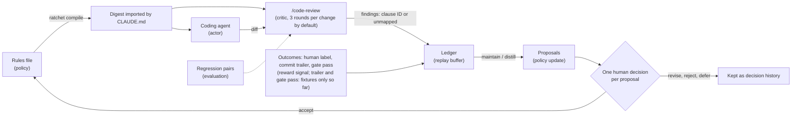

English | [中文](METHOD.zh.md)

# Why the loop is built this way

I built review-ratchet because I kept re-learning my own coding standards through code review, then losing the lessons. This page covers the design, what broke while I built it, and how to carry the loop to your own repo and reviewer. It is one person's notes from a few repos and tens of reviewer findings: read the numbers as anecdotes with counts attached. Nothing here trains a model, and I have no evidence yet that reviews improve over time ([Limits](#8-limits-and-open-questions)). Commands are in the [README](../README.md).

## Terms

| Term | Meaning here |
|---|---|
| Rules file | versioned markdown file of your coding rules |
| Clause, ID, family | one rule with a stable ID (`P0E.2`); the family is the prefix before the dot (`P0E`) |
| Severity | `blocker`, `should-fix` or `nice`: the clause's own tag, else the rules file's family table ([COMPILE.md](COMPILE.md#severity-table)) |
| Reviewer-conduct clause | no severity (the `R.*` family): how to review, not a defect |
| Digest | short text from `ratchet compile`; coder and reviewer both load it |
| Ledger | append-only local JSONL file of findings and outcomes |
| Finding | one reported defect, labeled with a clause ID or `unmapped` |
| `source` | where a finding came from: `gate`, or `l1` / `l2` (review tiers, treated alike; `add` can record human review comments too) |
| Outcome | `fixed` (a change resolved it), `dismissed` (skipped), `false_positive` (no change needed) |
| Gate | an automated check (linter, script) that feeds the ledger |
| Round, change | a change is a branch since it forked from the default branch, or a `--target`; a round is one review of it |
| Replay | re-importing a recorded review; not another round |
| Maintain, distill | the periodic step that turns open findings into proposed rule edits |
| Fold | a finding's state, computed from its events in file order |

## 1. The problem

- **AI-written code repeats a few kinds of bloat.** In my repos: broad `except` blocks that swallow errors, fallbacks that make failure look like success, abstractions with one implementation, comments that restate the code.
- **A generic reviewer does not know your standards.** Claude Code's built-in `/code-review` is a bundled skill you cannot edit; for project rules it follows your `CLAUDE.md` and does not read `REVIEW.md` ([docs](https://code.claude.com/docs/en/code-review-local)).
- **Written rules rot.** Mine lived in three hand-synced copies, and nothing carried a review result back to a rule.

So: one versioned rules file with stable clause IDs; the same compiled digest for coder and reviewer; every finding logged against a clause ID, with its outcome; and edit proposals that a person approves.

## 2. The loop, and the RL analogy

| RL term | Here |
|---|---|
| Policy | the rules file (`CODING-STYLE.md`), compiled to a short digest |
| Actor | the coding agent that writes the change |
| Critic | `/code-review`, or any reviewer that reads the same digest |
| Reward signal | a finding's outcome (`fixed`, `dismissed`, `false_positive`). The intended automatic sources, a `Fixes-Finding:` commit trailer and a gate pass, have run on fixtures only; every real outcome so far is a human label |
| Replay buffer | the ledger, an append-only local JSONL file |
| Policy update | the distill step plus one human decision per proposal |
| Evaluation | violating and compliant regression pairs, hand-written today |

No weights change. What is iterated is rule text, and every rule edit is meant to follow a recorded human decision. The vocabulary is an illustration, not a claim of equivalence: the critic reads the same rules as the actor, the reward is sparse and partly human, and the "update" is a person reading a proposal. Others already frame text-only learning this way (Reflexion, Training-Free GRPO; see [section 6](#6-prior-art-and-positioning)).

## 3. Guarding against reward hacking

Whatever produces a signal that feeds rule changes will tend to satisfy the signal, not your intent. Most cases below are ones I saw or nearly saw (the precision-only case is anticipated, not observed), each with its guard. Pilot figures come from one private pilot repository (its ledger as read on 2026-10-26, plus its history notes): historical observations, not re-verified, from different moments, so never read two as before and after.

### A catch-all label

- **What happened.** Early labels had no "none of these" option. In the pilot, 19 of 41 reviewer findings landed under one clause, the reviewer-conduct rule "standards come from this file".
- **Why.** A labeler forced to name a rule picks the bucket that can never be wrong; the catch-all looked like the busiest rule and hid real gaps (by my manual reading of those 19; the count alone proves nothing).
- **Guard.** `unmapped` is a first-class label, and the digest tells the reviewer to prefer it to stretching a clause. Labels are validated deterministically ([section 5](#5-carrying-the-loop-to-another-reviewer)), and an ID recovered from prose is marked `attributed`. ([LEDGER.md](LEDGER.md#rule-ids))

### An instruction nobody wired

- **What happened.** The pilot's skill text said to run the step that closes findings; nothing did. A dry run later showed it could close 95 of 97 open gate findings (and 0 of 21 reviewer findings, since no commit convention existed). Automatic outcomes: 0.
- **Why.** The reward was absent, not low: fix and false-positive rates were undefined, yet a long "open" list looked like many bugs.
- **Guard.** Mechanical triggers, not reminders. A post-commit hook runs `ratchet infer`, closing a finding when a commit message ends with `Fixes-Finding: <id>`; a gate pass closes gate findings in the files it covered; a local page collects human labels for the rest. The automatic two have run on fixtures only ([Limits](#8-limits-and-open-questions)). ([LEDGER.md](LEDGER.md#attribution))

### A guard that never fires

- **What happened.** In a second repo, `init` appended its pre-commit check below the existing hook's `exit 0`: dead code, reported as success, "already ok" on rerun.
- **Why.** "Never fired" looks identical to "nothing to catch".
- **Guard.** The block goes directly under the shebang. After install, `init` runs each hook once with `RATCHET_HOOK_PROBE=1`; the block must answer before any of your code runs, or the step fails (no skip flag). Every gate also needs a mutation check (R.7, [section 4](#4-when-a-rule-becomes-a-mechanical-gate)): `tests/mutation_check.py` injects one deliberate bug at a time and requires the suite to go red (328 of 328 caught in the last full run, per [ACCEPTANCE.md](ACCEPTANCE.md)). That tests the tool's own code, not the loop's effect. ([ONBOARDING.md](ONBOARDING.md#where-the-block-goes-and-the-live-check))

### Precision alone rewards silence

- **What happened.** Not seen in this tool; it is the first trap of automating rule changes against a precision number.
- **Why.** Reporting nothing scores perfectly, and so does a rule that never fires.
- **Guard.** Check a rule change on a pair: recall must not drop (the violating case is still reported) and clean code must not get invented findings (the compliant control stays clean). The sample reviewer prompt returns `[]` rather than forcing a finding, and R.2 asks the reviewer to say which rule clean code gets right. The pairs are hand-written; nothing extracts them from the ledger.

### Fixes can create new findings

- **What happened.** In the tool's own self-review, round 1 reported 10 findings and round 2 reported 6 more, mostly in code a round-1 fix touched. One example: letting a saved review replay past the cap (r1-1) let a paid run slip past it by reusing an ID (r2-1). Caveats: I counted the rounds by hand (the two reviews fell under different round keys, [LEDGER.md](LEDGER.md#review-rounds)), and round 1's 10 equals the reviewer's default cap, so it may be truncated.
- **Why.** A fix is new code, and the next pass reviews it, so each extra pass adds cost and fixes to re-check. I have not measured whether later passes are worth less.
- **Guard.** A per-change cap, default 3. The fourth round is refused before the reviewer runs (exit 3, so it costs nothing); `--over-cap` records the override. On the last round fix blockers only, with the caveat in [the next case](#severity-can-rank-backwards). A replay is not a round, and reusing an ID cannot bypass the cap (PRJ.1). Three is a cost choice; I have not compared other values. ([LEDGER.md](LEDGER.md#review-rounds))

### Severity can rank backwards

- **What happened.** In round 1 of that self-review, the only `blocker` was a missing output line on a detached HEAD, because it matched a blocker-family clause. The real bugs (a vendor command that deleted the old copy before the new one was in place) matched no clause: 8 of 10 findings were `unmapped`, severity picked by the model.
- **Why.** Severity comes from the clause family, so `unmapped` has no anchor, and "fix blockers only" would have fixed the trivial issue first. My rules had no family for data loss.
- **Guard.** No code fixes this. Treat `unmapped` as input for new rules (the vendor bug became REL.1) and check that your rules cover the defect classes you care about: "blockers only on the last round" is only as good as that coverage. A person can override it (in that self-review I fixed 12 of the 13 `unmapped` findings), but it remains a known weakness.

### A falling count is not a fix

- **What happened.** In the pilot's history a nesting-depth check fell from 51 hits to 23 to 8. The first drop was a checker fix (an `elif` chain had counted as nesting); the second was flattened code. (Historical record, not re-verified.)
- **Why.** A count falls when the ruler changes, when findings are dismissed, or when the reviewer goes quiet.
- **Guard.** A person decides every rule change; the tool records the answer and applies nothing without one. Accepting a rule never marks its source findings fixed; a default, silence or a model's recommendation is not consent; uncertain or refuted evidence cannot produce a draft; stale batches are refused; applied batches can be rolled back. ([DECISION-CARDS.md](DECISION-CARDS.md))

## 4. When a rule becomes a mechanical gate

My rule of thumb ([CODING-STYLE.md](../CODING-STYLE.md), section 0): if a rule holds in every session, is unrelated to the task and is unambiguous, make it mechanical (a linter or syntax-tree script in pre-commit). Otherwise it stays judgment, applied by the reviewer.

Promotion evidence is repeated findings of a form a tool can decide; the ledger gives the counts, a person decides, and the tool does not write the gate. Demotion happens too: a mechanical prefix check for boolean names blocked clear idioms such as `truncated`, so it became reviewer judgment (see the ADJUST note on P2.5 in the [template](../templates/CODING-STYLE.template.md)).

A new gate needs a failing example that proves it fires, a compliant one that stays clean (starting with the rule's stated exceptions), proof that reverting turns it green, and a mutation check, all committed (R.7; [CONTRIBUTING.md](../CONTRIBUTING.md)). Gates feed the same ledger through `ratchet gate record` and `ratchet gate pass` ([GATES.md](GATES.md)); a pass closes that file's gate findings, which is weaker than "verified fixed".

## 5. Carrying the loop to another reviewer

Most of the loop is plain files and a standard-library Python CLI; Claude Code supplies the reviewer, how it reads instructions and the question tool. Only Claude Code was exercised, so a port would need five things plus two guards (the deterministic label check and the round cap).

| Part | Commands | Claude Code needed? |
|---|---|---|
| Digest | `compile` | no: deterministic text |
| Import | `ingest-code-review`, `add`, `review --from-file` | no: any reviewer's JSON |
| Outcomes | `infer`, `gate record`, `gate pass`, `label-page`, `apply-labels` | no |
| Direct label | `label` | no: a person's answer in the host's question popup is recorded straight as a `human` outcome |
| Decision records | `decision-context`, `prepare-decisions`, `apply-decisions`, `apply-proposals`, `rollback-proposals` | no: they call no model |
| Run the reviewer | `review` | yes: it runs `claude -p "/code-review <level>"` |
| Assess and ask | the `maintain` skill | yes: the host agent writes the assessment and asks the native question |

**1. Make the reviewer read your rules.** Find where yours takes instructions, then check with a canary: a clause that can be cited only if the digest was loaded. The digest is deterministic text, one `ID | severity | short rule` line per violation clause (`ID | short rule` for reviewer-conduct clauses) plus a fixed labeling instruction, kept small because every session pays for it ([COMPILE.md](COMPILE.md#what-the-digest-contains)).

| Reviewer | Reads | Status |
|---|---|---|
| Claude Code `/code-review` | `CLAUDE.md`, `@import` expanded; not `REVIEW.md` | canary observed once (2026-10-26, `claude -p`): cited in both runs with the import, not in the runs without it; not re-run |
| Managed GitHub Code Review | `REVIEW.md` (from the base or default branch, never from the pull request's own changes) and `CLAUDE.md`, per [Anthropic's docs](https://code.claude.com/docs/en/code-review) | not tested by me |
| Anything else | its own config file, rules file or prompt | write the digest there |

**2. A finding contract.** One object per defect: `file`, `line`, `summary`, `failure_scenario`, `category` (a kebab-case clause ID such as `rel-1`, or `unmapped`) and `severity` (`blocker`, `should-fix`, `nice`). The reviewer-facing contract is the digest's Labeling section plus a [sample prompt](../samples/config-replacement/reviewer-prompt.md); the [schema](../schemas/finding.v1.schema.json) defines the stored ledger events. The importer accepts a bare JSON array or the first fenced `json` block.

The built-in reviewer, on the Claude Code version I tested in October 2026 (`claude -p`), printed at most 10 findings by default (newer versions add `--max-findings`), as plain-text JSON with `file`, `line`, `summary` and `failure_scenario`. It added `category` and `severity` when `CLAUDE.md` demanded them (2 of 2 runs), so the digest phrases it as an order. Labels were unstable: in the second run it stretched unmatched problems into existing clauses and split one defect into three findings under three IDs. A model's label is a proposal.

**3. Finding identity.** For reviews, the importer mints IDs, not the reviewer: findings in one review get display IDs `<run>-1`, `<run>-2`, ... (such as `r3-2`, run `r3`), stored under the full ID `<repo>:<source>:<run>:<display ID>`. The fixer must see the display ID: `ratchet review` prints it in its table, and a PR-comment port should put it in each comment. The fixing commit then ends with a `Fixes-Finding: r3-2` trailer ([LEDGER.md](LEDGER.md#finding)).

**4. A ledger and mechanical outcomes.** An append-only JSONL file with four event kinds: `finding`, `outcome` (by commit trailer, gate pass or human, with evidence), `gate_pass` and `review_run` (one review round, for the cap). A finding's state is the fold of its events in file order ([LEDGER.md](LEDGER.md#events)). Two traps when you build matching: do not parse commit subjects (an ID like `S1` collides with scope tags), and do not compare timestamps (a fix can be committed before the finding is logged).

**5. A human decision step.** Give a model the findings, their code and the whole rules file. Per group of findings sharing a mechanism it returns a verdict (supported, uncertain or refuted), an action (`covered`, `keep`, `add`, `rewrite`, `merge`, `retire`), a reason and the exact clause text. Ask a person one question per proposal, showing that evidence, with accept, revise, reject or defer. Record the answer as given, apply accepted changes in one reversible transaction, recompile ([DECISION-CARDS.md](DECISION-CARDS.md)). Check each accepted rule with a violating case and a compliant control.

The two guards:

- **Deterministic label check.** The clause ID must exist in the rules file, else `unmapped`; a reviewer-conduct clause cannot be blamed; an ID cited only in prose is a fallback, marked `attributed`; findings on one file and line collapse into the most severe; re-importing a review is a no-op, and a reused ID with different content is refused. This proves a label exists, not that it applies; a person judges that.
- **Round cap.** Count rounds per change: the branch since it forked from the default branch, or an explicit `--target` (in a PR-based port, the pull request). Check the cap before calling the reviewer, so a refused round costs nothing. Re-importing an already recorded review (`--from-file` with its run ID) is a replay, not a round ([LEDGER.md](LEDGER.md#review-rounds)).

## 6. Prior art and positioning

Others have built most of the pieces. I checked these papers against their arXiv pages and text (searches plus targeted reading, not a full read of each).

| Work | What it updates | Gap relative to this repo |
|---|---|---|
| [Reflexion](https://arxiv.org/abs/2303.11366) (Shinn et al., 2023) | reflections in episodic memory | per-episode memory; no stable IDs, lifecycle or shared rule file; task or self-generated signal |
| [Self-Refine](https://arxiv.org/abs/2303.17651) (Madaan et al., 2023), [TextGrad](https://arxiv.org/abs/2406.07496) (Yuksekgonul et al., 2024) | the current output, or text variables, from self-critique or an LLM-written loss | no persisted clause-level rules, outcome ledger or human gate |
| [DSPy](https://arxiv.org/abs/2310.03714), [MIPRO](https://arxiv.org/abs/2406.11695), [OPRO](https://arxiv.org/abs/2309.03409), [ProTeGi](https://arxiv.org/abs/2305.03495) | prompts and demonstrations against a fixed-set metric | metric-driven; no per-clause approval; no coder and reviewer sharing one rule set |
| [ExpeL](https://arxiv.org/abs/2308.10144) (Zhao et al., 2023) | natural-language insight list | closest on mechanism; users may edit insights, but no approval step, clause IDs or repo outcomes; insights serve the same acting agent |
| [ACE](https://arxiv.org/abs/2510.04618) (Zhang et al., 2025) | playbook bullets with IDs and helpful/harmful counters | closest artifact; no per-update human gate (experts can unlearn items), no repo review outcomes, no versioned file read by a separate reviewer |
| [Training-Free GRPO](https://arxiv.org/abs/2510.08191) (Cai et al., 2025) | experience library, model frozen | closest on the RL framing; benchmark rewards, no human gate |
| [BitsAI-CR](https://arxiv.org/abs/2501.15134) (Sun et al., 2025) | fine-tuned checker over 219 rules, tracked per rule from real review signals; rules can be retired | closest on the review side; low-precision samples retrain the model (weights change); rules feed review only |

Not novel, and I do not claim it: the RL analogy, LLM-maintained natural-language rule lists with add, edit, delete and vote, and per-rule tracking of real review outcomes that retires rules.

What I do claim is the combination and the governance:

- **(a)** the reward comes from a team's own repository review outcomes (fixed, dismissed, false positive), logged per clause;
- **(b)** every rule change needs a recorded per-proposal human decision, though the tool cannot check who answered ([Limits](#8-limits-and-open-questions)). I found no such gate in these papers: ExpeL lets users edit insights, ACE lets experts unlearn items, and BitsAI-CR has humans annotate samples and retire low-precision rules;
- **(c)** one versioned rules file, recompiled each cycle, is read by both the coding session and the reviewer.

I found no discussion of reward hacking in these papers (same caveat), so the human gate here is a deliberate guard against it. If you know closer work, please open an issue.

## 7. Worked example

The public example is synthetic: [`samples/config-replacement`](../samples/config-replacement/README.md), recorded in [ACCEPTANCE.md](ACCEPTANCE.md). One mechanism: replacing a configuration file can destroy the last usable copy before its replacement is ready.

1. The rules held ERR.1 (propagate parse errors) and reviewer guidance, but no REL.1. The native review flagged swallowed parse errors under ERR.1, and delete-before-write under nothing: `unmapped`.
2. The model compared the finding with the whole corpus and proposed keeping ERR.1 and adding a scoped REL.1. A real native question showed the exact clause; I accepted both. The tool stored my answer, applied one rule edit and recompiled the digest.
3. A later review attributed the replacement defect to REL.1.
4. On the third and last allowed round I added compliant controls and a transfer case not used to draft the clause:

| Check | Observed |
|---|---|
| Write fails after the old file is deleted | the deterministic unsafe example loses the old content; the prepared replacement keeps it |
| Serialization fails after the target is truncated (transfer case) | reported under REL.1; a deterministic check reproduces the loss |
| Serialize and validate before replacing (two compliant controls) | not reported against REL.1 |
| Anything else | missing permission-bit preservation, reported as `unmapped` |

I did not suppress the last finding. The published safe examples now preserve mode bits, with a deterministic check; the cap meant that fix got no fourth review. This is one run of a nondeterministic reviewer, so no accuracy figure follows. The transfer pair is now public, so it is a regression sample, not a hidden test, and the [recorded review](../samples/config-replacement/recorded-review.txt) predates the permission fix ([provenance](../samples/config-replacement/recorded-review-provenance.json)). The sample's deterministic checks run without a model.

The tool's own self-review followed only the first half of that path: 16 findings over two rounds ([RECONCILIATION.md](RECONCILIATION.md): 15 verified fixes, one nonblocking cleanup) led to five accepted proposals, PRJ.1, PRJ.2, REL.1, REL.2 and an R.7 amendment, each with "Why added" and sources in [CODING-STYLE.md](../CODING-STYLE.md). Nothing has been re-reviewed under those rules, so this repo has no later-review or control evidence for `PRJ.*` or `REL.*` (the REL.1 evidence above comes from the synthetic sample's own rules). Be skeptical of the PRJ clauses: they are project-specific and close to "the bug we just fixed, written as a rule".

## 8. Limits and open questions

- **Small N.** One author, a few repos, one reviewer, tens of findings. None of this is a rate.
- **No effectiveness data yet.** I have not shown that repeat violations or false positives fall after rule changes; applying a rule is not evidence that it works. "Ratchet" names the mechanism (rule changes are recorded, approved and reversible), not a measured improvement.
- **Self-referential evidence.** Mostly the tool reviewing its own code, plus a sample built around a mechanism I had already met there. Only Claude Code was exercised end to end.
- **Single-run evaluation.** Regression checks use single runs of a nondeterministic reviewer; no run count or pass threshold is defined.
- **Automatic outcomes are unproven in real use.** The trailer and gate paths are tested on fixtures, but every outcome in this repo's real history so far came from a human label; trailer-based closing has not fired in real use.
- **Trailers can be lost.** `Fixes-Finding` counts only in a commit message's last paragraph, so a squash merge or rewritten message can drop it; check your merge strategy.
- **The ledger is one developer's local, gitignored file.** A team port needs shared storage and concurrent appends.
- **Model labels are unstable.** Validation checks that a label exists, not that it fits.
- **The human gate is a recorded-answer contract, not authentication.** The CLI cannot tell a person from an agent typing the answer; the host must keep that boundary. It also costs attention (one question per proposal), and I do not know how it scales to a team or how consistent one person is; [DECISION-METRICS.md](DECISION-METRICS.md) is a design note, not a result.
- **The rule set only grows.** A person can approve `retire`, but nothing triggers it, and "no recent hits" is not evidence. The digest size budget (4,096 bytes by default; this repo's own digest is 4,087 as I write) is the only mechanical pressure to prune.

If you try it, the most useful things to send back are synthetic failing examples, regression pairs and rule proposals, never real private findings or code. See [CONTRIBUTING.md](../CONTRIBUTING.md).
