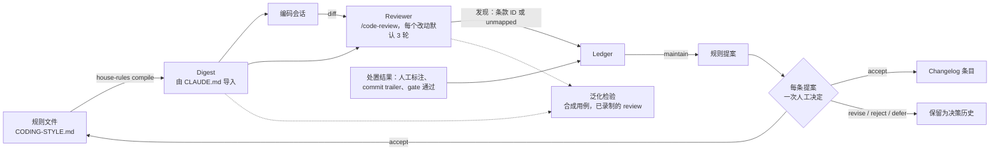

[English](METHOD.md) | 中文

# 为什么这样设计这个循环

我做 house-rules，是因为我总在 code review 里一遍遍重新学自己的编码规范，然后又把教训弄丢。想法是：外部 reviewer（Claude Code 内置的 `/code-review`）反复发现的问题，变成写下来、带版本的规则，由我逐条批准；这些规则被编译成一份 digest，编码会话和下一次 review 都会读它。这一页讲设计、这类循环怎样误导自己、怎么把它搬到你自己的仓库和 reviewer 上、相关工作，以及局限。

它只是一个人在几个仓库、一个私有试点和一次小规模录制检验上的笔记：请把里面的数字当成附带计数的轶事。这里没有任何东西在训练模型，没有 benchmark，我也不主张 agent 因此写出更好的代码。唯一被度量的部分是一次[泛化检验](#规则能泛化吗)：从一条发现学来的规则，能不能迁移到新用例上；结果以负面为主。在决定这东西适不适合你之前，请先读[局限](#8-局限)。命令见 [README](../README.zh.md)。

## 术语

| 术语 | 在这里的含义 |
|---|---|
| 规则文件 | 带版本的 markdown 文件，写你的编码规则 |
| 条款、ID、条款族 | 一条规则及其稳定 ID（`P0E.2`）；条款族是点号前的前缀（`P0E`） |
| 严重度 | `blocker`、`should-fix` 或 `nice`：先取条款自己的标签，否则取规则文件里的族表（[COMPILE.md](COMPILE.md#severity-table)） |
| Reviewer | 读一个改动并报告发现的程序；这里指 Claude Code 内置的 `/code-review`，由厂商持续升级，本仓库从不修改它 |
| reviewer 行为准则 | 不带严重度的条款（`R.*` 族）：规定怎么 review，不是缺陷 |
| Digest | `house-rules compile` 生成的短文本；编码会话和 reviewer 都会加载 |
| Ledger | 只追加的本地 JSONL 文件，记录发现和处置结果 |
| 发现（finding） | reviewer 报告的一个缺陷，标注为某个条款 ID 或 `unmapped` |
| `source` | 发现的来源：`gate`，或 `l1` / `l2`（两档 review，同等对待；`add` 也能记录人工 review 的评论） |
| 处置结果（outcome） | `fixed`（某个改动解决了它）、`dismissed`（跳过）、`false_positive`（无需改动） |
| Gate | 自动检查（linter、脚本），把结果喂给 ledger |
| 轮、改动 | 一个改动是从默认分支分叉出来的那段分支，或一个 `--target`；一轮是对它的一次 review |
| 回放（replay） | 重新导入一份已记录的 review（不算新的一轮），或对泛化检验里已录制的运行重新打分 |
| Maintain / distill | 周期性步骤：把未关闭的发现变成拟议的规则编辑 |
| Fold | 按事件在文件中的顺序算出的发现状态 |
| 泛化检验 | `samples/generalization/`：合成用例，问的是从一条真实发现学来的规则，能否让 reviewer 报出同一机制的新实例并标上这条规则（[第 7 节](#规则能泛化吗)） |
| 用例（case） | 一对文件（一个违规例和一个合规的对照）加一个行为 oracle，oracle 靠运行它们来证明两者的差别 |
| 检验轮 | 用同一份 digest 做出的一组检验运行；与 review 的轮不是一回事 |

## 1. 问题所在

- **AI 写的代码总在重复几种臃肿。** 在我的仓库里：吞掉错误的宽泛 `except` 块、把失败伪装成成功的兜底、只有一个实现的抽象、复述代码的注释。
- **通用 reviewer 不了解你的标准。** Claude Code 内置的 `/code-review` 是随程序打包的 skill，你没法编辑它；对项目规则，它遵循你的 `CLAUDE.md`，不读 `REVIEW.md`（[文档](https://code.claude.com/docs/en/code-review-local)）。
- **写下来的规则会腐烂。** 我的规则曾散落在三份手工同步的副本里，没有任何东西把 review 的结果带回规则。

所以：一份带版本、条款 ID 稳定的规则文件；编码会话和 reviewer 共用同一份编译出的 digest；每条发现都按条款 ID 记账并附上处置结果；规则编辑只以提案的形式出现，由人批准。

## 2. 循环

用文字说：

1. **规则。** 一份带稳定条款 ID 的 markdown 文件。`house-rules compile` 把它编译成一份简短的 digest（默认最多 4096 字节），由 `CLAUDE.md` 导入，所以编码会话和 reviewer 读的是同一段文字。
2. **Review。** 一件活干完时，手动运行 `house-rules review`，或者因为可选的 Stop hook 发现改动够大，reviewer 会在加载了 digest 的情况下审这个改动。Reviewer 是外部的，由厂商升级；本仓库记录它的版本，从不试图改进它。这个循环找的是规则里的盲点，不是 bug。
3. **Ledger。** 每条发现存在一个本地的、只追加的文件里，带 file、line、一段代码片段，以及一个条款 ID 或 `unmapped`。
4. **处置结果。** 一条发现由人工标注、修复 commit 上的 `Fixes-Finding:` trailer，或一次 gate 通过来关闭。
5. **提案。** 周期性地，以及在收口（wrap-up）时出现新的 `unmapped` 发现后，由模型根据未关闭的发现起草规则提案：add、rewrite、merge、retire，或保留现有规则（keep）。
6. **人工决定。** 每条提案向人问一个问题：accept、revise、reject 或 defer。没有回答，什么也不会应用。
7. **规则与 changelog。** 被接受的提案会修改规则文件，追加一条 changelog（改前和改后、证据、那个人的原话），并重新编译 digest。下一次编码会话和下一次 review 读的就是新的 digest。
8. **泛化检验。** 在主路径之外：对一条从真实发现学来的规则，合成用例能否表明 reviewer 报出了新实例、标上了这条规则的 ID、并放过了合法的对照？（[第 7 节](#规则能泛化吗)。）

没有权重被改动。被迭代的是规则文本，每一次规则编辑都应当跟在一次有记录的人工决定之后。

Review 要花钱，也要花注意力，所以默认值都很小，且都是配置项：每个改动最多 3 次 review；一次收口 review 只在改动至少 200 行或 5 个文件时才运行；每个仓库在任意 24 小时内最多 2 次自动 review；一次收口最多问一个问题、起草 3 条提案；digest 有 4096 字节的预算。低于阈值时，什么都不运行，也不产生费用。

## 3. 这类循环怎样误导自己

一个根据 reviewer 输出来改规则的循环，会在不起眼的地方骗过它的主人：永远不会错的标签、没人去执行的指令、永不触发的防线、因为错误原因而下降的数字、随噪声晃动的度量。下面的案例大多是我亲眼见过或差点遇到的（只看 precision 的那个是预判，并非观察到的），每个都配有对应的防线。第一组来自一个私有试点和工具自己的 review 历史。试点数字是我对其 ledger 的转述（读取时间 2026-10-26）：它们是历史观察，未重新核实，且取自不同时刻，所以绝不要把其中两个数当作改动前后的对比。最后三个案例来自[泛化检验](#规则能泛化吗)。

### 兜底标签

- **发生了什么。** 早期的标签没有「都不是」这个选项。在一个私有试点里，41 条 reviewer 发现中有 19 条落在同一个条款下，即 reviewer 行为准则「标准来自这个文件」（R.1）。
- **为什么。** 被迫指名一条规则的标注者，会挑一个永远不会错的桶；这个兜底条款看上去像最忙的规则，把真实的缺口藏了起来（这是我对那 19 条人工读过之后的判断；光看计数什么也证明不了）。
- **防线。** `unmapped` 是一等标签，digest 会告诉 reviewer 宁可用它，也别硬凑一个条款。标签由确定性逻辑校验（[第 5 节](#5-把循环搬到别的-reviewer)），从正文里还原出的 ID 会标为 `attributed`。（[LEDGER.md](LEDGER.md#rule-ids)）

### 没人接线的指令

- **发生了什么。** 试点里的 skill 文本写着要运行关闭发现的那个步骤，但没有任何东西去运行它。后来对那个步骤做了一次 dry run，在试点的 ledger 上（当时有 138 条发现；这是我的报告，你无法核对），它能关闭 97 条未关闭的 gate 发现中的 95 条，而 21 条未关闭的 reviewer 发现一条也关不掉，因为当时没有 commit 约定。自动处置结果：0。
- **为什么。** 当时没有处置结果的数据：修复率和误报率都无从定义，可一长串「未关闭」的列表看上去像一大堆 bug。
- **防线。** 用机械触发，不靠提醒。post-commit hook 运行 `house-rules infer`，当 commit message 以 `Fixes-Finding: <id>` 结尾时关闭对应的发现；gate 通过会关闭它所覆盖文件里的 gate 发现；其余的由本地页面收集人工标注。trailer 这条路径后来在本仓库自己的使用中触发过了：在我本地的 ledger 里（被 git 忽略，所以你没法核对），29 个处置结果中有 9 个由 trailer 关闭，第一次在 2026-10-30，另外 20 个是人工标注。gate 通过这条路径仍然只在 fixture 上跑过（[局限](#8-局限)）。（[LEDGER.md](LEDGER.md#attribution)）

### 永不触发的防线

- **发生了什么。** 在第二个仓库里，`init` 把它的 pre-commit 检查追加到了已有 hook 的 `exit 0` 之后：这是死代码，却被报告为成功，重跑时还显示「already ok」。
- **为什么。** 「从未触发」和「没有可抓的东西」看起来一模一样。
- **防线。** 这个代码块放在 shebang 的正下方。安装之后，`init` 用 `HOUSE_RULES_HOOK_PROBE=1` 把每个 hook 各运行一次；这个块必须在你的任何代码运行之前就作出应答，否则这一步失败（没有跳过开关）。每个 gate 还需要一次变异检查（R.7，[第 4 节](#4-规则何时升级为机械-gate)）：`tests/mutation_check.py` 每次植入一个刻意的 bug，并要求测试套件变红。它定义了 1500 多个变异。最近一次完整运行在 2026-10-28，当时存在的 328 个全部抓到了（[ACCEPTANCE.md](ACCEPTANCE.md)）；此后新增的每个变异都做过定向运行，不是完整运行，首次发布前计划再做一次完整运行。这检验的是工具自己的代码，不是这个循环的效果。（[ONBOARDING.md](ONBOARDING.md#where-the-block-goes-and-the-live-check)）

### 只看 precision 会偏向沉默

- **发生了什么。** 这个工具里没有见到；这是针对 precision 数字去自动化规则改动时的第一个陷阱。
- **为什么。** 什么都不报，得分就是满分；一条永不触发的规则同样如此。
- **防线。** 用一对用例检查规则改动：recall 不能掉（违规用例仍被报出），干净的代码不能被编造出发现（合规的对照仍保持干净）。示例 reviewer 提示词在没有问题时返回 `[]`，而不是硬凑一条发现；R.2 要求 reviewer 说明干净的代码做对了哪条规则。泛化检验就是建立在这样的用例对上的；没有任何东西从 ledger 里把它们提取出来，它们是手写的。

### 修复可能制造新的发现

- **发生了什么。** 在工具自己的自我 review 里，第 1 轮报告了 10 条发现，第 2 轮又报告了 6 条，大多出在第 1 轮某个修复改过的代码里。一个例子：允许已保存的 review 回放越过上限（r1-1），结果让一次付费运行借着复用 ID 越过了上限（r2-1）。需要说明：这两轮是我手工数的（两次 review 落在不同的 round key 下，[LEDGER.md](LEDGER.md#review-rounds)），而且第 1 轮的 10 条恰好等于 reviewer 的默认上限，所以可能被截断了。
- **为什么。** 修复本身就是新代码，下一轮 review 会审它，所以每多一轮，都会增加成本和需要复查的修复。我没有度量过后面几轮是否更不值。
- **防线。** 每个改动设一个上限，默认 3。第四轮会在 reviewer 运行之前被拒绝（退出码 3，所以不花钱）；`--over-cap` 会记录这次越权。最后一轮只修 blocker，但要留意[下一个案例](#严重度可能排反)里的保留意见。回放不算一轮，复用 ID 也绕不过上限（PRJ.1）。三轮是出于成本的选择；我没有比较过其他取值。（[LEDGER.md](LEDGER.md#review-rounds)）

### 严重度可能排反

- **发生了什么。** 在那次自我 review 的第 1 轮里，唯一的 `blocker` 是 detached HEAD 下少打印了一行输出，只因为它命中了 blocker 族的一个条款。真正的 bug（一个 vendor 命令在新副本就位之前就删掉了旧副本）不匹配任何条款：10 条发现里有 8 条是 `unmapped`，严重度由模型自己定。
- **为什么。** 严重度来自条款所属的族，所以 `unmapped` 没有锚点，而「只修 blocker」会先去修那个无关紧要的问题。我的规则里没有「数据丢失」这一族。
- **防线。** 代码层面解决不了这个问题。把 `unmapped` 当作新规则的输入（那个 vendor bug 后来成了 REL.1），并检查你的规则是否覆盖了你在意的缺陷类别：「最后一轮只修 blocker」的效果取决于这种覆盖。人可以推翻它（那次自我 review 里，13 条 `unmapped` 发现我修了 12 条），但它仍是一个已知的弱点。

### 数字下降不等于修好

- **发生了什么。** 在试点的历史里，嵌套深度检查的命中数从 51 降到 23，再降到 8。第一次下降是检查器的修正（一条 `elif` 链曾被算作嵌套）；第二次是代码被拍平了。（历史记录，未重新核实。）
- **为什么。** 数字下降，可能是因为尺子变了，可能是因为发现被驳回了，也可能是因为 reviewer 沉默了。
- **防线。** 每一次规则改动都由人来决定；工具记录这个回答，没有回答就什么也不应用。接受一条规则绝不会把它来源的发现标成已修复；默认值、沉默或模型的建议都不算同意；不确定或已被驳斥的证据不能产出草案；过期的批次会被拒绝；已应用的批次可以回滚。（[DECISION-CARDS.md](DECISION-CARDS.md)）

### 写进 digest 的例外没能拦住误标

- **发生了什么。** REL.1 豁免可随时丢弃、可重建的临时产物。在泛化检验里，reviewer 在 `rel-1` 的 3 次运行中全部、在留出的 `rel-1b` 的 3 次运行中有 2 次，给这个属于例外的对照标上了 REL.1。我把 digest 里的那一行改写成先讲例外。改写之后，计数没变：仍是 3/3 和 2/3。对 REL.2（两个用例，共六次运行），对照被标上的次数从 6 次里的 2 次变成 1 次，违规例被标上的次数从 6 次里的 3 次变成 1 次：没有明显收益。无论 digest 里有没有这条规则，reviewer 在每一次运行里都会报出对照文件的问题；规则只改变了这些问题带着哪个标签。
- **为什么。** 我不知道。这些计数说明的是：发现问题和给它贴标签是两种分得开的行为，而 digest 里那一行讲了例外，reviewer 并没有照着它去做。
- **防线。** 在相信措辞之前，先在一个留出的对照上测每一条例外。`rel-1b` 和 `rel-2b` 就是为此在第 1 轮之后写的，没有用来调这次改写。并且把模型给的标签当作提议，由人来读。

### 缩短标注指令让 category 键几乎消失

- **发生了什么。** 检验的第 2 轮缩短了 digest 里的 Labeling 指令（它不再点出 reviewer 自带的那些键名），并改写了 REL.1 和 REL.2。在 18 次 `with_rule` 运行里有 17 次，没有任何发现带 `category`，于是什么都标不了，每个用例都失败了。`rel-3b` 和 `rel-4` 的条款没有变，却都丢光了标签，`rel-3b` 从 PASS 变成 FAIL。恢复原来的指令之后，仍有 18 次里的 6 次缺这个键（第 1 轮是 21 次里的 7 次）。
- **为什么。** 我从这些计数得出的推断是：是指令的措辞让 reviewer 加上这个键；这只是推断，不是经过检验的机制。
- **防线。** 录制之前先写下你要改什么、要数什么；保存每次运行所用的 digest；尽量每一轮只改一件事（第 3 轮只改了 REL.1 和 REL.2 的那两行，并恢复了 Labeling 文本）；读结论之前先看这个键在不在。

### 每个条件只跑三次，噪声很大

- **发生了什么。** `rel-4` 的条款文本在第 1 轮和第 3 轮之间没有变，但违规例被标上的次数从第 1 轮的 3 次里 1 次，变成第 3 轮的 3 次里 3 次（对照：从 0/3 到 1/3）。`rel-3b` 是 2/3、0/3、3/3，中间还夹着一次标注指令的改动。
- **为什么。** Reviewer 每次运行的输出都会有差异，而 3 次运行的一格只能取 0、1、2、3。
- **防线。** 报告计数，不报比率；绝不把几轮合并；差一两次运行就当没有差别；保留还是回滚，留给看过所有轮次的人来定。这里 REL.1 和 REL.2 的改写在任何一轮里都没有改善，所以我把它们回滚到了第 1 轮的措辞（[changelog](../CODING-STYLE.changelog.md) 里的 Revision 5）。现在的 digest 与第 1 轮录制时用的那份逐字节相同。

## 4. 规则何时升级为机械 gate

我的经验法则（[CODING-STYLE.md](../CODING-STYLE.md) 第 0 节）：如果一条规则在每个会话里都成立、与当前任务无关、而且没有歧义，就把它做成机械的（pre-commit 里的 linter 或语法树脚本）。否则它保持为判断，由 reviewer 来应用。

升级的证据是反复出现、且工具能判定的那类发现；ledger 给出计数，由人来决定，工具不会替你写 gate。降级也会发生：一个检查布尔变量名前缀的机械检查，拦下了 `truncated` 这类明明正当的惯用名，于是它被改成 reviewer 判断（见[模板](../templates/CODING-STYLE.template.zh.md)里 P2.5 的 ADJUST 注释）。

一个新的 gate 需要：一个证明它会触发的失败示例、一个保持干净的合规示例（先从该规则声明的例外开始）、证明撤销后会变绿，以及一次变异检查，这些都要提交（R.7；[CONTRIBUTING.md](../CONTRIBUTING.md)）。Gate 通过 `house-rules gate record` 和 `house-rules gate pass` 把结果喂进同一个 ledger（[GATES.md](GATES.md)）；一次 pass 会关闭该文件的 gate 发现，这比「确认已修复」弱。

## 5. 把循环搬到别的 reviewer

这个循环的大部分是纯文件加一个只用标准库的 Python CLI；Claude Code 提供的是 reviewer、它加载指令的方式和提问工具。只有 Claude Code 被完整跑通过，所以搬到别处需要五样东西，外加两道防线（确定性的标签检查和轮数上限）。文档里写明的换 reviewer 的办法是：自己去运行它，再导入它的输出：`house-rules review --from-file out.txt --run ID`（或 `wrapup --from-file`，阈值照样适用）。

| 部分 | 命令 | 需要 Claude Code 吗？ |
|---|---|---|
| Digest | `compile` | 不需要：确定性文本 |
| 导入 | `ingest-code-review`、`add`、`review --from-file` | 不需要：任何 reviewer 的 JSON 都行 |
| 处置结果 | `infer`、`gate record`、`gate pass`、`label-page`、`apply-labels` | 不需要 |
| 直接标注 | `label` | 不需要：人在宿主弹窗里给出的判断，直接记成一条 `human` 处置结果 |
| 决策记录 | `decision-context`、`prepare-decisions`、`apply-decisions`、`apply-proposals`、`rollback-proposals` | 不需要：它们不调用模型 |
| 运行 reviewer | `review` | 需要：它运行 `claude -p "/code-review <level>"` |
| 评估与提问 | `maintain` skill | 需要：由宿主 agent 写评估并发起原生提问 |

**1. 让 reviewer 读到你的规则。** 找到你的 reviewer 在哪里接收指令，然后用 canary 检查：一条只有加载了 digest 才可能被引用的条款。digest 是确定性文本，每条违规条款一行 `ID | severity | short rule`（reviewer 行为准则条款是 `ID | short rule`），外加一段固定的标注指令，保持得很小，因为每个会话都要为它付费（[COMPILE.md](COMPILE.md#what-the-digest-contains)）。

| Reviewer | 读取 | 状态 |
|---|---|---|
| Claude Code `/code-review` | `CLAUDE.md`（`@import` 会展开）；不读 `REVIEW.md` | canary 只观察过一次（2026-10-26，`claude -p`）：加了 import 的两次运行里都被引用，没加的几次运行里没有；未复测 |
| 托管的 GitHub Code Review | `REVIEW.md`（取自基准分支或默认分支，绝不取自 pull request 自身的改动）和 `CLAUDE.md`，依据 [Anthropic 文档](https://code.claude.com/docs/en/code-review) | 我没测过 |
| 其他 | 它自己的配置文件、规则文件或提示词 | 把 digest 写进去 |

**2. 发现的契约。** 每个缺陷一个对象：`file`、`line`、`summary`、`failure_scenario`、`category`（kebab-case 的条款 ID，如 `rel-1`，或 `unmapped`）和 `severity`（`blocker`、`should-fix`、`nice`）。面向 reviewer 的契约是 digest 的 Labeling 段，加一份[示例提示词](../samples/config-replacement/reviewer-prompt.md)；[schema](../schemas/finding.v1.schema.json) 定义的是存储下来的 ledger 事件。导入器接受裸的 JSON 数组，或第一个带围栏的 `json` 代码块。

内置 reviewer，在我 2026 年 10 月测试的那个 Claude Code 版本（`claude -p`）上，默认最多输出 10 条发现（更新的版本新增了 `--max-findings`），形式是纯文本 JSON，带 `file`、`line`、`summary` 和 `failure_scenario`。当 `CLAUDE.md` 要求时，它会加上 `category` 和 `severity`（2 次运行里有 2 次），所以 digest 把这条写成命令的口吻。标签并不稳定：第二次运行里，它把对不上的问题硬凑进已有条款，还把一个缺陷拆成三条发现、挂在三个 ID 下。后来泛化检验量到了同样的弱点（[第 3 节](#缩短标注指令让-category-键几乎消失)）。模型给的标签只是一个提议。

**3. 发现的身份。** 对 review 来说，ID 由导入器生成，而不是由 reviewer 生成：同一次 review 里的发现得到显示 ID `<run>-1`、`<run>-2`……（如 `r3-2`，run 为 `r3`），存储时用完整 ID `<repo>:<source>:<run>:<display ID>`。修复的人必须看得到显示 ID：`house-rules review` 会在它的表格里打印；如果搬到 PR 评论的场景，应该把它放进每条评论。修复的 commit 随后以一条 `Fixes-Finding: r3-2` trailer 结尾（[LEDGER.md](LEDGER.md#finding)）。

**4. Ledger 与机械的处置结果。** 一个只追加的 JSONL 文件，有四种事件：`finding`、`outcome`（由 commit trailer、gate 通过或人工给出，附证据）、`gate_pass` 和 `review_run`（一轮 review，用于上限；它也记录 reviewer 的版本）。一个发现的状态是它的事件按文件顺序的 fold（[LEDGER.md](LEDGER.md#events)）。做匹配时有两个陷阱：不要去解析 commit 标题（像 `S1` 这样的 ID 会和 scope 标签撞车），也不要比较时间戳（修复可能比发现被记账更早提交）。

**5. 人工决定这一步。** 把发现、它们的代码和整份规则文件交给模型。对每组共享同一机制的发现，它返回一个结论（supported、uncertain 或 refuted）、一个动作（`covered`、`keep`、`add`、`rewrite`、`merge`、`retire`）、一个理由和确切的条款文本。每条提案向人问一个问题，附上这些证据，选项是 accept、revise、reject 或 defer。按原样记录回答，把被接受的改动放进一次可回滚的事务里应用，然后重新编译（[DECISION-CARDS.md](DECISION-CARDS.md)）。对每条被接受的规则，用一个违规用例和一个合规的对照来检查。

两道防线：

- **确定性的标签检查。** 条款 ID 必须存在于规则文件里，否则记为 `unmapped`；reviewer 行为准则条款不能被指为违反对象；只在正文里引用的 ID 是兜底方案，标为 `attributed`；同一文件同一行上的多条发现合并成最严重的那条；重新导入一份 review 是空操作，复用 ID 而内容不同则被拒绝。这只能证明标签存在，不能证明它适用；这要由人来判断。
- **轮数上限。** 按改动计数：从默认分支分叉出来的那段分支，或显式的 `--target`（在基于 PR 的搬运里就是那个 pull request）。在调用 reviewer 之前检查上限，这样被拒绝的一轮不花钱。重新导入一份已记录的 review（`--from-file` 加它的 run ID）是回放，不算一轮（[LEDGER.md](LEDGER.md#review-rounds)）。

## 6. 相关工作

我读这些论文是为了看有什么可以借用，不是做综述，并对照各自的 arXiv 页面做了核对（检索加针对性阅读，不是逐篇通读）。这份阅读清单来自我在 2026-10-29 做的检索。

**最近的先例是 Aggarwal 2026**，「Self-Improving AI Coding Agents Through Accumulated Behavioral Rules」（[arXiv 2607.13091](https://arxiv.org/abs/2607.13091)）。已采纳的 review 意见交给工程师，由他判断这个问题会不会再犯；会的话，就写进一份带版本的规则文件和 checklist，由编码 agent 加载。骨架和本仓库相同。它的研究是观察性的：11 个 session、没有对照、规则从不退役。它的反馈主要来自人。

据我所知，本仓库不同的地方是：反馈来源是由厂商运行并升级的 LLM reviewer，而不是主要来自人；每次 review 都记录 reviewer 的版本；每一次规则改动都带一次有记录的、逐条提案的人工决定，以及附证据的 changelog 条目，已应用的批次可以回滚；规则可以退役（靠人工，目前三条）；泛化检验则带着对照去测一条规则能否迁移。这个检验规模很小、结果以负面为主，所以它只是一个方法的草图，不是一个发现。我从 Aggarwal 那里借来的是「会不会再犯？」这个问题；我在人工决定那一步问它，但文档里还没有把它写成一个明文步骤。

| 论文 | arXiv | 我借的做法 | 在本仓库的体现 |
|---|---|---|---|
| Aggarwal 2026, Self-Improving AI Coding Agents Through Accumulated Behavioral Rules | [2607.13091](https://arxiv.org/abs/2607.13091) | 最近的先例；一条发现变成规则之前，由人先问「会不会再犯？」 | 每条提案的人工决定（[DECISION-CARDS.md](DECISION-CARDS.md)） |
| Zhang 2026, Guardrails Beat Guidance | [2604.11088](https://arxiv.org/abs/2604.11088) | 把规则写成禁止句（「不要……」）：在它的数据里，单条有效的规则全是禁止句（它度量的是解题率，不是风格合规） | [RULE-WRITING.md](RULE-WRITING.md) |
| Gloaguen 2026, Evaluating AGENTS.md | [2602.11988](https://arxiv.org/abs/2602.11988) | 上下文文件要挣回它的 token 成本：规则要少，只写模型默认做不到的（LLM 写的上下文文件没有帮助，成本还多约 20%） | digest 的字节预算 |
| Li 2026, SkillsBench | [2602.12670](https://arxiv.org/abs/2602.12670) | 几条聚焦的 skill 胜过大而全的一条，模型自生成的 skill 不如人审过的 | 先合并再新增；每次收口最多 3 条提案 |
| Zhang 2026, RSIFlow | [2610.21791](https://arxiv.org/abs/2610.21791) | skill 记录格式：适用范围、必须保住的行为、正反证据、后继版本；Add / Supplement / Revise / Merge 四种操作；「找盲点，不是找 bug」的提法 | 评估动作 covered / keep / add / rewrite / merge / retire |
| Chen 2026, Co-Harness | [2607.22688](https://arxiv.org/abs/2607.22688) | 补丁以带版本的 diff 保存、可回滚（论文自己也警告补丁会越堆越多） | 带改前改后的 changelog 条目；`rollback-proposals` |
| Sunkavalli 2026, LLM Judges as Raters | [2608.29517](https://arxiv.org/abs/2608.29517) | judge 升级会改变严重度打分（最多达量表的 13%）：记录版本，升级前后不比较条数 | `review_run` 里的 `reviewer_version`（[LEDGER.md](LEDGER.md)） |
| Zhang 2026, Ratchet | [2605.22148](https://arxiv.org/abs/2605.22148) | 让规则退役需要一个可靠的 judge；judge 不可靠时，靠人工退役 | 退役由人工完成 |

另外四篇，我是当作警示而不是方法来源来读的：

- SWR-Bench（[2509.01494](https://arxiv.org/abs/2509.01494)）：一次 review 只是抽样（单次 review 最好 F1 为 19.38%，合并多次运行可到 43.67%），所以没出现的发现不等于没有盲点。
- CriticGPT（[2407.00215](https://arxiv.org/abs/2407.00215)）：LLM reviewer 会编造 bug，人与它配合则编造得更少，所以每条提案都要由人批准。
- Useful Memories Become Faulty（[2605.12978](https://arxiv.org/abs/2605.12978)）：没有把关的 LLM 合并，效果可能跌破无记忆基线，所以这里的合并同样要人来定。
- When the Judge Changes（[2607.08535](https://arxiv.org/abs/2607.08535)）：新版 judge 不一定更好，所以不假定 reviewer 升级就是改进。

这个项目在 2026-10-31 之前叫 review-ratchet。我给它改名，是因为一篇 2026 年的论文 Ratchet（[2605.22148](https://arxiv.org/abs/2605.22148)，见上表）用了这个名字；发现 ID 和较早的 changelog 条目保留旧前缀。

**我没能找到的。** 两路独立检索（2026-10-29）都没有找到这样的先前工作：

- 把厂商升级的 LLM 代码 reviewer 当作规则提炼的反馈来源（Aggarwal 的反馈主要来自人）；
- 专门研究代码 review 里 reviewer 版本的漂移（LLM Judges as Raters 讲的是一般意义上的 judge）；
- 在厂商升级 reviewer 之后，检验积累下来的规则是否稳定、会不会被钻空子，或者在真实仓库上、人工把关下做逐条规则的 leave-one-out 消融。

两次检索只能算很弱的「没有」的证据，而且除了记录 reviewer 版本和做了一次小规模的迁移检验之外，本仓库并没有填上这些空白。如果你知道更接近的工作，请开一个 issue。

## 7. 实例演示

两个实例。第一个是公开的合成示例，把循环走一遍。第二个回答第一个回答不了的问题：从一条发现学来的规则，在新用例上有没有帮助？

### config-replacement 示例

这个示例是合成的：[`samples/config-replacement`](../samples/config-replacement/README.md)，记录在 [ACCEPTANCE.md](ACCEPTANCE.md) 里。一个机制：替换配置文件时，可能在替代品就绪之前就毁掉最后一份可用的副本。

1. 规则里有 ERR.1（传播解析错误）和 reviewer 指导，但没有 REL.1。原生 review 把吞掉解析错误的问题归到 ERR.1 下，把「先删后写」归不到任何条款下：`unmapped`。
2. 模型把这条发现和整个语料对照，提议保留 ERR.1 并新增一条限定范围的 REL.1。一次真实的原生提问展示了确切的条款；我两条都接受了。工具存下我的回答，应用了一次规则编辑，并重新编译了 digest。
3. 之后的一次 review 把这个替换缺陷归到 REL.1 名下。
4. 在允许的第三轮、也是最后一轮，我加了合规的对照，以及一个没有用来起草该条款的迁移用例：

| 检查 | 观察到的结果 |
|---|---|
| 旧文件被删除后写入失败 | 确定性的不安全示例丢失了旧内容；先准备好替代品的示例保住了它 |
| 目标被截断后序列化失败（迁移用例） | 归到 REL.1 名下；确定性检查能复现这次丢失 |
| 替换前先序列化并校验（两个合规对照） | 没有被报为违反 REL.1 |
| 其他 | 缺少权限位的保留，报为 `unmapped` |

我没有压掉最后那条发现。公开的安全示例现在会保留 mode 位，并带一个确定性检查；因为有上限，这个修复没有得到第四次 review。这只是对一个非确定性 reviewer 的一次运行，所以不给出准确率数字。迁移用例对现在已经公开，所以它是回归样本，不是隐藏测试，而且[录制的 review](../samples/config-replacement/recorded-review.txt)早于权限修复（[来源说明](../samples/config-replacement/recorded-review-provenance.json)）。示例里的确定性检查不需要模型就能运行。

工具自己的 review 历史是规则的另一个来源。两轮自我 review 产生了 16 条发现（[RECONCILIATION.md](RECONCILIATION.md)：15 个经核实的修复，1 个非阻塞的清理）和五个被接受的提案：PRJ.1、PRJ.2、REL.1、REL.2 和对 R.7 的一次修订。之后在这些规则下做的 review 又催生了 REL.3 和 REL.4，另有三条条款（R.5、P0E.4、P0E.6）已经退役；[changelog](../CODING-STYLE.changelog.md) 一共记录了 17 项被接受的改动，每项都带证据。按我本地的 ledger（不在仓库里），对这个工具做的五次 review 共产生 39 条发现，其中 32 条标为 `unmapped`：reviewer 报出的大多是没有任何规则点名的东西。REL.1 到 REL.4 现在有了检验，见下文。PRJ.1 和 PRJ.2 仍然没有；对它们请保持怀疑，因为它们是项目特定的，很接近「把刚修的那个 bug 写成规则」。

### 规则能泛化吗？

**问题。** 对四条从真实发现学来的规则（REL.1 到 REL.4），这条规则能否让 reviewer（a）报出同一机制的新实例，（b）标上这条规则的 ID，（c）放过看着相似的合法对照？没有规则时，reviewer 也常常会报出真实的缺陷；在这次检验里，它在每一次运行中对两个文件都有发现，所以规则能增加的是标签和例外。按设计，不计算总体准确率。

**用例。** 四条规则，七个用例。每个用例是一个违规文件、一个对照（合规，或落在该规则声明的例外之内）和一个行为 `oracle.py`：它在规则所针对的故障下运行这两个文件，所以真值来自行为，不来自模型。所有代码都是合成的，只用标准库。`rel-3b` 取代了 `rel-3` 那个有缺陷的对照（reviewer 是对的，是我的对照错了；两者都有报告）；`rel-1b` 和 `rel-2b` 是第 1 轮之后写的、针对例外的留出用例。这些规则来自真实的发现：一个 vendor 命令先删了旧副本（REL.1），一个显示 ID 的格式变了而没有迁移（REL.2），一个 hook 的公告文件形状不对，导致每次运行都失败（REL.3），以及一个每日上限在末尾才计数、只在成功时计数、或靠主动选择才计数（REL.4）。

**条件与通过线。** 每个用例用仓库的 digest（`with_rule`）被审三次，再用去掉该用例条款那一行的同一份 digest（`without_rule`）被审三次，reviewer 是 Claude Code 内置的 `/code-review`，级别 `high`。一个用例通过的条件是：带规则时，违规文件在 3 次运行中至少 2 次被标上该条款，而对照文件 3 次里一次都没有。这条线是在任何录制之前写下的（[CRITERIA.md](../samples/generalization/CRITERIA.md)）；未通过的用例被记为局限，不会反复重跑直到通过。

**第 1 轮，规则保持原样**（digest `f85fe1df1803`，42 次运行；`with_rule`，3 次中的次数）：

| 用例 | 条款 | 对照属于 | 违规例被标上 | 对照被标上 | 结论 |
|---|---|---|---|---|---|
| rel-1 | REL.1 | 例外 | 3/3 | 3/3 | FAIL |
| rel-1b | REL.1 | 例外（留出） | 2/3 | 2/3 | FAIL |
| rel-2 | REL.2 | 例外 | 2/3 | 2/3 | FAIL |
| rel-2b | REL.2 | 例外（留出） | 1/3 | 0/3 | FAIL |
| rel-3 | REL.3 | 合规（有缺陷） | 3/3 | 3/3 | FAIL |
| rel-3b | REL.3 | 合规 | 2/3 | 0/3 | PASS |
| rel-4 | REL.4 | 合规 | 1/3 | 0/3 | FAIL |

PASS 1（`rel-3b`），FAIL 6。在每个用例、两种条件下，reviewer 在 3 次运行中全部对两个文件都报了点什么；而没有规则时，条款标签在所有地方都是 0/3：规则移动的是标签，不是检出。按表数一数，违规例达到通过线（3 次中至少 2 次）的有 7 个用例中的 5 个，对照没被标上的有 7 个中的 3 个；两者同时成立的只有 `rel-3b`。

**三轮。** 第 1 轮之后，我试着改进规则（改了什么见[第 3 节](#缩短标注指令让-category-键几乎消失)）。第 2 轮用了更短的 Labeling 指令，外加改写成先讲例外的 REL.1 和 REL.2（digest `a57942f0ac67`，36 次运行）；第 3 轮恢复了 Labeling 指令，只保留 REL.1 和 REL.2 的改写（digest `9eebabb0c6c3`，36 次运行）。`with_rule` 的计数，第 1 轮 -> 第 2 轮 -> 第 3 轮：

| 用例 | 违规例被标上 | 对照被标上 | 结论 |
|---|---|---|---|
| rel-1 | 3/3 -> 0/3 -> 3/3 | 3/3 -> 0/3 -> 3/3 | FAIL -> FAIL -> FAIL |
| rel-1b | 2/3 -> 0/3 -> 2/3 | 2/3 -> 0/3 -> 2/3 | FAIL -> FAIL -> FAIL |
| rel-2 | 2/3 -> 0/3 -> 0/3 | 2/3 -> 0/3 -> 0/3 | FAIL -> FAIL -> FAIL |
| rel-2b | 1/3 -> 0/3 -> 1/3 | 0/3 -> 0/3 -> 1/3 | FAIL -> FAIL -> FAIL |
| rel-3b | 2/3 -> 0/3 -> 3/3 | 0/3 -> 0/3 -> 0/3 | PASS -> FAIL -> PASS |
| rel-4 | 1/3 -> 0/3 -> 3/3 | 0/3 -> 0/3 -> 1/3 | FAIL -> FAIL -> FAIL |

合计：第 1 轮 PASS 1 / FAIL 6，第 2 轮 PASS 0 / FAIL 6，第 3 轮 PASS 1 / FAIL 5。第 2 轮处处是 0/3，主要是因为缺了 `category` 键，不是对规则的裁决；`rel-3` 只录制在第 1 轮。完整的表格（含次要的「在 summary 中被点名」计数）见 [results-compare.md](../samples/generalization/results-compare.md) 和它旁边各轮的结果文件。

**决定。** 这些改写在任何一轮里都没有改善，所以我把 REL.1 和 REL.2 回滚到了第 1 轮的措辞（Revision 5，2026-10-31）。预先登记的标准写明：保留还是回滚由人来决定，没有自动判据；我是在三轮都看过之后作的决定。现在的 digest 与第 1 轮的逐字节相同，所以对剩下的这个状态，诚实的概括是：7 个用例里通过 1 个。

**规模与成本。** 一共 114 次 reviewer 调用（42、36、36；没有重试），全部用 Claude Code 2.1.284、级别 `high`，录制于 2026-10-31 到 2026-11-01（UTC）。模型 ID 没有记录。我没有记录美元花费；按我的估算，审一个两文件的改动约 0.2 美元、约半分钟，所以全部大约 24 美元。

**自己跑。** 回放免费且确定：`python3 samples/generalization/run_check.py` 给已录制的运行重新打分，并逐字节复现已提交的结果文件。它需要 git clone，下载的 zip 不行。每个 oracle 都离线运行（`python3 -I samples/generalization/cases/rel-1/oracle.py`）。回放用每份录制自己当时的 digest 打分，所以改一条规则绝不会改变分数；只有新的付费轮次，才能显示一次改动有没有帮助。见[检验的 README](../samples/generalization/README.md)。

## 8. 局限

**证据是什么**

- **没有 benchmark，也不主张 agent 因此变好。** 我没有做过对编码 agent「带规则与不带规则」的实验，这是有意的决定。应用了一条规则并不是它有效的证据，我也没有证明规则改动之后，重复违规或误报会下降。这个循环不训练权重。
- **样本量很小，而且是一个人的规则。** 一个作者、几个仓库、一个 reviewer，录制的检验里只有一个 reviewer 版本（4 条规则、7 个用例、每个条件 3 次运行）。结果以负面为主：剩下的这个状态是 7 个用例里通过 1 个。`REL.*` 和 `PRJ.*` 条款是项目特定的、由我遇到的 bug 推出来的规则；`PRJ.1` 和 `PRJ.2` 完全没有对照。
- **证据是自指的。** 这些规则是从工具对自己代码的 review 里学来的，检验的用例是我的编码 agent 围绕这些机制写出来的合成代码。`rel-1b` 和 `rel-2b` 的「留出」，只是指它们在第 1 轮之后写成、没有用来调措辞。`rel-3` 的对照有缺陷，`rel-1b` 的对照按 REL.1 的措辞可以说在范围之外；两者都照实报告。
- **有些数字你没法核对。** 试点的数字，以及本仓库的 ledger 计数（处置结果、发现总数），来自不在仓库里的本地文件。它们是我的转述。成本数字是估算。

**这个检验能说明什么、不能说明什么**

- **Reviewer 没有遵守写在 digest 里的例外。** 它连合法的对照也会报问题（对照文件在每个用例里 3 次运行中全部被报出），而且 REL.1 里属于例外的对照被标上条款的次数，和违规例一样多，在我改写那一行之前和之后都是如此。
- **标签取决于 reviewer 是否遵循标注指令。** 在第 1 轮的 21 次 `with_rule` 运行中，有 7 次没有任何发现带 `category` 键（不带规则时是 21 次中的 11 次）；指令缩短之后，是 18 次中的 17 次。模型给的标签本来也不稳定，校验只检查标签存在，不检查它合不合适。薄弱点是标签，不是发现。
- **小样本噪声很大。** 同样的条款文本，在两次录制之间从 1/3 变成 3/3。差一两次运行没有任何意义。
- **一次 review 只是抽样，而且 reviewer 会变。** 一遍会漏东西，没出现的发现不等于没有盲点。Reviewer 的版本有记录，但厂商会升级它，模型 ID 没有记录，ledger 也从不跨版本比较条数；已知 judge 模型的严重度会随版本漂移。
- **运行 review 的子进程加载的是作者自己的 Claude Code 配置。** 在每一次录制的运行里、两种条件下，reviewer 都用我的用户级配置运行。换一套环境，表现可能不同。
- **回放不能给改过的规则重新打分。** 只有新的付费轮次可以。回放也需要 git clone。
- **只跑过 Claude Code 内置的 `/code-review`。** 换别的 reviewer，要按[第 5 节](#5-把循环搬到别的-reviewer)的做法自己搬。

**这个工具不做什么**

- **自动关闭只被证明了一半。** trailer 关闭在真实使用中触发过（我的 ledger 里 29 个处置结果中有 9 个）；gate 通过的关闭没有。`Fixes-Finding` 只在 commit message 的最后一段才生效，所以 squash merge 或被改写的 message 可能把它丢掉；请检查你的合并策略。
- **Ledger 是一个开发者本地的、被 gitignore 的文件。** 团队用的话，需要共享存储和并发追加。用 `--from-file` 导入的发现，其代码片段取自导入时的工作区，可能与 reviewer 当时看到的代码不同。
- **人工把关是「记录回答」的契约，不是身份认证。** CLI 分不清作出回答的是人，还是在替人敲回答的 agent；这条边界必须由宿主来守住。它也消耗注意力（每条提案一个问题），我不知道它在团队里怎么扩展，也不知道同一个人前后有多一致；[DECISION-METRICS.md](DECISION-METRICS.md) 是一份设计笔记，不是结果。
- **规则集只增不减。** 人可以批准 `retire`，已经有三条条款这样退役了，但没有任何东西会触发它，「最近没有命中」也不是证据。digest 的体积预算（默认 4096 字节；本仓库自己的 digest 是 4082 字节，还剩 14 字节）是唯一的、机械的精简压力。
- **我在跑检验轮次时遇到的毛边。** 不带 `--ledger` 的 `apply-decisions` 会失败，并给出有误导性的「proposal evidence changed」；`rollback-proposals` 会恢复整个文件，因此会抹掉之后追加的 changelog 备注；导入的证据 ledger 会混进同一次运行里无关的发现。

如果你试用它，最有用的回馈是合成的失败示例、回归对、规则提案和泛化用例（一个违规例、一个合法对照，以及靠运行来证明两者差别的 oracle），绝不要发真实的私有发现或代码。见 [CONTRIBUTING.md](../CONTRIBUTING.md)。
