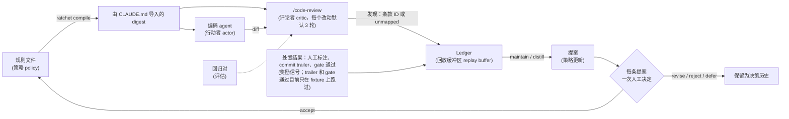

[English](METHOD.md) | 中文

# 为什么这样设计这个循环

我做 review-ratchet，是因为我总在 code review 里一遍遍重新学自己的编码规范，然后又把教训弄丢。这一页讲设计、搭建过程中踩过的坑，以及怎么把这个循环搬到你自己的仓库和 reviewer 上。它只是一个人在几个仓库、几十条 reviewer 发现上的笔记：请把里面的数字当成附带计数的轶事。这里没有任何东西在训练模型，我也还没有证据表明 review 会随时间变好（[局限](#8-局限与待解问题)）。命令见 [README](../README.zh.md)。

## 术语

| 术语 | 在这里的含义 |
|---|---|
| 规则文件 | 带版本的 markdown 文件，写你的编码规则 |
| 条款、ID、条款族 | 一条规则及其稳定 ID（`P0E.2`）；条款族是点号前的前缀（`P0E`） |
| 严重度 | `blocker`、`should-fix` 或 `nice`：先取条款自己的标签，否则取规则文件里的族表（[COMPILE.md](COMPILE.md#severity-table)） |
| reviewer 行为准则 | 不带严重度的条款（`R.*` 族）：规定怎么 review，不是缺陷 |
| Digest | `ratchet compile` 生成的短文本；编码 agent 和 reviewer 都会加载 |
| Ledger | 只追加的本地 JSONL 文件，记录发现和处置结果 |
| 发现（finding） | reviewer 报告的一个缺陷，标注为某个条款 ID 或 `unmapped` |
| `source` | 发现的来源：`gate`，或 `l1` / `l2`（两档 review，同等对待；`add` 也能记录人工 review 的评论） |
| 处置结果（outcome） | `fixed`（某个改动解决了它）、`dismissed`（跳过）、`false_positive`（无需改动） |
| Gate | 自动检查（linter、脚本），把结果喂给 ledger |
| 轮、改动 | 一个改动是从默认分支分叉出来的那段分支，或一个 `--target`；一轮是对它的一次 review |
| 回放（replay） | 重新导入一份已记录的 review；不算新的一轮 |
| Maintain / distill | 周期性步骤：把未关闭的发现变成拟议的规则编辑 |
| Fold | 按事件在文件中的顺序算出的发现状态 |

## 1. 问题所在

- **AI 写的代码总在重复几种臃肿。** 在我的仓库里：吞掉错误的宽泛 `except` 块、把失败伪装成成功的兜底、只有一个实现的抽象、复述代码的注释。
- **通用 reviewer 不了解你的标准。** Claude Code 内置的 `/code-review` 是随程序打包的 skill，你没法编辑它；对项目规则，它遵循你的 `CLAUDE.md`，不读 `REVIEW.md`（[文档](https://code.claude.com/docs/en/code-review-local)）。
- **写下来的规则会腐烂。** 我的规则曾散落在三份手工同步的副本里，没有任何东西把 review 的结果带回规则。

所以：一份带版本、条款 ID 稳定的规则文件；编码方和 reviewer 共用同一份编译出的 digest；每条发现都按条款 ID 记账并附上处置结果；规则编辑只以提案的形式出现，由人批准。

## 2. 循环与 RL 类比

| RL 术语 | 在这里 |
|---|---|
| 策略（policy） | 规则文件（`CODING-STYLE.md`），编译成一份简短的 digest |
| 行动者（actor） | 写这次改动的编码 agent |
| 评论者（critic） | `/code-review`，或任何读同一份 digest 的 reviewer |
| 奖励信号（reward signal） | 发现的处置结果（`fixed`、`dismissed`、`false_positive`）。预期的两个自动来源，即 `Fixes-Finding:` commit trailer 和 gate 通过，目前只在 fixture 上跑过；到目前为止每一个真实的处置结果都来自人工标注 |
| 回放缓冲区（replay buffer） | ledger，一个只追加的本地 JSONL 文件 |
| 策略更新（policy update） | distill 步骤，加上每条提案一次人工决定 |
| 评估（evaluation） | 违规与合规的回归对，目前是手写的 |

没有权重被改动。被迭代的是规则文本，每一次规则编辑都应当跟在一次有记录的人工决定之后。这套词汇只是用来说明，并不主张两者等价：评论者读的规则和行动者相同，奖励稀疏且部分来自人，「更新」就是一个人在读提案。别人已经用类似方式描述过只改文本的学习（Reflexion、Training-Free GRPO；见[第 6 节](#6-相关工作与定位)）。

## 3. 防范 reward hacking

任何产生信号、而且这个信号会驱动规则改动的东西，都倾向于去满足信号本身，而不是你的意图。下面的案例大多是我亲眼见过或差点遇到的（只看 precision 的那个是预判，并非观察到的），每个都配有对应的防线。试点数字来自一个私有的试点仓库（读取其 ledger 的时间是 2026-10-26，外加它的历史笔记）：它们是历史观察，未重新核实，且取自不同时刻，所以绝不要把其中两个数当作改动前后的对比。

### 兜底标签

- **发生了什么。** 早期的标签没有「都不是」这个选项。在试点里，41 条 reviewer 发现中有 19 条落在同一个条款下，即 reviewer 行为准则「标准来自这个文件」。
- **为什么。** 被迫指名一条规则的标注者，会挑一个永远不会错的桶；这个兜底条款看上去像最忙的规则，把真实的缺口藏了起来（这是我对那 19 条人工读过之后的判断；光看计数什么也证明不了）。
- **防线。** `unmapped` 是一等标签，digest 会告诉 reviewer 宁可用它，也别硬凑一个条款。标签由确定性逻辑校验（[第 5 节](#5-把循环搬到别的-reviewer)），从正文里还原出的 ID 会标为 `attributed`。（[LEDGER.md](LEDGER.md#rule-ids)）

### 没人接线的指令

- **发生了什么。** 试点里的 skill 文本写着要运行关闭发现的那个步骤，但没有任何东西去运行它。后来一次 dry run 显示，它能关闭 97 条未关闭的 gate 发现中的 95 条（21 条 reviewer 发现里则是 0 条，因为当时没有 commit 约定）。自动处置结果：0。
- **为什么。** 奖励是缺失，而不是偏低：修复率和误报率都无从定义，可一长串「未关闭」的列表看上去像一大堆 bug。
- **防线。** 用机械触发，不靠提醒。post-commit hook 运行 `ratchet infer`，当 commit message 以 `Fixes-Finding: <id>` 结尾时关闭对应的发现；gate 通过会关闭它所覆盖文件里的 gate 发现；其余的由本地页面收集人工标注。这两条自动路径目前只在 fixture 上跑过（[局限](#8-局限与待解问题)）。（[LEDGER.md](LEDGER.md#attribution)）

### 永不触发的防线

- **发生了什么。** 在第二个仓库里，`init` 把它的 pre-commit 检查追加到了已有 hook 的 `exit 0` 之后：这是死代码，却被报告为成功，重跑时还显示「already ok」。
- **为什么。** 「从未触发」和「没有可抓的东西」看起来一模一样。
- **防线。** 这个代码块放在 shebang 的正下方。安装之后，`init` 用 `RATCHET_HOOK_PROBE=1` 把每个 hook 各运行一次；这个块必须在你的任何代码运行之前就作出应答，否则这一步失败（没有跳过开关）。每个 gate 还需要一次变异检查（R.7，[第 4 节](#4-规则何时升级为机械-gate)）：`tests/mutation_check.py` 每次植入一个刻意的 bug，并要求测试套件变红（最近一次完整运行，328 个变异抓到了 328 个，见 [ACCEPTANCE.md](ACCEPTANCE.md)）。这检验的是工具自己的代码，不是这个循环的效果。（[ONBOARDING.md](ONBOARDING.md#where-the-block-goes-and-the-live-check)）

### 只看 precision 会奖励沉默

- **发生了什么。** 这个工具里没有见到；这是针对 precision 数字去自动化规则改动时的第一个陷阱。
- **为什么。** 什么都不报，得分就是满分；一条永不触发的规则同样如此。
- **防线。** 用一对用例检查规则改动：recall 不能掉（违规用例仍被报出），干净的代码不能被编造出发现（合规的对照仍保持干净）。示例 reviewer 提示词在没有问题时返回 `[]`，而不是硬凑一条发现；R.2 要求 reviewer 说明干净的代码做对了哪条规则。这些用例对是手写的；没有任何东西从 ledger 里把它们提取出来。

### 修复可能制造新的发现

- **发生了什么。** 在工具自己的自我 review 里，第 1 轮报告了 10 条发现，第 2 轮又报告了 6 条，大多出在第 1 轮某个修复改过的代码里。一个例子：允许已保存的 review 回放越过上限（r1-1），结果让一次付费运行借着复用 ID 越过了上限（r2-1）。需要说明：这两轮是我手工数的（两次 review 落在不同的 round key 下，[LEDGER.md](LEDGER.md#review-rounds)），而且第 1 轮的 10 条恰好等于 reviewer 的默认上限，所以可能被截断了。
- **为什么。** 修复本身就是新代码，下一轮 review 会审它，所以每多一轮，都会增加成本和需要复查的修复。我没有度量过后面几轮是否更不值。
- **防线。** 每个改动设一个上限，默认 3。第四轮会在 reviewer 运行之前被拒绝（退出码 3，所以不花钱）；`--over-cap` 会记录这次越权。最后一轮只修 blocker，但要留意[下一个案例](#严重度可能排反)里的保留意见。回放不算一轮，复用 ID 也绕不过上限（PRJ.1）。三轮是出于成本的选择；我没有比较过其他取值。（[LEDGER.md](LEDGER.md#review-rounds)）

### 严重度可能排反

- **发生了什么。** 在那次自我 review 的第 1 轮里，唯一的 `blocker` 是 detached HEAD 下少打印了一行输出，只因为它命中了 blocker 族的一个条款。真正的 bug（一个 vendor 命令在新副本就位之前就删掉了旧副本）不匹配任何条款：10 条发现里有 8 条是 `unmapped`，严重度由模型自己定。
- **为什么。** 严重度来自条款所属的族，所以 `unmapped` 没有锚点，而「只修 blocker」会先去修那个无关紧要的问题。我的规则里没有「数据丢失」这一族。
- **防线。** 代码层面解决不了这个问题。把 `unmapped` 当作新规则的输入（那个 vendor bug 后来成了 REL.1），并检查你的规则是否覆盖了你在意的缺陷类别：「最后一轮只修 blocker」的效果取决于这种覆盖。人可以推翻它（那次自我 review 里，13 条 `unmapped` 发现我修了 12 条），但它仍是一个已知的弱点。

### 数字下降不等于修好

- **发生了什么。** 在试点的历史里，嵌套深度检查的命中数从 51 降到 23，再降到 8。第一次下降是检查器的修正（一条 `elif` 链曾被算作嵌套）；第二次是代码被拍平了。（历史记录，未重新核实。）
- **为什么。** 数字下降，可能是因为尺子变了，可能是因为发现被驳回了，也可能是因为 reviewer 沉默了。
- **防线。** 每一次规则改动都由人来决定；工具记录这个回答，没有回答就什么也不应用。接受一条规则绝不会把它来源的发现标成已修复；默认值、沉默或模型的建议都不算同意；不确定或已被驳斥的证据不能产出草案；过期的批次会被拒绝；已应用的批次可以回滚。（[DECISION-CARDS.md](DECISION-CARDS.md)）

## 4. 规则何时升级为机械 gate

我的经验法则（[CODING-STYLE.md](../CODING-STYLE.md) 第 0 节）：如果一条规则在每个会话里都成立、与当前任务无关、而且没有歧义，就把它做成机械的（pre-commit 里的 linter 或语法树脚本）。否则它保持为判断，由 reviewer 来应用。

升级的证据是反复出现、且工具能判定的那类发现；ledger 给出计数，由人来决定，工具不会替你写 gate。降级也会发生：一个检查布尔变量名前缀的机械检查，拦下了 `truncated` 这类明明正当的惯用名，于是它被改成 reviewer 判断（见[模板](../templates/CODING-STYLE.template.zh.md)里 P2.5 的 ADJUST 注释）。

一个新的 gate 需要：一个证明它会触发的失败示例、一个保持干净的合规示例（先从该规则声明的例外开始）、证明撤销后会变绿，以及一次变异检查，这些都要提交（R.7；[CONTRIBUTING.md](../CONTRIBUTING.md)）。Gate 通过 `ratchet gate record` 和 `ratchet gate pass` 把结果喂进同一个 ledger（[GATES.md](GATES.md)）；一次 pass 会关闭该文件的 gate 发现，这比「确认已修复」弱。

## 5. 把循环搬到别的 reviewer

这个循环的大部分是纯文件加一个只用标准库的 Python CLI；Claude Code 提供的是 reviewer、它加载指令的方式和提问工具。只有 Claude Code 被完整跑通过，所以搬到别处需要五样东西，外加两道防线（确定性的标签检查和轮数上限）。

| 部分 | 命令 | 需要 Claude Code 吗？ |
|---|---|---|
| Digest | `compile` | 不需要：确定性文本 |
| 导入 | `ingest-code-review`、`add`、`review --from-file` | 不需要：任何 reviewer 的 JSON 都行 |
| 处置结果 | `infer`、`gate record`、`gate pass`、`label-page`、`apply-labels` | 不需要 |
| 决策记录 | `decision-context`、`prepare-decisions`、`apply-decisions`、`apply-proposals`、`rollback-proposals` | 不需要：它们不调用模型 |
| 运行 reviewer | `review` | 需要：它运行 `claude -p "/code-review <level>"` |
| 评估与提问 | `maintain` skill | 需要：由宿主 agent 写评估并发起原生提问 |

**1. 让 reviewer 读到你的规则。** 找到你的 reviewer 在哪里接收指令，然后用 canary 检查：一条只有加载了 digest 才可能被引用的条款。digest 是确定性文本，每条违规条款一行 `ID | severity | short rule`（reviewer 行为准则条款是 `ID | short rule`），外加一段固定的标注指令，保持得很小，因为每个会话都要为它付费（[COMPILE.md](COMPILE.md#what-the-digest-contains)）。

| Reviewer | 读取 | 状态 |
|---|---|---|
| Claude Code `/code-review` | `CLAUDE.md`（`@import` 会展开）；不读 `REVIEW.md` | canary 只观察过一次（2026-10-26，`claude -p`）：加了 import 的两次运行里都被引用，没加的几次运行里没有；未复测 |
| 托管的 GitHub Code Review | `REVIEW.md`（取自基准分支或默认分支，绝不取自 pull request 自身的改动）和 `CLAUDE.md`，依据 [Anthropic 文档](https://code.claude.com/docs/en/code-review) | 我没测过 |
| 其他 | 它自己的配置文件、规则文件或提示词 | 把 digest 写进去 |

**2. 发现的契约。** 每个缺陷一个对象：`file`、`line`、`summary`、`failure_scenario`、`category`（kebab-case 的条款 ID，如 `rel-1`，或 `unmapped`）和 `severity`（`blocker`、`should-fix`、`nice`）。面向 reviewer 的契约是 digest 的 Labeling 段，加一份[示例提示词](../samples/config-replacement/reviewer-prompt.md)；[schema](../schemas/finding.v1.schema.json) 定义的是存储下来的 ledger 事件。导入器接受裸的 JSON 数组，或第一个带围栏的 `json` 代码块。

内置 reviewer，在我 2026 年 10 月测试的那个 Claude Code 版本（`claude -p`）上，默认最多输出 10 条发现（更新的版本新增了 `--max-findings`），形式是纯文本 JSON，带 `file`、`line`、`summary` 和 `failure_scenario`。当 `CLAUDE.md` 要求时，它会加上 `category` 和 `severity`（2 次运行里有 2 次），所以 digest 把这条写成命令的口吻。标签并不稳定：第二次运行里，它把对不上的问题硬凑进已有条款，还把一个缺陷拆成三条发现、挂在三个 ID 下。模型给的标签只是一个提议。

**3. 发现的身份。** 对 review 来说，ID 由导入器生成，而不是由 reviewer 生成：同一次 review 里的发现得到显示 ID `<run>-1`、`<run>-2`……（如 `r3-2`，run 为 `r3`），存储时用完整 ID `<repo>:<source>:<run>:<display ID>`。修复的人必须看得到显示 ID：`ratchet review` 会在它的表格里打印；如果搬到 PR 评论的场景，应该把它放进每条评论。修复的 commit 随后以一条 `Fixes-Finding: r3-2` trailer 结尾（[LEDGER.md](LEDGER.md#finding)）。

**4. Ledger 与机械的处置结果。** 一个只追加的 JSONL 文件，有四种事件：`finding`、`outcome`（由 commit trailer、gate 通过或人工给出，附证据）、`gate_pass` 和 `review_run`（一轮 review，用于上限）。一个发现的状态是它的事件按文件顺序的 fold（[LEDGER.md](LEDGER.md#events)）。做匹配时有两个陷阱：不要去解析 commit 标题（像 `S1` 这样的 ID 会和 scope 标签撞车），也不要比较时间戳（修复可能比发现被记账更早提交）。

**5. 人工决定这一步。** 把发现、它们的代码和整份规则文件交给模型。对每组共享同一机制的发现，它返回一个结论（supported、uncertain 或 refuted）、一个动作（`covered`、`keep`、`add`、`rewrite`、`merge`、`retire`）、一个理由和确切的条款文本。每条提案向人问一个问题，附上这些证据，选项是 accept、revise、reject 或 defer。按原样记录回答，把被接受的改动放进一次可回滚的事务里应用，然后重新编译（[DECISION-CARDS.md](DECISION-CARDS.md)）。对每条被接受的规则，用一个违规用例和一个合规的对照来检查。

两道防线：

- **确定性的标签检查。** 条款 ID 必须存在于规则文件里，否则记为 `unmapped`；reviewer 行为准则条款不能被指为违反对象；只在正文里引用的 ID 是兜底方案，标为 `attributed`；同一文件同一行上的多条发现合并成最严重的那条；重新导入一份 review 是空操作，复用 ID 而内容不同则被拒绝。这只能证明标签存在，不能证明它适用；这要由人来判断。
- **轮数上限。** 按改动计数：从默认分支分叉出来的那段分支，或显式的 `--target`（在基于 PR 的搬运里就是那个 pull request）。在调用 reviewer 之前检查上限，这样被拒绝的一轮不花钱。重新导入一份已记录的 review（`--from-file` 加它的 run ID）是回放，不算一轮（[LEDGER.md](LEDGER.md#review-rounds)）。

## 6. 相关工作与定位

别人已经做出了其中大部分零件。我对照这些论文的 arXiv 页面和正文做了核对（检索加针对性阅读，不是逐篇通读）。

| 工作 | 它更新什么 | 与本仓库的差距 |
|---|---|---|
| [Reflexion](https://arxiv.org/abs/2303.11366)（Shinn et al., 2023） | 情景记忆（episodic memory）里的反思 | 以单个 episode 为单位的记忆；没有稳定 ID、生命周期或共享的规则文件；信号来自任务或自生成 |
| [Self-Refine](https://arxiv.org/abs/2303.17651)（Madaan et al., 2023），[TextGrad](https://arxiv.org/abs/2406.07496)（Yuksekgonul et al., 2024） | 当前输出，或文本变量，依据自我批评或 LLM 写的损失 | 没有持久化的条款级规则、处置结果 ledger 或人工把关 |
| [DSPy](https://arxiv.org/abs/2310.03714)、[MIPRO](https://arxiv.org/abs/2406.11695)、[OPRO](https://arxiv.org/abs/2309.03409)、[ProTeGi](https://arxiv.org/abs/2305.03495) | 针对固定集合上的指标优化提示词和示例 | 由指标驱动；没有逐条款批准；编码方和 reviewer 不共用一套规则 |
| [ExpeL](https://arxiv.org/abs/2308.10144)（Zhao et al., 2023） | 自然语言的 insight 列表 | 机制上最接近；用户可以编辑 insight，但没有批准步骤、条款 ID 或仓库处置结果；insight 服务的是同一个行动 agent |
| [ACE](https://arxiv.org/abs/2510.04618)（Zhang et al., 2025） | 带 ID 和 helpful/harmful 计数器的 playbook 条目 | 产物上最接近；没有逐次更新的人工把关（专家可以 unlearn 条目），没有仓库 review 的处置结果，也没有由独立 reviewer 读取的带版本文件 |
| [Training-Free GRPO](https://arxiv.org/abs/2510.08191)（Cai et al., 2025） | 经验库，模型冻结 | RL 框架上最接近；奖励来自基准测试，没有人工把关 |
| [BitsAI-CR](https://arxiv.org/abs/2501.15134)（Sun et al., 2025） | 在 219 条规则上微调的检查器，依据真实 review 信号逐条规则跟踪；规则可以退役 | review 侧最接近；低 precision 的样本会用来重训模型（权重会变）；规则只服务于 review |

不算新颖、我也不主张的：RL 类比、由 LLM 维护的自然语言规则列表（增、改、删、投票），以及逐条规则跟踪真实 review 结果并让规则退役。

我真正主张的是这个组合和治理方式：

- **(a)** 奖励来自团队自己仓库的 review 处置结果（已修复、已驳回、误报），按条款记录；
- **(b)** 每一次规则改动都需要一次有记录的、逐条提案的人工决定，不过工具无法核实是谁作的回答（[局限](#8-局限与待解问题)）。我在这些论文里没找到这样的把关：ExpeL 让用户编辑 insight，ACE 让专家 unlearn 条目，BitsAI-CR 让人标注样本并让低 precision 的规则退役；
- **(c)** 一份带版本的规则文件，每个周期重新编译，同时被编码会话和 reviewer 读取。

我在这些论文里没有发现对 reward hacking 的讨论（同样的保留），所以这里的人工把关是有意设置的、针对它的防线。如果你知道更接近的工作，请开一个 issue。

## 7. 实例演示

公开的示例是合成的：[`samples/config-replacement`](../samples/config-replacement/README.md)，记录在 [ACCEPTANCE.md](ACCEPTANCE.md) 里。一个机制：替换配置文件时，可能在替代品就绪之前就毁掉最后一份可用的副本。

1. 规则里有 ERR.1（传播解析错误）和 reviewer 指导，但没有 REL.1。原生 review 把吞掉解析错误的问题归到 ERR.1 下，把「先删后写」归不到任何条款下：`unmapped`。
2. 模型把这条发现和整个语料对照，提议保留 ERR.1 并新增一条限定范围的 REL.1。一次真实的原生提问展示了确切的条款；我两条都接受了。工具存下我的回答，应用了一次规则编辑，并重新编译了 digest。
3. 之后的一次 review 把这个替换缺陷归到 REL.1 名下。
4. 在允许的第三轮、也是最后一轮，我加了合规的对照，以及一个没有用来起草该条款的迁移用例：

| 检查 | 观察到的结果 |
|---|---|
| 旧文件被删除后写入失败 | 确定性的不安全示例丢失了旧内容；先准备好替代品的示例保住了它 |
| 目标被截断后序列化失败（迁移用例） | 归到 REL.1 名下；确定性检查能复现这次丢失 |
| 替换前先序列化并校验（两个合规对照） | 没有被报为违反 REL.1 |
| 其他 | 缺少权限位的保留，报为 `unmapped` |

我没有压掉最后那条发现。公开的安全示例现在会保留 mode 位，并带一个确定性检查；因为有上限，这个修复没有得到第四次 review。这只是对一个非确定性 reviewer 的一次运行，所以不给出准确率数字。迁移用例对现在已经公开，所以它是回归样本，不是隐藏测试，而且[录制的 review](../samples/config-replacement/recorded-review.txt)早于权限修复（[来源说明](../samples/config-replacement/recorded-review-provenance.json)）。示例里的确定性检查不需要模型就能运行。

工具自己的自我 review 只走完了那条路径的前半段：两轮共 16 条发现（[RECONCILIATION.md](RECONCILIATION.md)：15 个经核实的修复，1 个非阻塞的清理）催生了五个被接受的提案：PRJ.1、PRJ.2、REL.1、REL.2 和对 R.7 的一次修订，每个都在 [CODING-STYLE.md](../CODING-STYLE.md) 里带有「Why added」和来源。此后没有任何东西在这些规则下被重新 review 过，所以本仓库没有关于 `PRJ.*` 或 `REL.*` 的后续 review 或对照证据（上面的 REL.1 证据来自合成示例自己的规则）。对 PRJ 条款请保持怀疑：它们是项目特定的，很接近「把刚修的那个 bug 写成规则」。

## 8. 局限与待解问题

- **样本量很小。** 一个作者、几个仓库、一个 reviewer、几十条发现。这里没有任何一个数字是比率。
- **还没有有效性数据。** 我没有证明规则改动之后，重复违规或误报会下降；应用了一条规则并不是它有效的证据。「Ratchet」指的是这套机制（规则改动有记录、经批准、可回滚），不是某种被度量出来的改进。
- **证据是自指的。** 主要是工具在 review 自己的代码，外加一个围绕我在那里已经遇到过的机制搭出来的示例。只有 Claude Code 被端到端跑通过。
- **只评估过单次运行。** 回归检查用的是对非确定性 reviewer 的单次运行；没有定义运行次数，也没有定义通过阈值。
- **自动处置结果在真实使用中尚未得到验证。** trailer 和 gate 路径在 fixture 上测试过，但本仓库真实历史里到目前为止的每一个处置结果都来自人工标注；基于 trailer 的自动关闭在真实使用中还没有触发过。
- **trailer 可能丢失。** `Fixes-Finding` 只在 commit message 的最后一段才生效，所以 squash merge 或被改写的 message 可能把它丢掉；请检查你的合并策略。
- **Ledger 是一个开发者本地的、被 gitignore 的文件。** 团队用的话，需要共享存储和并发追加。
- **模型给的标签不稳定。** 校验只检查标签存在，不检查它合不合适。
- **人工把关是「记录回答」的契约，不是身份认证。** CLI 分不清作出回答的是人，还是在替人敲回答的 agent；这条边界必须由宿主来守住。它也消耗注意力（每条提案一个问题），我不知道它在团队里怎么扩展，也不知道同一个人前后有多一致；[DECISION-METRICS.md](DECISION-METRICS.md) 是一份设计笔记，不是结果。
- **规则集只增不减。** 人可以批准 `retire`，但没有任何东西会触发它，「最近没有命中」也不是证据。digest 的体积预算（默认 4,096 字节；本仓库自己的 digest 在我写这段时是 4,087 字节）是唯一的、机械的精简压力。

如果你试用它，最有用的回馈是合成的失败示例、回归对和规则提案，绝不要发真实的私有发现或代码。见 [CONTRIBUTING.md](../CONTRIBUTING.md)。
